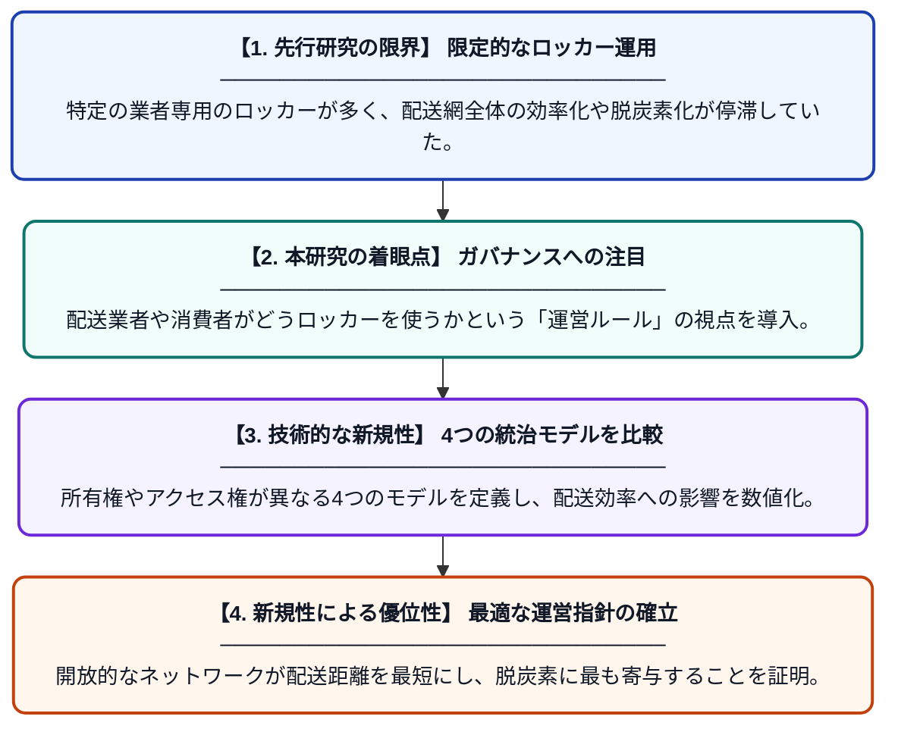

# ネットゼロな都市のラストマイル配送に向けて：宅配ロッカーのガバナンスの役割

**Original Title**: *Toward net-zero urban last-mile logistics: the role of parcel-locker governance*

> **💡 一言要約**: ロッカーの「共通利用」が都市の脱炭素を加速する

| 項目 | 内容 |
|---|---|
| **著者** | DH Lee, ZT Uglik, DL Sárdi, TY Kim |
| **掲載誌** | International Journal of Logistics Research and … 2026 |
| **アラートキーワード** | logistics |
| **原文リンク** | [https://www.tandfonline.com/doi/abs/10.1080/13675567.2026.2754095](https://www.tandfonline.com/doi/abs/10.1080/13675567.2026.2754095) |
| **PDF版要約** | [README.pdf](./README.pdf) |

---

## 📊 新規性の図解（先行研究との違いと本研究のブレークスルー）

## 📝 要約

都市部のラストマイル配送における脱炭素化の手段として宅配ロッカーが注目されていますが、その削減効果は「誰がそのロッカーを使えるか」という運営ルール（ガバナンス）に依存します。本研究では4つの異なるガバナンスモデルを比較し、環境負荷を最小化するために最適なロッカーの運用形態を明らかにしました。

## ❓ どんな問題に取り組んだか

eコマースの拡大に伴い、配送の最終区間（ラストマイル）でのCO2排出が深刻な課題となっています。宅配ロッカーは解決策の一つですが、特定の配送業者しか利用できない「独占型」と、複数が利用できる「共有型」のどちらが、どれほど脱炭素に寄与するのかという定量的な指針が不足していました。

## ✨ 何が新しい？何がすごい？（新規性）

本研究の新規性は、ロッカーの設置数だけでなく「ガバナンス（誰が所有し、誰にアクセス権があるか）」という管理体制に焦点を当てた点にあります。先行研究では個別の効率化が主眼でしたが、本研究では4つの統治モデルを系統的に比較することで、ネットワークの開放性が配送距離の短縮に直結することを証明しました。これにより、公共政策としてのロッカー活用のあり方を具体化した点が大きな貢献です。

## 🎓 大学1年生向けの解説

ネット通販で買った荷物が届く最後の区間は、トラックの移動が多くて環境に大きな負担がかかっています。街中の宅配ロッカーは便利ですが、もし「A社の荷物しか入れられない」ロッカーばかりだと、他の業者は遠くまで運ぶ必要が出てしまいます。この研究は、ロッカーをいろいろな会社で共有するルールを作ることで、どれくらい二酸化炭素を減らせるかを調べたものです。結論として、みんなでシェアする仕組みが一番地球に優しいことがわかりました。
