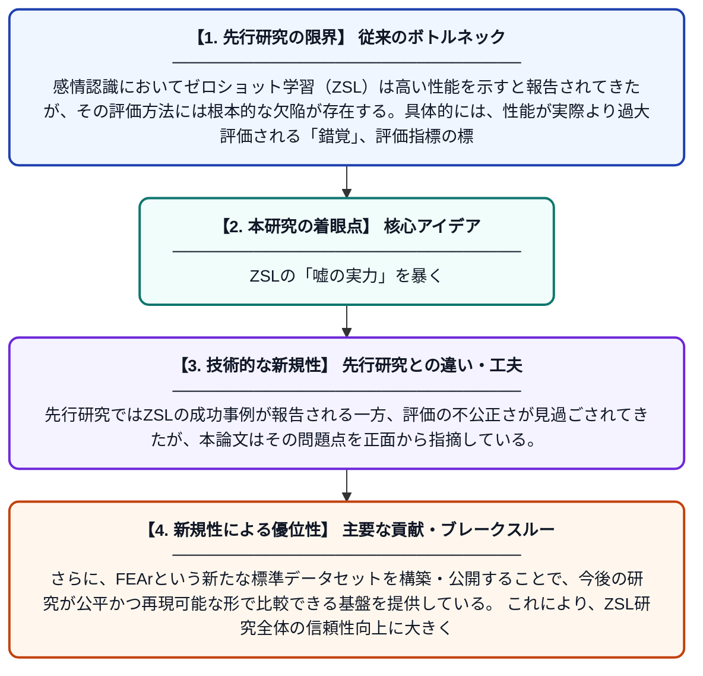

# 能力の幻想を超えて：FEArデータセットによる感情認識におけるゼロショット学習の再考

**Original Title**: *Beyond illusions of competence: Revisiting zero-shot learning in emotion recognition with FEAr dataset*

> **💡 一言要約**: ZSLの「嘘の実力」を暴く

| 項目 | 内容 |
|---|---|
| **著者** | ZK Hew, LK Wong, CS Chan |
| **掲載誌** | Signal Processing: Image Communication 2026 |
| **アラートキーワード** | zero shot |
| **原文リンク** | [https://www.sciencedirect.com/science/article/pii/S0923596526001815](https://www.sciencedirect.com/science/article/pii/S0923596526001815) |
| **PDF版要約** | [README.pdf](./README.pdf) |

---

## 📊 新規性の図解（先行研究との違いと本研究のブレークスルー）

## 📝 要約

本論文は、感情認識分野におけるゼロショット学習（ZSL）の有効性を検証し、「見せかけの高性能」「標準化された評価指標の欠如」「堅牢なベンチマークの不足」という3つの重大な問題点を明らかにした。これらの課題に対処するため、著者らはFEAr（Facial Expression for ZSL Evaluation）データセットを新たに構築・公開し、より公正で信頼性の高い評価基準を提案している。

## ❓ どんな問題に取り組んだか

感情認識においてゼロショット学習（ZSL）は高い性能を示すと報告されてきたが、その評価方法には根本的な欠陥が存在する。具体的には、性能が実際より過大評価される「錯覚」、評価指標の標準化不足、そして信頼できる比較基盤となるベンチマークの欠如という3つの問題が蔓延しており、研究の再現性や公平な比較が困難な状況にある。

## ✨ 何が新しい？何がすごい？（新規性）

本研究は、ZSLの感情認識における評価問題を体系的に整理し、「見せかけの高性能」が生じるメカニズムを具体的に示した点が新しい。先行研究ではZSLの成功事例が報告される一方、評価の不公正さが見過ごされてきたが、本論文はその問題点を正面から指摘している。さらに、FEArという新たな標準データセットを構築・公開することで、今後の研究が公平かつ再現可能な形で比較できる基盤を提供している。これにより、ZSL研究全体の信頼性向上に大きく貢献する。

## 🎓 大学1年生向けの解説

AIに「未学習の感情」を認識させる技術をゼロショット学習（ZSL）といいます。これはまるで、勉強したことのないテストに答えるようなもので、すごい技術に見えます。しかし本研究は、実はこの技術の成績が「見かけ倒し」であることを発見しました。テストの採点方法が不公平だったり、比較する基準がバラバラだったりして、本当の実力が正しく測れていなかったのです。そこでこの論文では、誰もが公平に比較できる新しいデータセット（問題集）を作り、正しい評価方法を提案しました。
