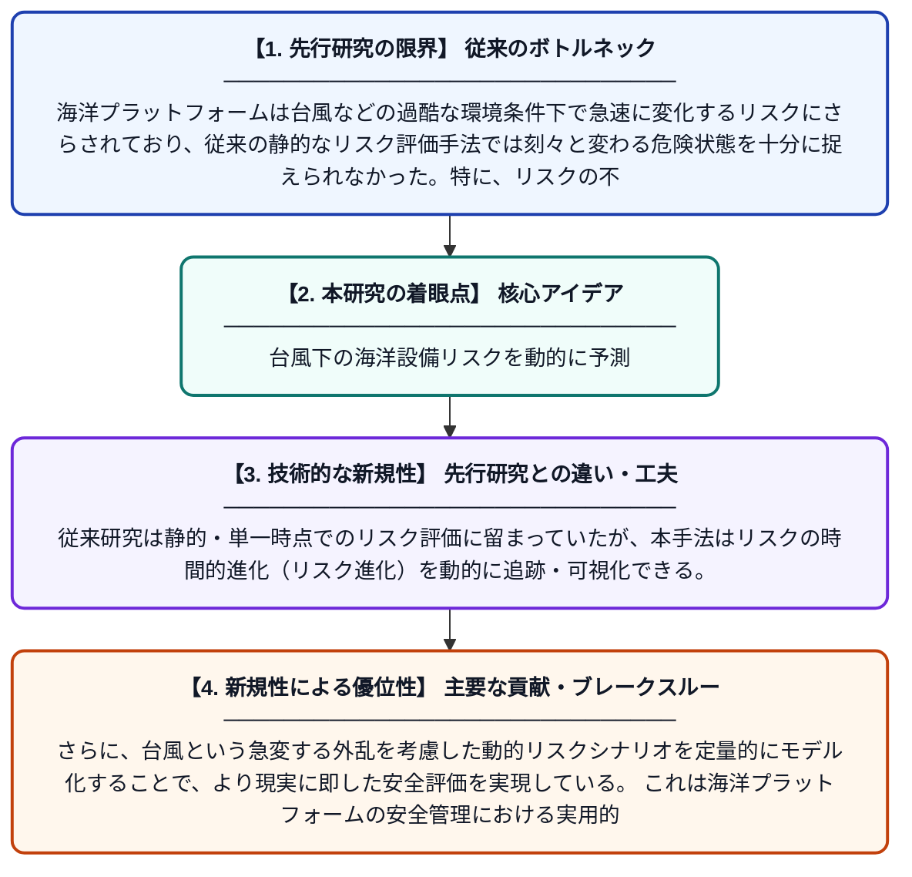

# クラウドモデルとMCMCに基づく台風外乱下における海洋プラットフォームの動的リスク進化解析

**Original Title**: *Dynamic Risk Evolution Analysis of Offshore Platforms Under Typhoon Disturbances Based on Cloud Model-MCMC*

> **💡 一言要約**: 台風下の海洋設備リスクを動的に予測

| 項目 | 内容 |
|---|---|
| **著者** | T Qin, X Zhang, Z Wu, Y Gui, J Zhang, S Song |
| **掲載誌** | Journal of Marine Science and … 2026 |
| **アラートキーワード** | MCMC |
| **原文リンク** | [https://link.springer.com/article/10.1007/s11804-026-00915-5](https://link.springer.com/article/10.1007/s11804-026-00915-5) |
| **PDF版要約** | [README.pdf](./README.pdf) |

---

## 📊 新規性の図解（先行研究との違いと本研究のブレークスルー）

## 📝 要約

本論文は、台風などの極端な海洋環境下で操業する海洋プラットフォームのリスクを動的に評価・可視化・追跡するための新しい手法を提案している。クラウドモデルとマルコフ連鎖モンテカルロ法（MCMC）を組み合わせることで、リスクの不確実性と時間的変化を同時に捉えることを可能にしている。これにより、台風接近に伴うリスクの急激な変化をリアルタイムに把握し、安全管理の意思決定を支援する。

## ❓ どんな問題に取り組んだか

海洋プラットフォームは台風などの過酷な環境条件下で急速に変化するリスクにさらされており、従来の静的なリスク評価手法では刻々と変わる危険状態を十分に捉えられなかった。特に、リスクの不確実性と時間的な進化を同時に定量化する手法が不足しており、適切なタイミングでの安全対策の意思決定が困難であった。

## ✨ 何が新しい？何がすごい？（新規性）

本研究の新規性は、定性的な不確実性表現に優れたクラウドモデルと、確率的シミュレーション手法であるMCMCを融合させた点にある。従来研究は静的・単一時点でのリスク評価に留まっていたが、本手法はリスクの時間的進化（リスク進化）を動的に追跡・可視化できる。さらに、台風という急変する外乱を考慮した動的リスクシナリオを定量的にモデル化することで、より現実に即した安全評価を実現している。これは海洋プラットフォームの安全管理における実用的かつ学術的な貢献といえる。

## 🎓 大学1年生向けの解説

海の上に建てられた石油や天然ガスを採掘するための大きな設備（海洋プラットフォーム）は、台風が来ると非常に危険な状態になります。この研究では、台風が接近するにつれてどのようにリスクが変化していくかをコンピューターで計算する方法を開発しました。「クラウドモデル」という曖昧なデータを扱う技術と、「MCMC」というランダムなシミュレーション手法を組み合わせています。これにより、危険がどのくらい急速に高まっているかをリアルタイムで把握し、作業員の安全を守るための判断をタイムリーに行えるようになります。
