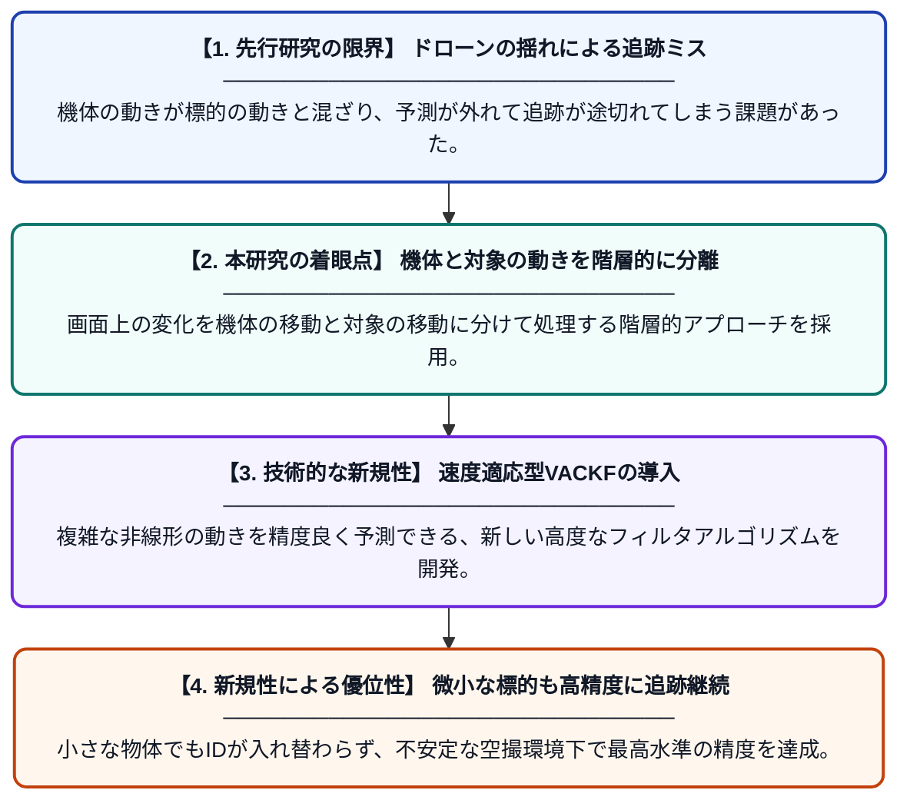

# HiMoTrack: UAVマルチオブジェクトトラッキングのための微小物体認識と階層的動き復元

**Original Title**: *HiMoTrack: Small-Object Perception and Hierarchical Motion Recovery for UAV Multi-Object Tracking*

> **💡 一言要約**: ドローンの揺れを克服し微小な標的を逃さず追跡

| 項目 | 内容 |
|---|---|
| **著者** | W Tao, X Wang, Y Wang, T Yan, J Yan |
| **掲載誌** | Remote Sensing 2026 |
| **アラートキーワード** | kalman filter |
| **PDF** | [https://www.mdpi.com/2072-4292/18/22/3969/pdf](https://www.mdpi.com/2072-4292/18/22/3969/pdf) |
| **原文リンク** | [https://www.mdpi.com/2072-4292/18/22/3969/pdf](https://www.mdpi.com/2072-4292/18/22/3969/pdf) |
| **PDF版要約** | [README.pdf](./README.pdf) |

---

## 📊 新規性の図解（先行研究との違いと本研究のブレークスルー）

## 📝 要約

ドローン（UAV）空撮における微小な物体の追跡精度を向上させるため、物体の動きと機体の揺れを分離して捉える「階層的動き復元」を提案しています。新開発の速度適応型求積カルマンフィルタ（VACKF）により、複雑な動きをするターゲットも正確に追跡可能です。

## ❓ どんな問題に取り組んだか

ドローン映像では、追跡対象の動きに加えて機体の移動や回転による「見かけ上の動き」が混ざるため、従来の等速モデルを用いた追跡では予測が外れやすくなります。また、高高度からの撮影では対象が非常に小さく、周囲のノイズに埋もれて追跡が途切れやすいという課題がありました。

## ✨ 何が新しい？何がすごい？（新規性）

機体の動きを補正しつつ対象の真の動きを推定する「階層的動き復元」を導入した点が画期的です。さらに、非線形な動きに柔軟に対応する「速度適応型求積カルマンフィルタ（VACKF）」を提案し、従来のカルマンフィルタの限界を突破しました。これにより、UAV特有の激しい視点変化下でも、微小な物体のIDスイッチ（追跡の取り違え）を大幅に削減することに成功しています。

## 🎓 大学1年生向けの解説

ドローンで上空から人や車を追いかけるとき、ドローン自身が動くと画面の中で標的がデタラメな動きをしているように見えてしまいます。この研究では、ドローンの揺れと標的の本来の動きを別々に計算して、より正確に予測する高度な計算式を作りました。これにより、豆粒のように小さく映る標的でも、見失うことなくずっと追い続けることができるようになります。
