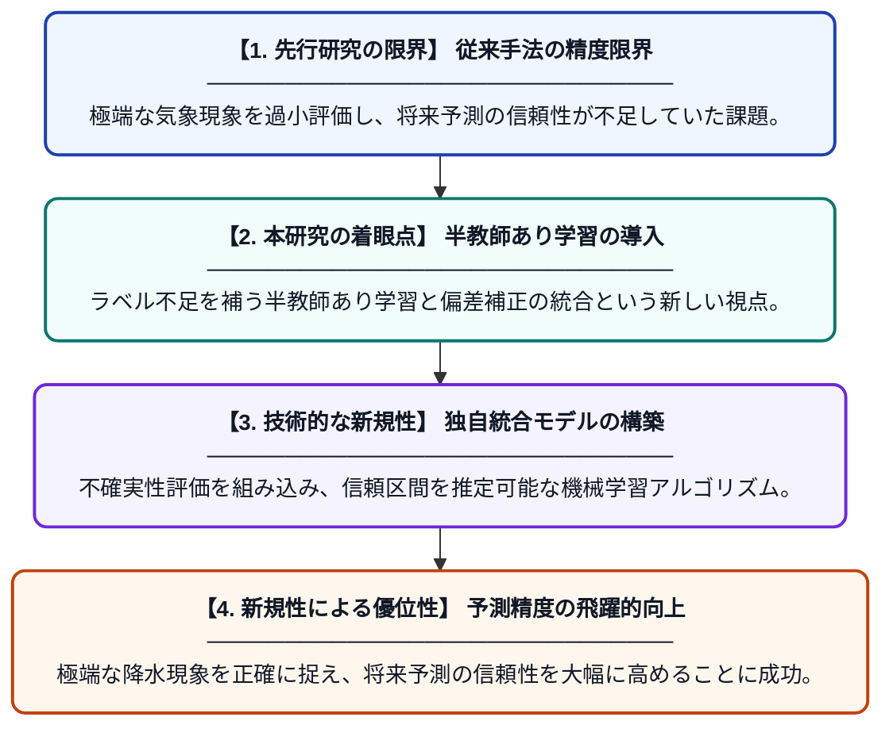

# ハイブリッド偏差補正と不確実性評価を伴う半教師ありダウンスケーリングによるCMIP6日降水量予測の高度化

**Original Title**: *Advancing CMIP6 daily precipitation projections through hybrid bias-correction and semi-supervised downscaling with uncertainty quantification*

> **💡 一言要約**: AIで極端な豪雨を正確に予測する革新的な手法

| 項目 | 内容 |
|---|---|
| **著者** | M Moghaddasi, M Moradi, MM Ghaleni, M Jamei… |
| **掲載誌** | Journal of Hydrology 2026 |
| **アラートキーワード** | Semi supervise |
| **原文リンク** | [https://www.sciencedirect.com/science/article/pii/S0022169426018305](https://www.sciencedirect.com/science/article/pii/S0022169426018305) |
| **PDF版要約** | [README.pdf](./README.pdf) |

---

## 📊 新規性の図解（先行研究との違いと本研究のブレークスルー）

## 📝 要約

本研究は、極端な気象現象の過小評価という課題を解決するため、ハイブリッドな偏差補正と半教師あり学習を組み合わせた新しい機械学習ダウンスケーリング手法を提案しました。このフレームワークは不確実性の定量化を統合することで、CMIP6モデルによる日降水量予測の精度を大幅に向上させています。

## ❓ どんな問題に取り組んだか

従来の統計的ダウンスケーリング手法では、極端な降水現象を過小評価する傾向があり、将来の気象予測の信頼性が不足していました。また、観測データの制約や予測に伴う不確実性の評価が不十分であることも、実用上の大きな課題でした。

## ✨ 何が新しい？何がすごい？（新規性）

本研究の新規性は、ハイブリッド偏差補正と半教師あり学習を統合し、さらに不確実性の定量化（UQ）を組み込んだ点にあります。ラベル付きデータが少ない状況でも高度な学習が可能であり、予測結果の信頼区間を提示できることが大きな特徴です。これにより、先行研究では困難だった極端な降水イベントの再現性が飛躍的に向上しました。

## 🎓 大学1年生向けの解説

地球温暖化の影響で大雨のリスクが高まっていますが、将来の雨量を正確に予測するのは非常に難しい課題です。これまでのAIや統計モデルでは「記録的な豪雨」を実際より小さく見積もってしまう弱点がありました。この研究では、最新のAI技術を組み合わせてその弱点を克服し、予測がどのくらい確かなのかという「信頼度」まで示せる新しいシステムを作り上げました。
