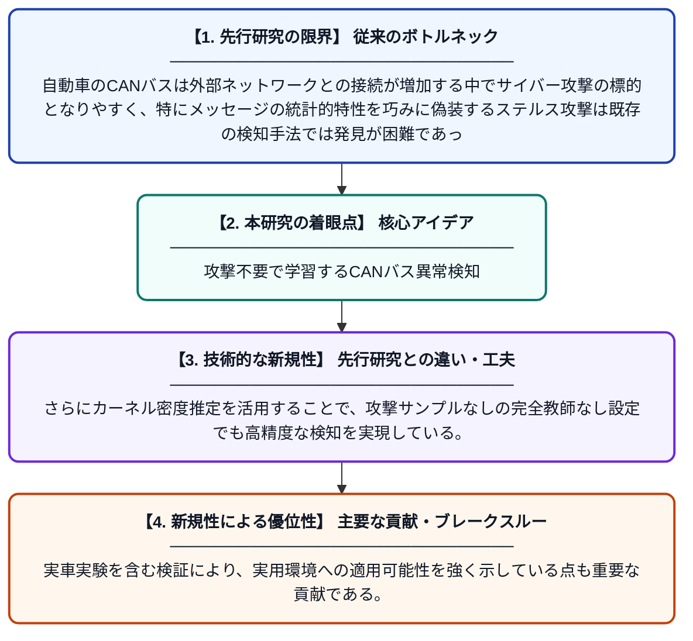

# トラフィック予測と再構成誤差に基づく重み付きエントロピーを用いたIoV向け新規ステルスCANバス攻撃検知手法

**Original Title**: *A Novel Stealthy CAN Attack Detection Method for the Internet of Vehicles via Traffic Prediction and Reconstruction-Error-Based Weighted Entropy*

> **💡 一言要約**: 攻撃不要で学習するCANバス異常検知

| 項目 | 内容 |
|---|---|
| **著者** | H Guang, S Yang, T Gong, W Gong, B Zheng, X Feng |
| **掲載誌** | IEEE Internet of Things Journal 2026 |
| **アラートキーワード** | kernel density estimation |
| **原文リンク** | [https://ieeexplore.ieee.org/abstract/document/11626112/](https://ieeexplore.ieee.org/abstract/document/11626112/) |
| **PDF版要約** | [README.pdf](./README.pdf) |

---

## 📊 新規性の図解（先行研究との違いと本研究のブレークスルー）

## 📝 要約

本論文は、コネクテッドカー（IoV）のCANバスネットワークを標的とした巧妙なステルス攻撃を検知する新しい手法を提案している。提案手法はトラフィックの予測と再構成誤差を組み合わせた重み付きエントロピースコアを算出し、カーネル密度推定（KDE）と組み合わせることで攻撃を検出する。攻撃サンプルを一切使用せずに2つの公開データセットと実車実験で有効性が検証されており、ラベルなし学習での高い実用性を示している。

## ❓ どんな問題に取り組んだか

自動車のCANバスは外部ネットワークとの接続が増加する中でサイバー攻撃の標的となりやすく、特にメッセージの統計的特性を巧みに偽装するステルス攻撃は既存の検知手法では発見が困難であった。また、実環境では攻撃サンプルを事前に収集することが難しいため、教師あり学習ベースの手法には限界があった。

## ✨ 何が新しい？何がすごい？（新規性）

本研究はトラフィック予測モデルによる再構成誤差と、それを重み付けしたエントロピーを組み合わせるという新しいスコアリング手法を提案し、ステルス性の高い攻撃パターンに対しても敏感に反応できる点が先行研究と大きく異なる。さらにカーネル密度推定を活用することで、攻撃サンプルなしの完全教師なし設定でも高精度な検知を実現している。実車実験を含む検証により、実用環境への適用可能性を強く示している点も重要な貢献である。

## 🎓 大学1年生向けの解説

現代の車はインターネットにつながっており、車内の部品どうしが「CANバス」という通信ネットワークで情報をやり取りしています。悪意のある攻撃者がこのネットワークに偽のメッセージを送り込むと、車の動作がおかしくなる危険があります。この研究では、普段の通信パターンをAIで学習しておき、いつもと違う動きを「重み付きエントロピー」という指標で素早く見つける仕組みを作りました。しかも、攻撃のデータを事前に集めなくても機能するので、実際の車にすぐ使えるというメリットがあります。
