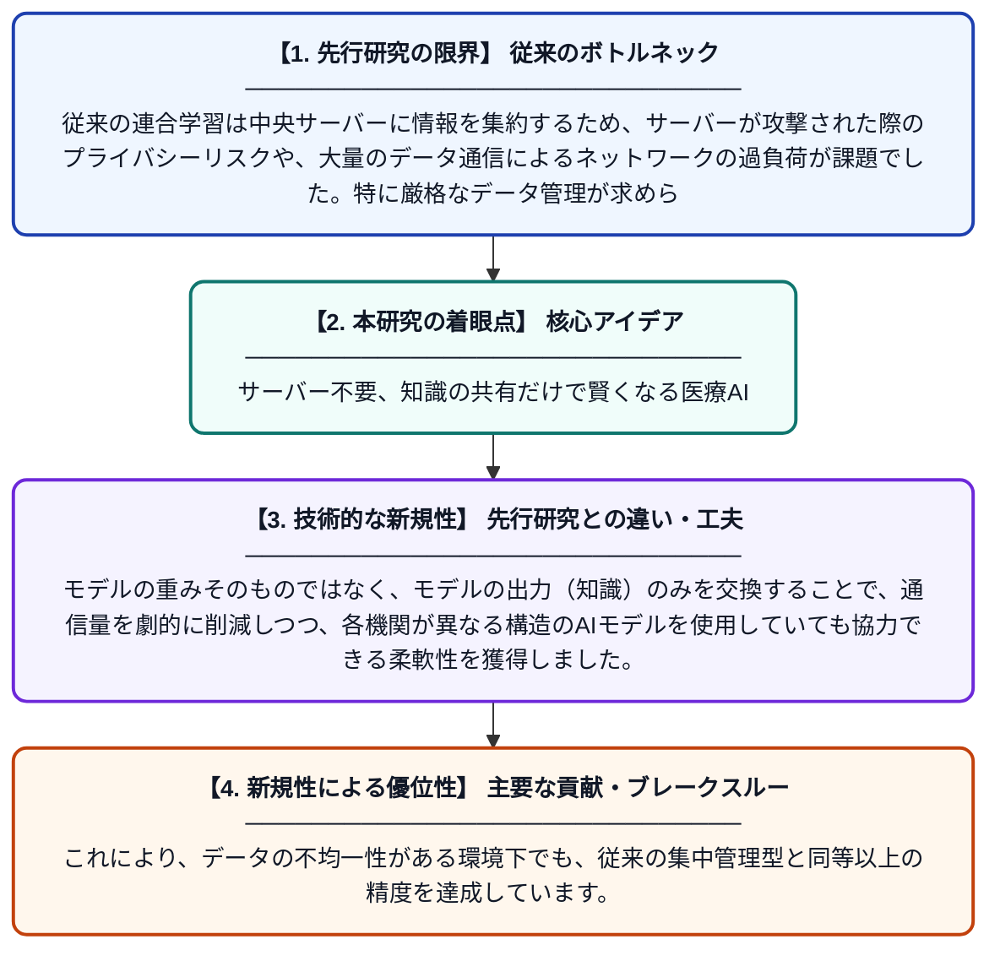

# プライバシー保護を目的とした医療画像解析のための、知識蒸留を用いた分散型連合学習

**Original Title**: *Knowledge-distilled decentralized federated learning for privacy-preserving medical image analysis*

> **💡 一言要約**: サーバー不要、知識の共有だけで賢くなる医療AI

| 項目 | 内容 |
|---|---|
| **著者** | SA Wagan, M Ghergherehchi, H Choi, J Muhammad |
| **掲載誌** | Ain Shams Engineering … 2027 |
| **アラートキーワード** | Federated Learning |
| **原文リンク** | [https://www.sciencedirect.com/science/article/pii/S2090447926005356](https://www.sciencedirect.com/science/article/pii/S2090447926005356) |
| **PDF版要約** | [README.pdf](./README.pdf) |

---

## 📊 新規性の図解（先行研究との違いと本研究のブレークスルー）

## 📝 要約

中央サーバーを介さずに、医療機関同士が直接連携して学習を行う分散型連合学習（FL）の手法を提案しています。知識蒸留技術を活用することで、各機関のプライバシーを高度に保護しながら、通信負荷の軽減と高い診断精度の両立を実現しました。

## ❓ どんな問題に取り組んだか

従来の連合学習は中央サーバーに情報を集約するため、サーバーが攻撃された際のプライバシーリスクや、大量のデータ通信によるネットワークの過負荷が課題でした。特に厳格なデータ管理が求められる医療分野では、より安全で効率的な分散型の仕組みが必要とされていました。

## ✨ 何が新しい？何がすごい？（新規性）

本研究の最大の特徴は、中央サーバーを完全に排除した「完全分散型」のアーキテクチャに「知識蒸留」を組み合わせた点にあります。モデルの重みそのものではなく、モデルの出力（知識）のみを交換することで、通信量を劇的に削減しつつ、各機関が異なる構造のAIモデルを使用していても協力できる柔軟性を獲得しました。これにより、データの不均一性がある環境下でも、従来の集中管理型と同等以上の精度を達成しています。

## 🎓 大学1年生向けの解説

病院にある患者さんのデータは外に出せませんが、たくさんのデータでAIを訓練したほうが精度は上がります。この研究は、中心となる管理者がいなくても、近所の病院同士が「勉強したコツ」だけを教え合う仕組みを作りました。これにより、大切な個人情報を守ったまま、世界中の病院が協力して高性能な病気発見AIを作れるようになります。スマホやPCの通信も少なくて済む、とても効率的な方法です。
