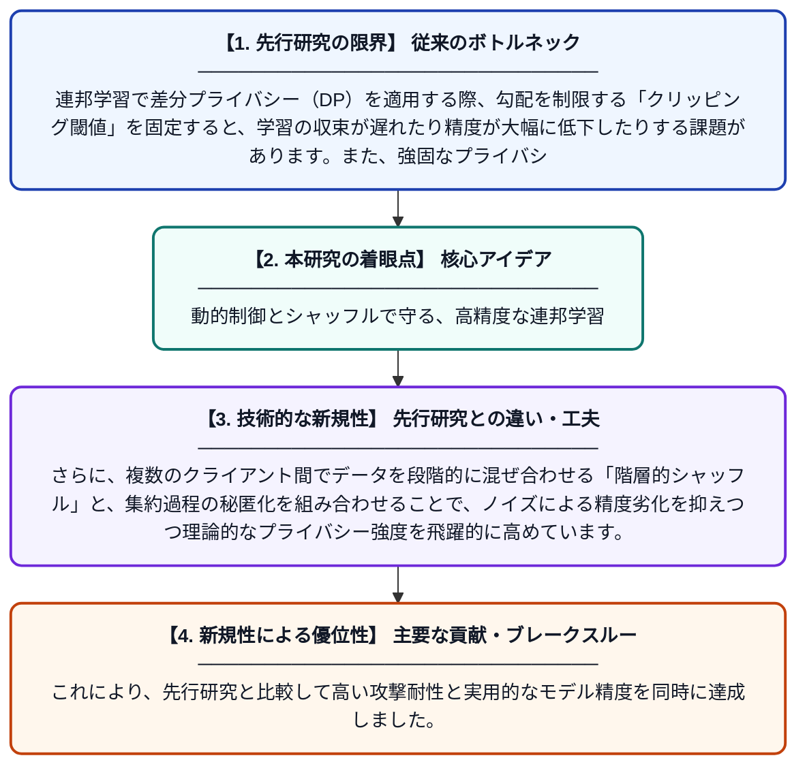

# 階層的シャッフルとセキュア集約を用いた連邦学習のための観測対応型動的プライバシー制御

**Original Title**: *OADPC-HSSA: Observation-Aware Dynamic Privacy Control for Federated Learning with Hierarchical Shuffling and Secure Aggregation*

> **💡 一言要約**: 動的制御とシャッフルで守る、高精度な連邦学習

| 項目 | 内容 |
|---|---|
| **著者** | J Xie, Z Wu, B Bu, M Yang, Q Xu |
| **掲載誌** | Expert Systems with Applications 2026 |
| **アラートキーワード** | Federated Learning |
| **原文リンク** | [https://www.sciencedirect.com/science/article/pii/S0957417426037322](https://www.sciencedirect.com/science/article/pii/S0957417426037322) |
| **PDF版要約** | [README.pdf](./README.pdf) |

---

## 📊 新規性の図解（先行研究との違いと本研究のブレークスルー）

## 📝 要約

連邦学習におけるプライバシー保護とモデル精度のトレードオフを改善するため、動的なクリッピング閾値調整と階層的シャッフル、セキュア集約を統合した新手法「OADPC-HSSA」を提案しています。学習プロセスの観測結果に基づいてノイズ量や閾値を最適化することで、高いデータ保護性能を維持しつつ、従来手法よりも優れた学習精度と収束速度を実現しました。

## ❓ どんな問題に取り組んだか

連邦学習で差分プライバシー（DP）を適用する際、勾配を制限する「クリッピング閾値」を固定すると、学習の収束が遅れたり精度が大幅に低下したりする課題があります。また、強固なプライバシー保証と通信効率の両立も困難でした。

## ✨ 何が新しい？何がすごい？（新規性）

学習の進行状況をリアルタイムに観測してクリッピング閾値を動的に変更する「OADPC」メカニズムを導入した点が最大の特徴です。さらに、複数のクライアント間でデータを段階的に混ぜ合わせる「階層的シャッフル」と、集約過程の秘匿化を組み合わせることで、ノイズによる精度劣化を抑えつつ理論的なプライバシー強度を飛躍的に高めています。これにより、先行研究と比較して高い攻撃耐性と実用的なモデル精度を同時に達成しました。

## 🎓 大学1年生向けの解説

AIに学習させるとき、個人のデータを秘密にしたまま計算する「連邦学習」という技術があります。しかし、これまでは秘密を守るための制限が厳しすぎて、AIがなかなか賢くならないという悩みがありました。この研究では、学習の進み具合に合わせて制限の強さを賢く変え、さらにデータをトランプのようにシャッフルして誰のものか分からなくする工夫をしました。その結果、個人の秘密をしっかり守りながら、とても賢いAIを効率よく作れるようになりました。
