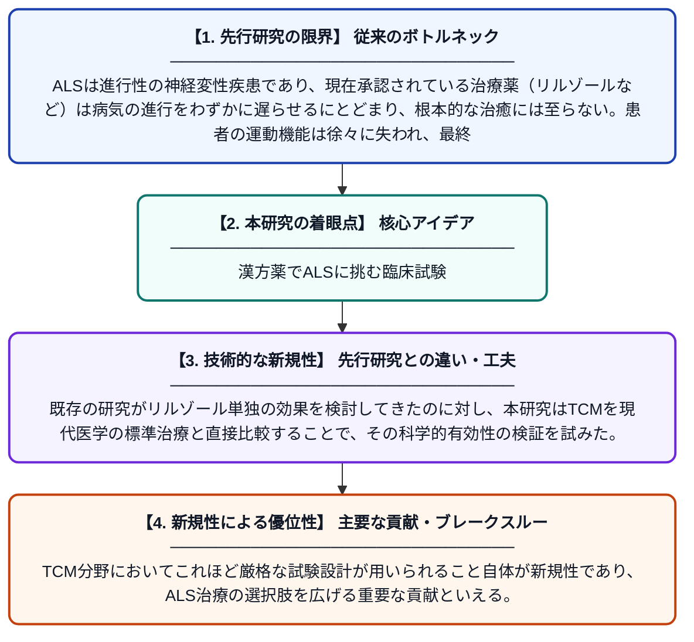

# 筋萎縮性側索硬化症に対する活霊昇機顆粒の有効性：多施設・無作為化・二重盲検・リルゾール対照試験

**Original Title**: *Huoling Shengji granule in amyotrophic lateral sclerosis: A multicenter, randomized, double-blind, riluzole-controlled trial*

> **💡 一言要約**: 漢方薬でALSに挑む臨床試験

| 項目 | 内容 |
|---|---|
| **著者** | X Liu, W Fu, X Cui, Y Feng, B Wen, L Shan, X Xu |
| **掲載誌** | Neurotherapeutics 2026 |
| **アラートキーワード** | ALS |
| **原文リンク** | [https://www.sciencedirect.com/science/article/pii/S1878747926001236](https://www.sciencedirect.com/science/article/pii/S1878747926001236) |
| **PDF版要約** | [README.pdf](./README.pdf) |

---

## 📊 新規性の図解（先行研究との違いと本研究のブレークスルー）

## 📝 要約

筋萎縮性側索硬化症（ALS）に対する根本的な治療法は現在存在しない。本研究では、伝統的中国医学（TCM）の処方である活霊昇機顆粒（HLSJ）の有効性と安全性を、標準治療薬であるリルゾールと比較する多施設・無作為化・二重盲検試験が実施された。その結果、HLSJがALS患者に対して有望な治療選択肢となり得ることが示された。

## ❓ どんな問題に取り組んだか

ALSは進行性の神経変性疾患であり、現在承認されている治療薬（リルゾールなど）は病気の進行をわずかに遅らせるにとどまり、根本的な治癒には至らない。患者の運動機能は徐々に失われ、最終的には呼吸不全に至るため、より効果的な治療法の開発が急務となっている。

## ✨ 何が新しい？何がすごい？（新規性）

本研究は、伝統的中国医学の処方であるHLSJをALS治療薬として多施設・無作為化・二重盲検という厳密な臨床試験デザインで評価した初めての大規模研究である。既存の研究がリルゾール単独の効果を検討してきたのに対し、本研究はTCMを現代医学の標準治療と直接比較することで、その科学的有効性の検証を試みた。TCM分野においてこれほど厳格な試験設計が用いられること自体が新規性であり、ALS治療の選択肢を広げる重要な貢献といえる。

## 🎓 大学1年生向けの解説

ALS（筋萎縮性側索硬化症）とは、体を動かす神経が徐々に壊れていく病気で、手足が動かなくなり最終的には呼吸もできなくなる非常に深刻な難病です。現在使われている薬（リルゾール）は病気の進みをほんの少し遅らせるだけで、完治させる方法はまだありません。この研究では、中国の伝統的な漢方薬「活霊昇機顆粒」がALSに効くかどうかを、コインを投げるように患者をランダムにグループ分けし、お医者さんも患者さんもどちらの薬かわからない「二重盲検」という公平な方法で調べました。その結果、この漢方薬が新たな治療の可能性を持つことが示され、伝統医学と現代医学を組み合わせる新しいアプローチへの期待が高まっています。
