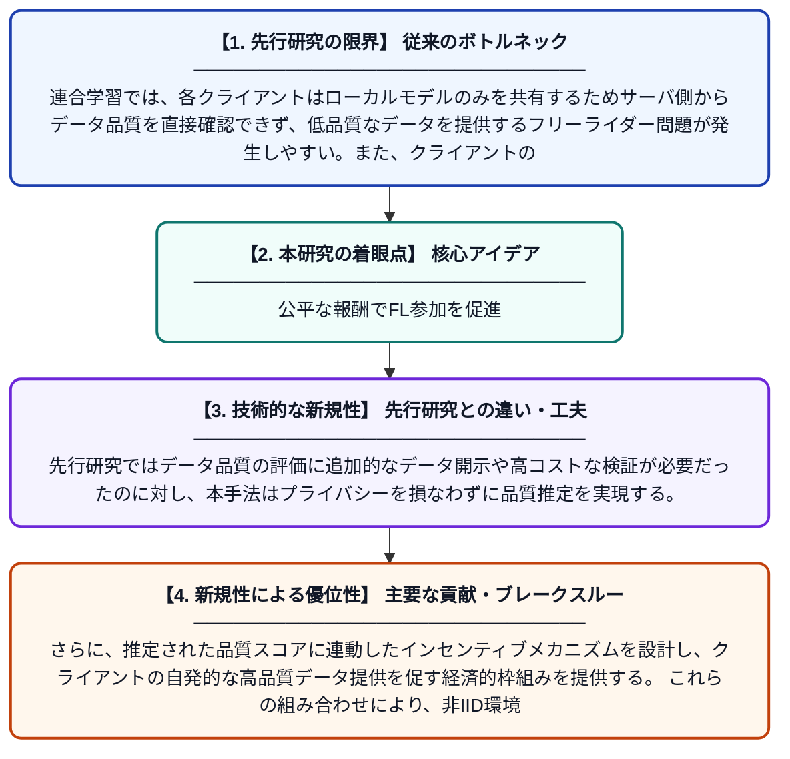

# 連合学習におけるユーティリティ推定とデータ品質評価インセンティブメカニズム

**Original Title**: *Utility Estimation and Quality Evaluation Incentive Mechanism for Federated Learning*

> **💡 一言要約**: 公平な報酬でFL参加を促進

| 項目 | 内容 |
|---|---|
| **著者** | F Tian, X Zhang, Y Li |
| **掲載誌** | IEEE Transactions on Cloud Computing 2026 |
| **アラートキーワード** | Federated Learning |
| **原文リンク** | [https://ieeexplore.ieee.org/abstract/document/11622681/](https://ieeexplore.ieee.org/abstract/document/11622681/) |
| **PDF版要約** | [README.pdf](./README.pdf) |

---

## 📊 新規性の図解（先行研究との違いと本研究のブレークスルー）

## 📝 要約

エッジネットワーク上の分散クライアントが保有する非IIDデータを活用する連合学習において、データ品質の公平な評価と適切なインセンティブ設計は大きな課題である。本論文では、クライアントが提供するデータの品質を推定・評価するメカニズムと、それに基づく報酬設計を提案する。これにより、質の高いデータを持つクライアントが積極的に参加するよう動機づけ、連合学習全体の性能向上を目指す。

## ❓ どんな問題に取り組んだか

連合学習では、各クライアントはローカルモデルのみを共有するためサーバ側からデータ品質を直接確認できず、低品質なデータを提供するフリーライダー問題が発生しやすい。また、クライアントのデータが非IID（独立同分布でない）分布に従うため、貢献度の公平な評価が困難である。これらの問題により、優良なクライアントが参加を敬遠し、モデル精度が低下するリスクがある。

## ✨ 何が新しい？何がすごい？（新規性）

本研究は、クライアントのデータ品質をモデル更新情報から間接的に推定するユーティリティ評価手法を新たに設計した点が独自である。先行研究ではデータ品質の評価に追加的なデータ開示や高コストな検証が必要だったのに対し、本手法はプライバシーを損なわずに品質推定を実現する。さらに、推定された品質スコアに連動したインセンティブメカニズムを設計し、クライアントの自発的な高品質データ提供を促す経済的枠組みを提供する。これらの組み合わせにより、非IID環境下でも公平かつ効率的な連合学習を可能にしている。

## 🎓 大学1年生向けの解説

連合学習とは、スマートフォンなど多くの端末がデータをサーバに送らずに協力してAIを賢くする仕組みです。しかし、各端末が本当に良いデータを提供しているかどうかをサーバは確かめられないため、手を抜く端末が出てしまう問題があります。この論文では、端末から送られてくるモデルの更新情報を分析することで、データの品質を間接的に見積もる方法を考案しました。そして、品質の高いデータを提供した端末にはより多くの報酬を与えることで、みんながちゃんと参加したくなる仕組みを作りました。まるで授業でちゃんと発言した人が良い評価をもらえるような、公平なルール設計です。
