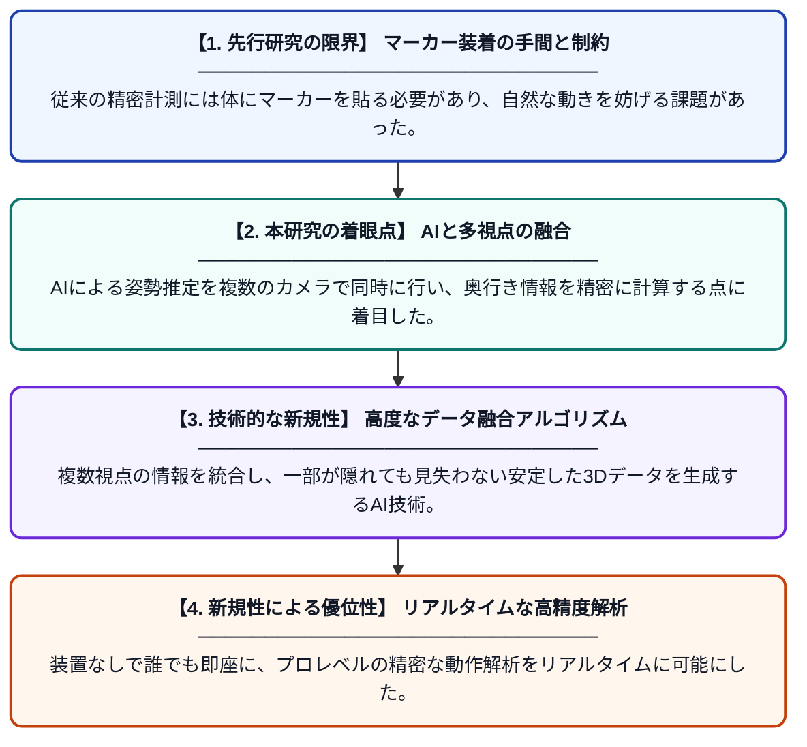

# リアルタイム3D人体動作追跡、生体力学的分析、および持続可能なパフォーマンスのためのAI駆動型マルチカメラステレオビジョンフレームワーク

**Original Title**: *An AI-Driven Multi-Camera Stereo Vision Framework for Real-Time 3D Human Movement Tracking, Biomechanical Analysis, and Sustainable Performance …*

> **💡 一言要約**: AIと複数カメラで動作を3D精密解析

| 項目 | 内容 |
|---|---|
| **著者** | Z Kaszai, Á Kovács |
| **掲載誌** | Engineering Proceedings 2026 |
| **アラートキーワード** | Multi Camera Tracking |
| **原文リンク** | [https://www.mdpi.com/2673-4591/157/1/41](https://www.mdpi.com/2673-4591/157/1/41) |
| **PDF版要約** | [README.pdf](./README.pdf) |

---

## 📊 新規性の図解（先行研究との違いと本研究のブレークスルー）

## 📝 要約

AIを活用したマルチカメラ・ステレオビジョンにより、リアルタイムで高精度な3D人体動作のトラッキングを実現するシステムを提案しています。高度な姿勢推定とデータ統合を組み合わせることで、スポーツや医療における詳細な生体力学的分析を可能にします。

## ❓ どんな問題に取り組んだか

従来の動作解析システムは、高価なマーカーを体に付ける必要があったり、リアルタイムでの処理が困難だったりする課題がありました。また、単一カメラでは奥行き情報の取得が不十分で、複雑な動きを正確に追跡することが難しいという点も問題でした。

## ✨ 何が新しい？何がすごい？（新規性）

本研究は、AI駆動の姿勢推定とマルチカメラによるステレオビジョンを統合し、マーカーレスで高精度な3D追跡をリアルタイムで実現した点が画期的です。複数の視点からのデータを高度に融合させることで、遮蔽物がある環境でも安定した計測を可能にし、従来のシステムよりも持続可能で利用しやすいフレームワークを構築しました。

## 🎓 大学1年生向けの解説

自分の体の動きをデジタル化して分析するには、これまでは体にセンサーをたくさん付ける必要がありました。この研究では、AIが複数のカメラ映像を同時に分析することで、センサーなしでも「どこがどう動いているか」を3Dで瞬時に把握できるようにしました。これにより、スポーツ選手のフォーム改善やリハビリの様子を、より手軽かつ精密に調べることができるようになります。
