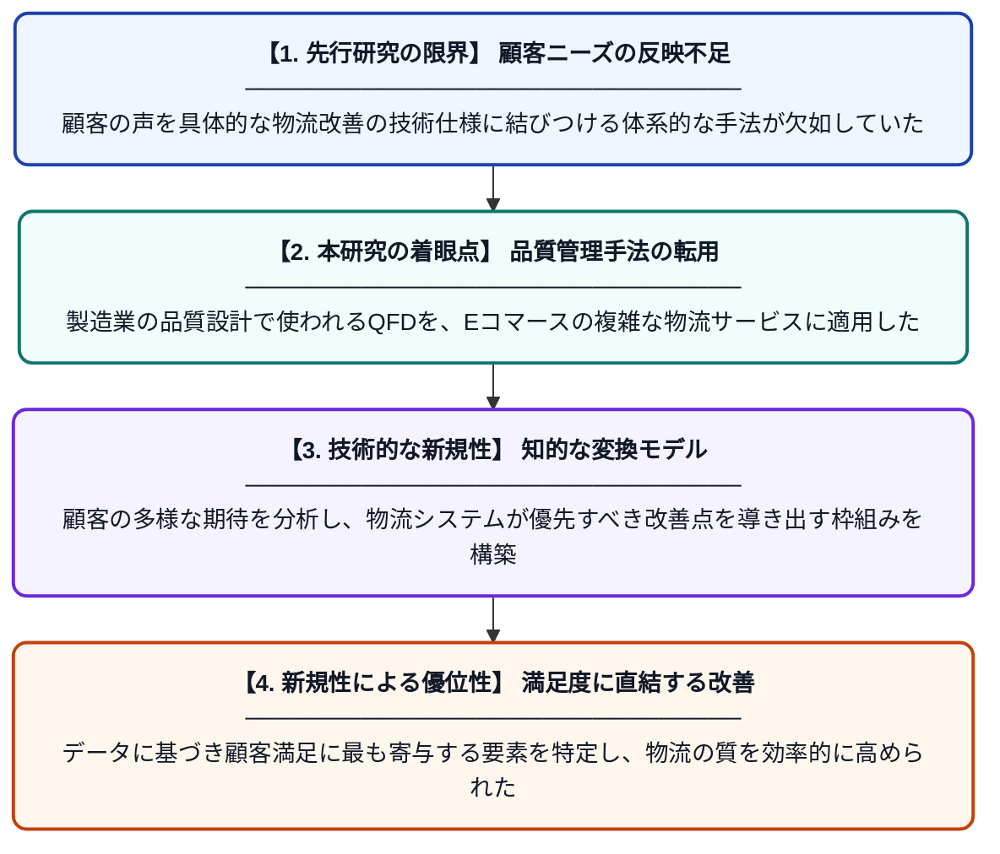

# Eコマースシステムにおける物流最適化のためのインテリジェントなQFDベースのアプローチ

**Original Title**: *An Intelligent QFD-Based Approach for Logistics Optimization in E-Commerce Systems*

> **💡 一言要約**: QFDで顧客の声を物流の質に変える最適化術

| 項目 | 内容 |
|---|---|
| **著者** | V Anatasia, LB Sugiyanto, K Gularso, TQ Anh… |
| **掲載誌** | 5th International … 2026 |
| **アラートキーワード** | logistics |
| **原文リンク** | [https://ieeexplore.ieee.org/abstract/document/11749321/](https://ieeexplore.ieee.org/abstract/document/11749321/) |
| **PDF版要約** | [README.pdf](./README.pdf) |

---

## 📊 新規性の図解（先行研究との違いと本研究のブレークスルー）

## 📝 要約

本研究は、品質機能展開（QFD）を活用して、Eコマースにおける物流サービスの質を向上させる手法を提案しています。顧客の期待を詳細に分析し、物流サービスの主要な課題を特定することで、顧客満足度を最大化するプロセスを構築します。

## ❓ どんな問題に取り組んだか

Eコマースの急速な普及により、物流サービスに対する顧客の期待は高度化かつ多様化しています。しかし、従来の物流管理では顧客の要望を具体的なサービス改善に効果的に反映させる仕組みが不足しており、サービスの質と期待の間にミスマッチが生じていました。

## ✨ 何が新しい？何がすごい？（新規性）

本研究は、製造業で用いられる品質管理手法「QFD」をインテリジェントな枠組みとして物流分野に適用した点が独創的です。顧客の声を単なるアンケート結果で終わらせず、物流システムの具体的な技術的要件へと論理的に変換する体系的なアプローチを実現しました。先行研究と比較して、主観的な期待値を客観的な改善優先度へと変換する精度を高めているのが特徴です。

## 🎓 大学1年生向けの解説

ネットショッピングで注文した商品が届くまでの「物流」を、もっと便利で満足度の高いものにするための研究です。「QFD」という特別なツールを使って、「お客さんは何を望んでいるか」を正確に把握し、それを配送のスピードや丁寧さなどの具体的な計画に変換します。これにより、単なる効率化だけでなく、お客さんが本当に「嬉しい」と感じるサービスを無駄なく作れるようになります。
