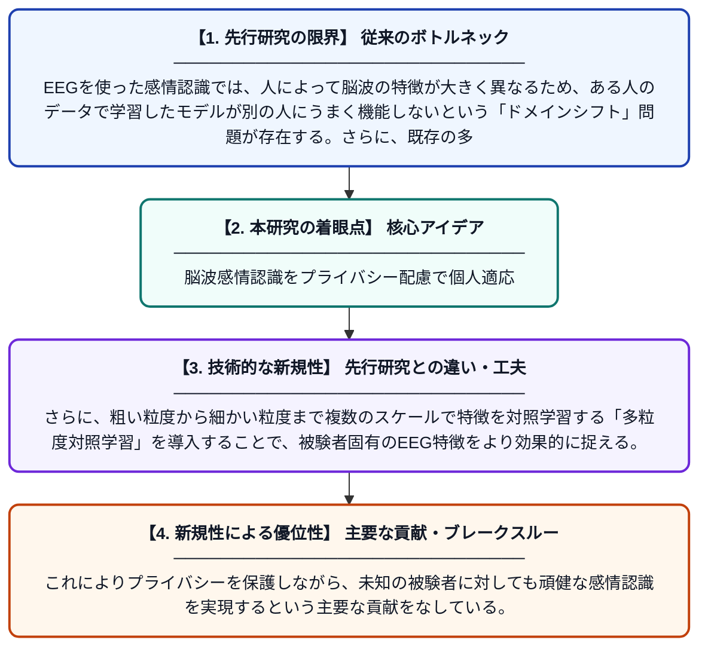

# 多粒度対照学習によるEEG感情認識のためのソースフリードメイン適応

**Original Title**: *Source-Free Domain Adaptation for EEG Emotion Recognition via Multi-Granularity Contrastive Learning*

> **💡 一言要約**: 脳波感情認識をプライバシー配慮で個人適応

| 項目 | 内容 |
|---|---|
| **著者** | X Xiao, W Li, Y Cui, P Zhai, J Li |
| **掲載誌** | International Conference on Intelligent Computing 2027 |
| **アラートキーワード** | affective computing |
| **原文リンク** | [https://link.springer.com/chapter/10.1007/978-981-92-3432-5_5](https://link.springer.com/chapter/10.1007/978-981-92-3432-5_5) |
| **PDF版要約** | [README.pdf](./README.pdf) |

---

## 📊 新規性の図解（先行研究との違いと本研究のブレークスルー）

## 📝 要約

本論文は、脳波（EEG）を用いた感情認識において、被験者間の分布の違いによるモデル汎化の問題に取り組んでいる。特に、元の学習データ（ソースデータ）にアクセスせずに新しい被験者へ適応する「ソースフリードメイン適応」という難しい設定のもと、多粒度対照学習を用いた新しいフレームワークを提案している。これにより、プライバシーへの配慮を保ちながらも高い感情認識精度を実現することを目指している。

## ❓ どんな問題に取り組んだか

EEGを使った感情認識では、人によって脳波の特徴が大きく異なるため、ある人のデータで学習したモデルが別の人にうまく機能しないという「ドメインシフト」問題が存在する。さらに、既存の多くの手法はモデル適応の際に元の学習データへのアクセスを前提としており、個人情報・プライバシーの観点から現実的な利用が難しいという課題もある。

## ✨ 何が新しい？何がすごい？（新規性）

本研究は、元のソースデータに一切アクセスしない「ソースフリー」という制約のもとでEEG感情認識のドメイン適応を行う点が先行研究と大きく異なる。さらに、粗い粒度から細かい粒度まで複数のスケールで特徴を対照学習する「多粒度対照学習」を導入することで、被験者固有のEEG特徴をより効果的に捉える。これによりプライバシーを保護しながら、未知の被験者に対しても頑健な感情認識を実現するという主要な貢献をなしている。

## 🎓 大学1年生向けの解説

人間の感情は脳の電気活動（脳波・EEG）から読み取ることができますが、脳波のパターンは人それぞれ大きく異なるため、ある人のデータで作ったAIが別の人にはうまく使えないという問題があります。また、他人の脳波データを共有することはプライバシーの問題もあります。この研究では、元のデータを使わずに新しい人の脳波だけでAIを適応させる方法を考えました。「対照学習」という技術を複数のレベルで使うことで、少ない情報からでも個人の特徴をうまく学習できるようにしています。これにより、プライバシーを守りながら誰にでも使える感情認識AIの実現に近づきます。
