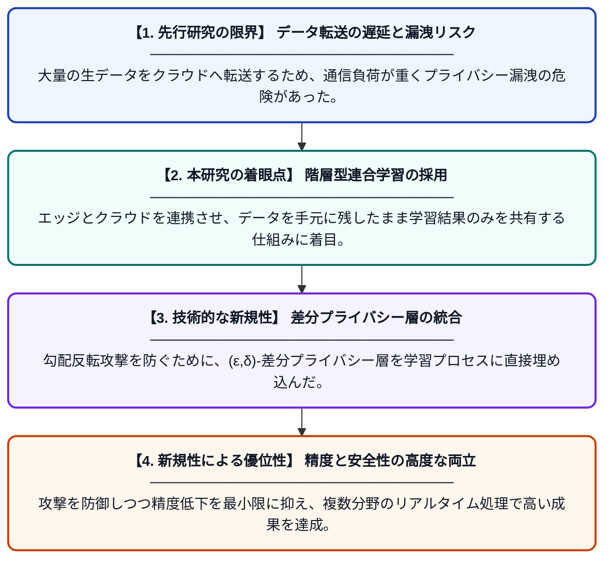

# 連合エッジ・クラウド分析：IoT駆動型スマートエコシステムのためのプライバシー保護型リアルタイム・ビッグデータ処理フレームワーク

**Original Title**: *Federated Edge-to-Cloud Analytics: A Privacy-Preserving Real-Time Big Data Processing Framework for IoT-Driven Smart Ecosystems*

> **💡 一言要約**: プライバシーを守りつつIoTデータを高速処理する連合学習

| 項目 | 内容 |
|---|---|
| **著者** | TG Krishna, SZU Huq, NS Kumar… |
| **掲載誌** | … on I-SMAC (IoT in Social … 2026 |
| **アラートキーワード** | differential privacy |
| **原文リンク** | [https://ieeexplore.ieee.org/abstract/document/11747361/](https://ieeexplore.ieee.org/abstract/document/11747361/) |
| **PDF版要約** | [README.pdf](./README.pdf) |

---

## 📊 新規性の図解（先行研究との違いと本研究のブレークスルー）

## 📝 要約

IoT環境におけるリアルタイムなデータ処理とプライバシー保護を両立させる「FECA」フレームワークを提案しています。エッジからクラウドにわたる階層的な連合学習に、精度を維持しつつ勾配反転攻撃を防ぐ差分プライバシー層を組み込んだ点が特徴です。

## ❓ どんな問題に取り組んだか

IoTデバイスから収集される膨大なデータをクラウドで処理する際、通信遅延とプライバシー保護が大きな課題となっていました。特に連合学習において、送信される勾配情報から元のデータが推測される「勾配反転攻撃」への対策が急務でした。

## ✨ 何が新しい？何がすごい？（新規性）

本研究の新規性は、エッジ・クラウド間の階層構造に(ε,δ)-差分プライバシー層を統合し、セキュリティと処理性能を高度に両立させた点にあります。従来の差分プライバシー手法ではモデルの精度が大幅に低下する傾向にありましたが、FECAは独自の調整により精度損失を最小限に抑えています。スマートシティ、ヘルスケア、産業オートメーションの3つのベンチマークで、実用性の高い高いパフォーマンスを証明しました。

## 🎓 大学1年生向けの解説

スマホやセンサーなどのIoT機器が増える中で、私たちのプライバシー情報を守りながら便利なAIサービスを利用する技術が求められています。この論文では、データをどこか一箇所に集めるのではなく、各機器で学習を行って「学習のヒント」だけをやり取りする仕組みを改良しました。さらに、そのヒントの中にノイズを絶妙に混ぜることで、悪意のある人に元のデータを見破られないようにする強力なセキュリティを実現しています。
