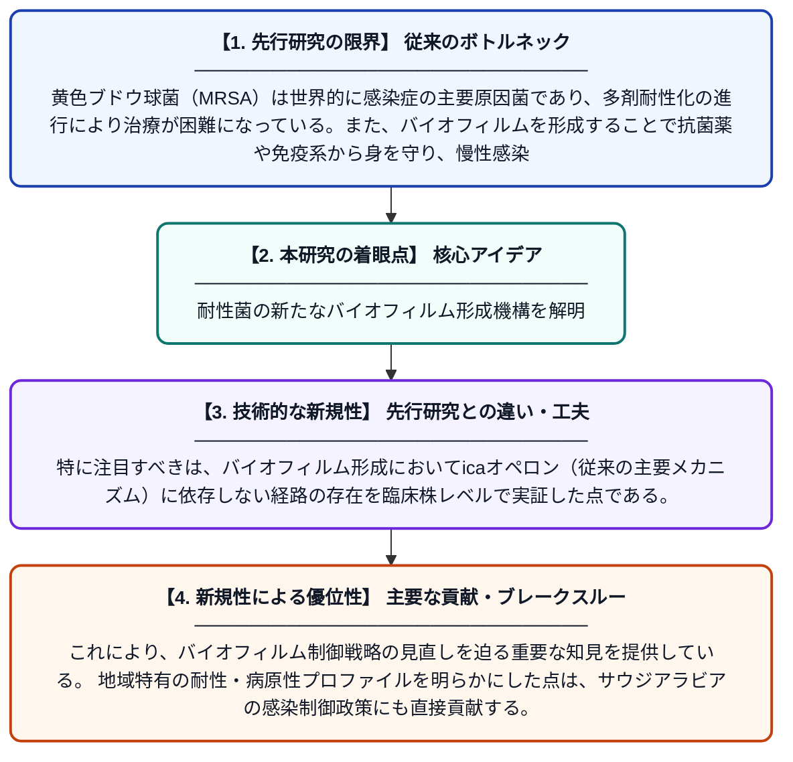

# リヤドにおける臨床黄色ブドウ球菌分離株におけるSCCmecタイプIIIの優勢、多剤耐性、およびica非依存性バイオフィルム形成の証拠

**Original Title**: *Predominance of SCCmec type III, multidrug resistance, and evidence of ica-independent biofilm formation among clinical Staphylococcus aureus isolates in Riyadh …*

> **💡 一言要約**: 耐性菌の新たなバイオフィルム形成機構を解明

| 項目 | 内容 |
|---|---|
| **著者** | M Alabdullatif |
| **掲載誌** | BMC Infectious Diseases 2026 |
| **アラートキーワード** | ICA |
| **原文リンク** | [https://link.springer.com/article/10.1186/s12879-026-14079-8](https://link.springer.com/article/10.1186/s12879-026-14079-8) |
| **PDF版要約** | [README.pdf](./README.pdf) |

---

## 📊 新規性の図解（先行研究との違いと本研究のブレークスルー）

## 📝 要約

本研究は、サウジアラビアのリヤドにおける臨床分離黄色ブドウ球菌の多剤耐性（MDR）パターンとバイオフィルム形成能を解析したものである。SCCmecタイプIIIが主要な遺伝型として確認され、多くの株が多剤耐性を示した。さらに、従来のicaオペロンに依存しないバイオフィルム形成経路の存在が明らかにされた。

## ❓ どんな問題に取り組んだか

黄色ブドウ球菌（MRSA）は世界的に感染症の主要原因菌であり、多剤耐性化の進行により治療が困難になっている。また、バイオフィルムを形成することで抗菌薬や免疫系から身を守り、慢性感染症の原因となる。特に中東地域における耐性パターンやバイオフィルム形成機構の詳細は十分に解明されていなかった。

## ✨ 何が新しい？何がすごい？（新規性）

本研究はリヤドという特定の地域に焦点を当て、臨床分離株におけるSCCmecタイプIIIの優勢を明確に示した点が新しい。特に注目すべきは、バイオフィルム形成においてicaオペロン（従来の主要メカニズム）に依存しない経路の存在を臨床株レベルで実証した点である。これにより、バイオフィルム制御戦略の見直しを迫る重要な知見を提供している。地域特有の耐性・病原性プロファイルを明らかにした点は、サウジアラビアの感染制御政策にも直接貢献する。

## 🎓 大学1年生向けの解説

黄色ブドウ球菌は、傷口や手術後の感染を引き起こす危険な細菌で、抗生物質が効きにくい「耐性菌」が世界的に問題になっています。この研究では、サウジアラビアの病院から集めた細菌を調べ、どんな種類の耐性遺伝子を持っているかを分析しました。また、細菌が体の中で「バイオフィルム」という膜を作って薬から身を守る仕組みについても研究し、従来考えられていたメカニズムとは別の方法でも膜を作れることを発見しました。この発見は、より効果的な治療法の開発につながる可能性があります。
