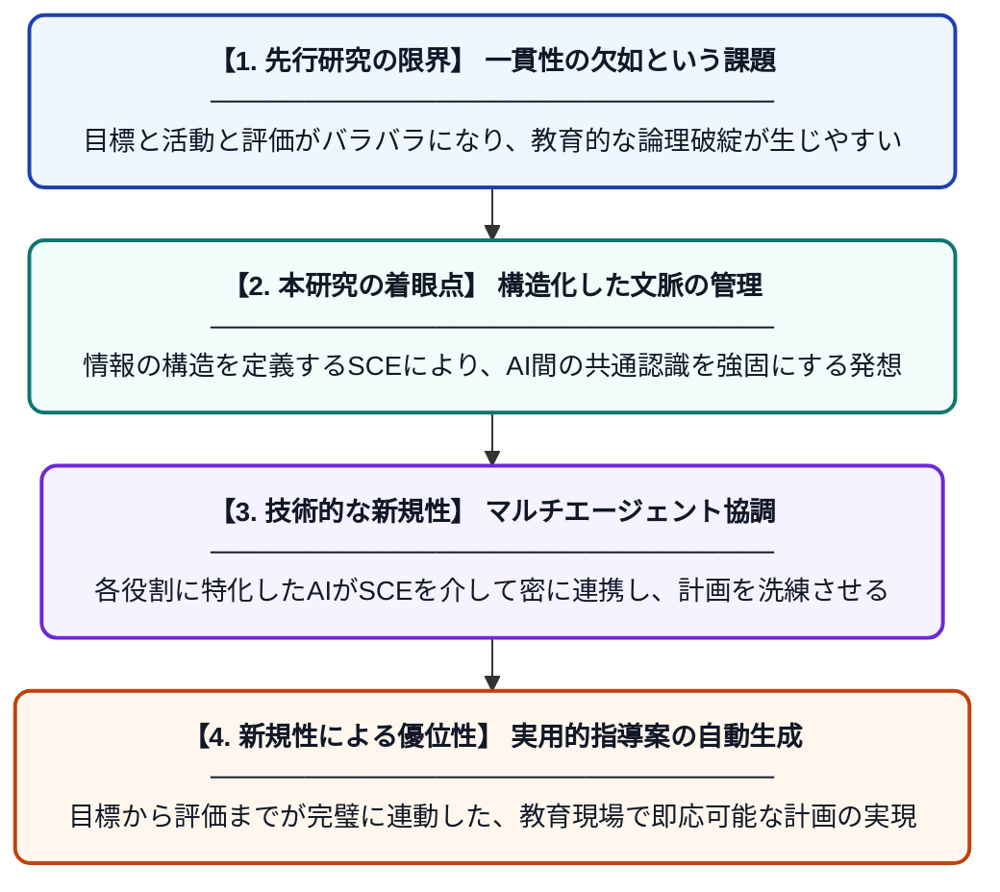

# 構造化コンテキストエンジニアリングによる授業計画生成のためのマルチエージェントフレームワーク

**Original Title**: *A multi-agent framework for lesson plan generation driven by Structured Context Engineering*

> **💡 一言要約**: 目標と活動が一致した授業計画をAIが自動作成

| 項目 | 内容 |
|---|---|
| **著者** | Q Huang, C Hu, C Huang, F Shu |
| **掲載誌** | Information Processing & Management 2027 |
| **アラートキーワード** | multi agent |
| **原文リンク** | [https://www.sciencedirect.com/science/article/pii/S0306457326006758](https://www.sciencedirect.com/science/article/pii/S0306457326006758) |
| **PDF版要約** | [README.pdf](./README.pdf) |

---

## 📊 新規性の図解（先行研究との違いと本研究のブレークスルー）

## 📝 要約

大規模言語モデルを用いた授業計画の作成において、学習目標・活動・評価の一貫性を維持することは困難でした。本研究では、構造化コンテキストエンジニアリング（SCE）を導入したマルチエージェントフレームワークを提案し、論理的に整合した質の高い授業計画の自動生成を実現しました。

## ❓ どんな問題に取り組んだか

既存のLLMは流暢な文章を作成できるものの、授業全体の目標と具体的な活動、そして学習評価の内容を矛盾なく一致させることが苦手でした。そのため、教育現場でそのまま使える実用的なレベルの授業計画を生成するには限界がありました。

## ✨ 何が新しい？何がすごい？（新規性）

構造化コンテキストエンジニアリング（SCE）という新たなプロトコルを提案し、複数のAIエージェントが役割を分担して協調する仕組みを構築しました。各エージェントが目標設定や評価などの要素に特化しつつ、SCEを通じて構造化された情報を共有することで、全体の論理的整合性を飛躍的に高めています。これにより、単一のAIによる生成よりも教育的価値の高い計画作成が可能となりました。

## 🎓 大学1年生向けの解説

先生が授業をする前に作る「授業の設計図（指導案）」をAIに作ってもらう研究です。これまでのAIは、文章は上手でも「何を教えるか」と「どうテストするか」がバラバラになってしまうことがありました。そこでこの研究では、役割の違う複数のAIたちがチームを組み、情報を整理しながら相談して一つの計画を作る仕組みを作りました。これによって、最初から最後まで筋の通った使いやすい指導案が自動で出来上がります。
