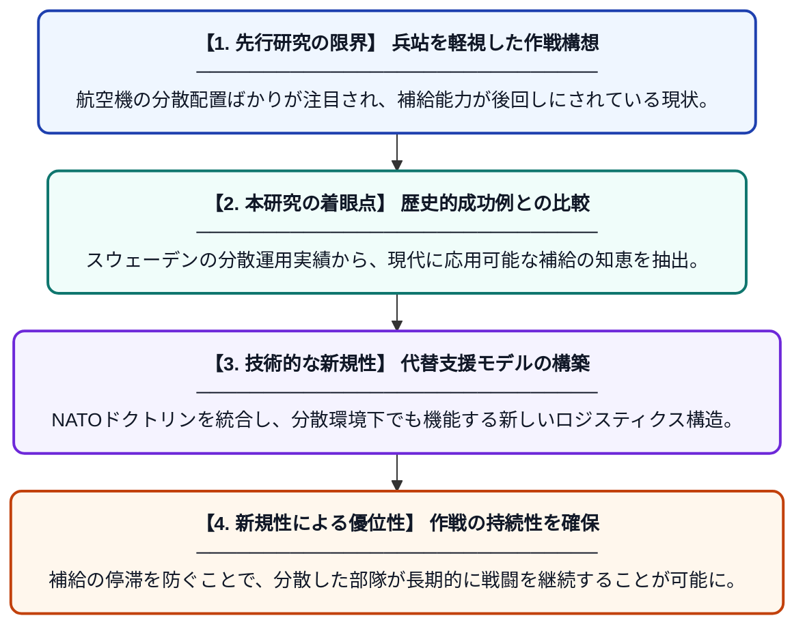

# 分散配置を超えて：敏捷な戦闘展開（ACE）と代替ロジスティクス支援モデルの批判的評価

**Original Title**: *Beyond Dispersal: A Critical Evaluation of Agile Combat Employment and Alternative Logistics Support Models*

> **💡 一言要約**: ACEの兵站課題を暴き、次世代の補給モデルを提言

| 項目 | 内容 |
|---|---|
| **著者** | R Hellberg, D Manning |
| **掲載誌** | ISMS Conference 2026 |
| **アラートキーワード** | logistics |
| **原文リンク** | [https://www.diva-portal.org/smash/record.jsf?pid=diva2:2117557](https://www.diva-portal.org/smash/record.jsf?pid=diva2:2117557) |
| **PDF版要約** | [README.pdf](./README.pdf) |

---

## 📊 新規性の図解（先行研究との違いと本研究のブレークスルー）

## 📝 要約

米空軍の作戦構想であるACE（敏捷な戦闘展開）におけるロジスティクス面の不備を批判的に検証した論文です。歴史的なスウェーデン軍の空軍基地構想やNATOドクトリンを参考に、分散した部隊を支えるための持続可能な補給モデルの必要性を提唱しています。

## ❓ どんな問題に取り組んだか

現在のACE構想は航空機の分散配置や迅速な展開を重視していますが、それを支えるためのロジスティクス（兵站）モデルが未発達です。補給線が攻撃されるリスクがある環境下で、どのように弾薬や燃料を供給し続けるかという具体的な仕組みが欠落している点が大きな課題です。

## ✨ 何が新しい？何がすごい？（新規性）

本論文の新規性は、ACEを単なる現代の戦術として捉えるのではなく、歴史的に成功したスウェーデンの分散基地運用や既存のNATOドクトリンと比較・統合した点にあります。ロジスティクスの観点からACEの前提条件を再評価し、単なる分散を超えた実効性の高い「代替支援モデル」を具体的に提示したことが、これまでの研究にはない大きな貢献です。

## 🎓 大学1年生向けの解説

現代の空軍は、敵のミサイル攻撃を避けるために、一つの大きな基地ではなく小さな場所にバラバラに分かれて戦う「ACE」という作戦を考えています。しかし、バラバラになった部隊それぞれに燃料や食べ物を届けるのは、実はとても難しいことです。この論文は、昔のスウェーデン軍などの知恵を借りて、どうすればバラバラの部隊を全滅させずに支え続けられるかを提案しています。
