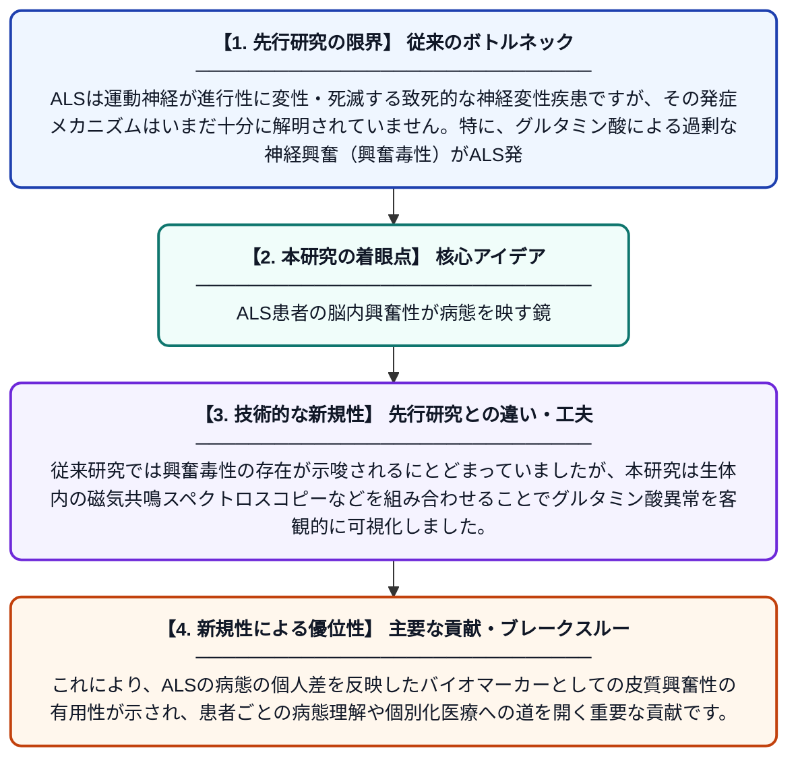

# 筋萎縮性側索硬化症における皮質興奮性が神経化学プロファイルを層別化する

**Original Title**: *Cortical excitability stratifies neurochemical profiles in amyotrophic lateral sclerosis*

> **💡 一言要約**: ALS患者の脳内興奮性が病態を映す鏡

| 項目 | 内容 |
|---|---|
| **著者** | S Tu, CJ Mahoney, W Huynh, S Vucic, MC Kiernan |
| **掲載誌** | Brain Communications 2026 |
| **アラートキーワード** | ALS |
| **PDF** | [https://academic.oup.com/braincomms/advance-article-pdf/doi/10.1093/braincomms/fcag292/70299079/fcag292.pdf](https://academic.oup.com/braincomms/advance-article-pdf/doi/10.1093/braincomms/fcag292/70299079/fcag292.pdf) |
| **原文リンク** | [https://academic.oup.com/braincomms/advance-article-pdf/doi/10.1093/braincomms/fcag292/70299079/fcag292.pdf](https://academic.oup.com/braincomms/advance-article-pdf/doi/10.1093/braincomms/fcag292/70299079/fcag292.pdf) |
| **PDF版要約** | [README.pdf](./README.pdf) |

---

## 📊 新規性の図解（先行研究との違いと本研究のブレークスルー）

## 📝 要約

この研究は、筋萎縮性側索硬化症（ALS）患者において、皮質運動興奮性の変化がグルタミン酸を中心とした神経化学的プロファイルとどのように関連するかを生体内で検討したものです。ALS発症の主要メカニズムとされるグルタミン酸による興奮毒性について、皮質興奮性の指標を用いて患者を層別化することで、その異常を客観的に評価しました。本研究の知見は、ALSの病態解明や将来的な治療戦略の開発に貢献する可能性があります。

## ❓ どんな問題に取り組んだか

ALSは運動神経が進行性に変性・死滅する致死的な神経変性疾患ですが、その発症メカニズムはいまだ十分に解明されていません。特に、グルタミン酸による過剰な神経興奮（興奮毒性）がALS発症に関与すると考えられているものの、生体内でそれを定量的に評価・分類する手法が確立されていませんでした。

## ✨ 何が新しい？何がすごい？（新規性）

本研究は、皮質興奮性の電気生理学的指標を用いてALS患者を神経化学的プロファイルごとに層別化するという新しいアプローチを採用しています。従来研究では興奮毒性の存在が示唆されるにとどまっていましたが、本研究は生体内の磁気共鳴スペクトロスコピーなどを組み合わせることでグルタミン酸異常を客観的に可視化しました。これにより、ALSの病態の個人差を反映したバイオマーカーとしての皮質興奮性の有用性が示され、患者ごとの病態理解や個別化医療への道を開く重要な貢献です。

## 🎓 大学1年生向けの解説

ALS（筋萎縮性側索硬化症）とは、全身の筋肉を動かす神経が徐々に壊れていく怖い病気です。脳の神経細胞が「グルタミン酸」という物質によって過剰に興奮・疲弊してしまうことが原因の一つと考えられています。この研究では、脳の「興奮しやすさ」を測る方法を使って、ALS患者さんの脳内の化学的な異常パターンを分類しました。これにより、患者さんごとに病気の進み方が異なる理由が少しずつ明らかになってきています。将来的には、この知見をもとにALSに対するより個人に合った治療法が開発されることが期待されます。
