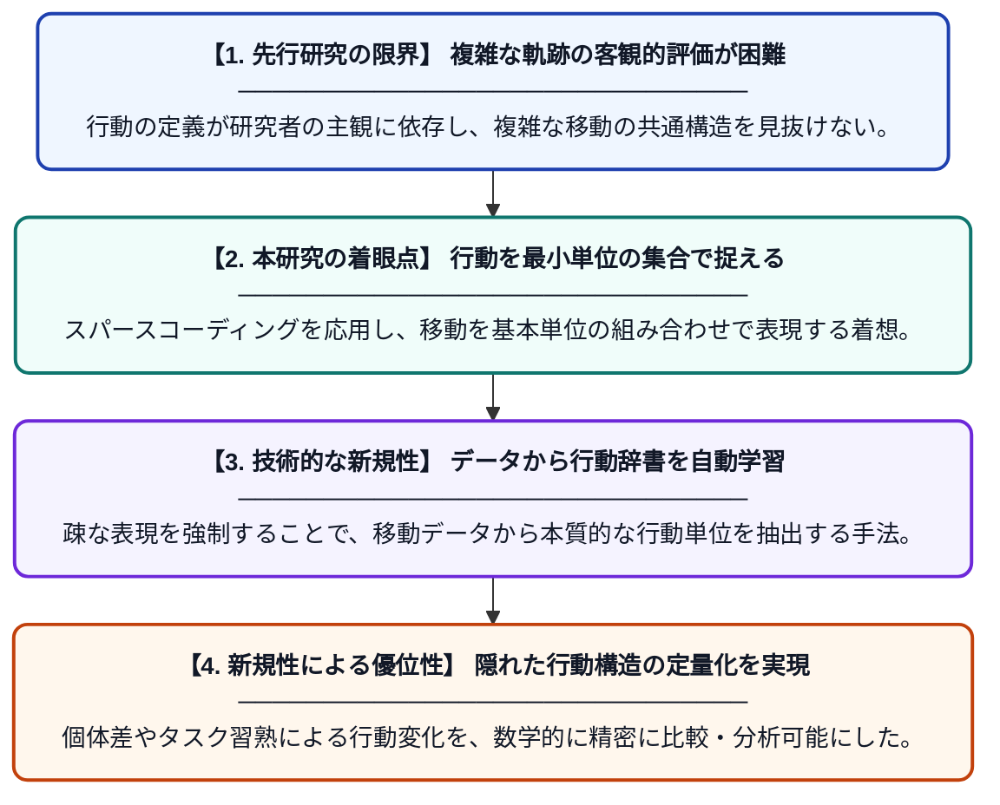

# 齧歯類の空間移動軌跡における構造化された行動パターンを特定するためのフレームワーク

**Original Title**: *www. nature. com/scientificreports OPEN A framework to identify structured behavioral patterns within rodent spatial trajectories*

> **💡 一言要約**: 移動データから隠れた行動の「型」を見つけ出す技術

| 項目 | 内容 |
|---|---|
| **著者** | F Donnarumma, R Prevete, D Maisto, S Fuscone… |
| **アラートキーワード** | sparse coding |
| **原文リンク** | [https://repository.rice.edu/server/api/core/bitstreams/cff0a399-e0ad-45da-a76d-46403a8ce5f4/content](https://repository.rice.edu/server/api/core/bitstreams/cff0a399-e0ad-45da-a76d-46403a8ce5f4/content) |
| **PDF版要約** | [README.pdf](./README.pdf) |

---

## 📊 新規性の図解（先行研究との違いと本研究のブレークスルー）

## 📝 要約

ネズミなどの齧歯類が空間を移動する際の軌跡データから、意味のある行動パターンを自動抽出する新しいフレームワークを提案しています。スパースコーディングという手法を用いて、複雑な動きの中に隠れた規則的な構成単位（辞書アトム）を特定することに成功しました。

## ❓ どんな問題に取り組んだか

従来の行動解析では、複雑な移動軌跡から生物学的に意味のある一貫したパターンを客観的に抽出することが困難でした。特に、自由な移動の中に潜む構造を特定するための数学的かつ汎用的な枠組みが不足していました。

## ✨ 何が新しい？何がすごい？（新規性）

信号処理で用いられる「スパースコーディング」を軌跡解析に応用し、行動の「辞書」を自動構築する点が革新的です。先行研究のようにあらかじめ定義された動作に依存せず、データ駆動型で行動の基本単位を学習できます。これにより、個体間の微妙な行動差や、学習過程でのパターンの変化を定量的に捉えることが可能になりました。

## 🎓 大学1年生向けの解説

ネズミが迷路を走る様子は、一見すると不規則でバラバラな動きに見えます。しかし、この研究は「よく使う動きのパーツ」を辞書のようにまとめ、それらを組み合わせて複雑な動きを説明する方法を開発しました。これを使うと、ネズミがどんなルールで動いているのか、以前より詳しく分析できます。AIがデータの共通点を見つける仕組みを、生き物の観察に応用した画期的な研究です。
