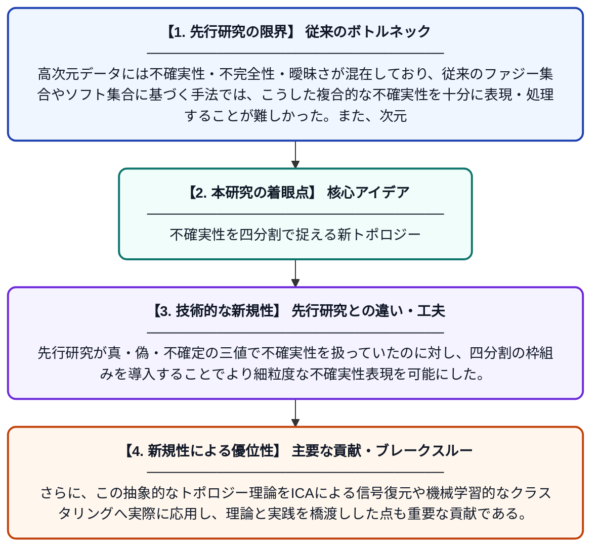

# 四分割中性推論的ソフトトポロジーと高次元空間における次元削減・クラスタリング・信号復元

**Original Title**: *Quadri-Partition Neutrosophic Soft Topology and Dimensionality Reduction, Clustering, and Signal Recovery in High-Dimensional Spaces*

> **💡 一言要約**: 不確実性を四分割で捉える新トポロジー

| 項目 | 内容 |
|---|---|
| **著者** | MM Saeed, D Pamucer, R Hatamleh, HHA Abujabal |
| **掲載誌** | European Journal of Pure and Applied Mathematics 2026 |
| **アラートキーワード** | independent component ... |
| **原文リンク** | [https://www.ejpam.com/ejpam/article/view/7019](https://www.ejpam.com/ejpam/article/view/7019) |
| **PDF版要約** | [README.pdf](./README.pdf) |

---

## 📊 新規性の図解（先行研究との違いと本研究のブレークスルー）

## 📝 要約

本論文は、中性推論的ソフト集合論に基づく「四分割」トポロジー構造を新たに提案し、高次元データの次元削減・クラスタリング・信号復元への応用を探求する。独立成分分析（ICA）を用いた混合信号の分離・精製手法も示されており、クラスタリング誤差の改善や潜在的な構造パターンの再構築が実現される。これらの成果は、不確実性や曖昧さを含む複雑なデータ解析において新たな数学的基盤を提供するものである。

## ❓ どんな問題に取り組んだか

高次元データには不確実性・不完全性・曖昧さが混在しており、従来のファジー集合やソフト集合に基づく手法では、こうした複合的な不確実性を十分に表現・処理することが難しかった。また、次元削減やクラスタリング、混合信号の分離においても、既存の数学的枠組みでは精度や表現力に限界があった。

## ✨ 何が新しい？何がすごい？（新規性）

本研究は、中性推論的ソフト集合論を発展させた「四分割中性推論的ソフトトポロジー」という全く新しい数学的構造を構築した点が最大の新規性である。先行研究が真・偽・不確定の三値で不確実性を扱っていたのに対し、四分割の枠組みを導入することでより細粒度な不確実性表現を可能にした。さらに、この抽象的なトポロジー理論をICAによる信号復元や機械学習的なクラスタリングへ実際に応用し、理論と実践を橋渡しした点も重要な貢献である。

## 🎓 大学1年生向けの解説

私たちが扱うデータには「正確にはわからない」情報がたくさん含まれています。この論文では、そのような「あいまいさ」や「不確かさ」を数学的にうまく整理するための新しい枠組みを作りました。たとえば、いくつかの音が混ざった録音から元の音を取り出すような問題や、大量のデータをうまくグループ分けする問題に応用しています。四分割という考え方を使うことで、従来よりも細かく「どのくらい確かか」を表現でき、より正確な分析が可能になりました。
