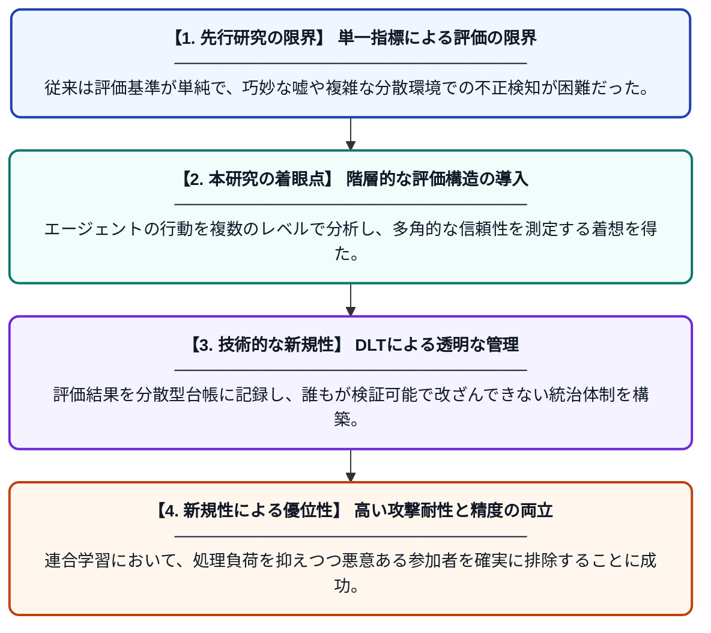

# 分散型マルチエージェントシステムにおける階層的信頼性評価：連合学習で検証されたDLTベースのガバナンスフレームワーク

**Original Title**: *Hierarchical Trustworthiness Evaluation for Distributed Multi-Agent Systems: A DLT-Based Governance Framework Evaluated in Federated Learning*

> **💡 一言要約**: DLTでAIの信頼性を守る階層型評価基盤

| 項目 | 内容 |
|---|---|
| **著者** | S Yoo, DY Kim |
| **掲載誌** | Applied Sciences 2026 |
| **アラートキーワード** | Federated Learning |
| **PDF** | [https://www.mdpi.com/2076-3417/16/22/11534/pdf](https://www.mdpi.com/2076-3417/16/22/11534/pdf) |
| **原文リンク** | [https://www.mdpi.com/2076-3417/16/22/11534/pdf](https://www.mdpi.com/2076-3417/16/22/11534/pdf) |
| **PDF版要約** | [README.pdf](./README.pdf) |

---

## 📊 新規性の図解（先行研究との違いと本研究のブレークスルー）

## 📝 要約

分散型マルチエージェントシステム（MAS）において、分散型台帳技術（DLT）を活用した階層的な信頼性評価フレームワークを提案しています。連合学習を実験の対象とし、悪意のある参加者の検知能力やシステム負荷を検証することで、中央管理者がいない環境下でのガバナンス手法を確立しました。

## ❓ どんな問題に取り組んだか

分散型システムでは、中央の管理者がいないため、悪意のある参加者が誤った情報を送信してシステム全体を破壊する攻撃を防ぐことが困難です。特に連合学習のような環境では、データのプライバシーを守りつつ、各エージェントの振る舞いが正しいかを判断する透明性の高い仕組みが不足していました。

## ✨ 何が新しい？何がすごい？（新規性）

本研究の核心は、信頼性評価を単一の指標ではなく、複数の階層（Hierarchical）で構成し、その結果を分散型台帳（DLT）に記録する点にあります。これにより、評価プロセスの改ざんを防ぎつつ、多角的なデータ分析に基づいた精緻な信頼スコアリングを実現しました。先行研究と比較して、連合学習におけるモデルの精度を維持しながら、悪意のある攻撃をより効率的に検知・排除できることを証明した点が大きな貢献です。

## 🎓 大学1年生向けの解説

「連合学習」は、みんなで協力して賢いAIを作る仕組みですが、中には嘘の情報を混ぜてAIをバカにしようとする「ずるい参加者」が紛れ込むことがあります。この研究は、ブロックチェーンのような技術（DLT）を使い、参加者一人一人の振る舞いを「多段階のテスト」で厳しくチェックする仕組みを作りました。この「通知表」のようなシステムをみんなで共有することで、嘘つきを自動で見つけ出し、安全にAIを育てることができるようになります。
