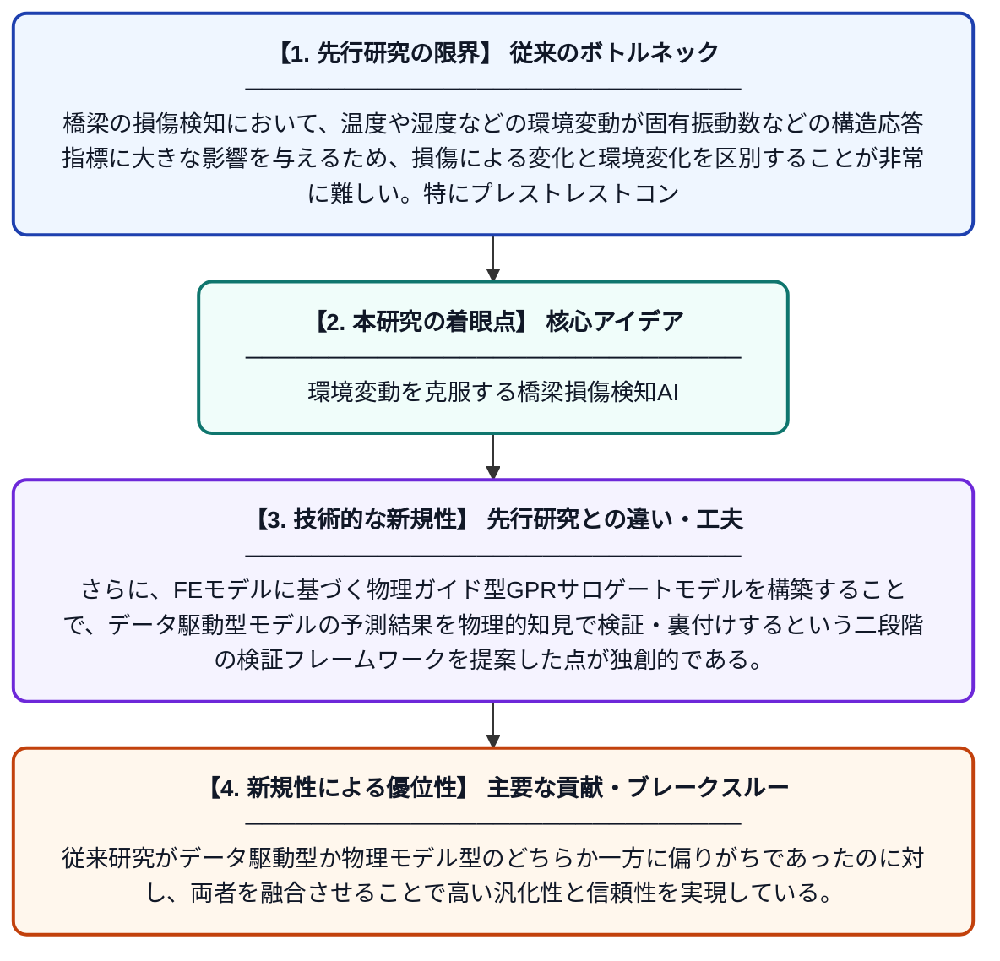

# 環境変動下における単径間プレストレストコンクリート桁橋の損傷検知：物理ガイド型サロゲートモデルで検証したガウス過程回帰の適用

**Original Title**: *Damage detection in a single-span prestressed concrete girder bridge under environmental variations using Gaussian process regression validated by physics-guided surrogate modeling*

> **💡 一言要約**: 環境変動を克服する橋梁損傷検知AI

| 項目 | 内容 |
|---|---|
| **著者** | H Ahmad, Y Matsumoto |
| **掲載誌** | Journal of Civil Structural Health Monitoring 2026 |
| **アラートキーワード** | gaussian process |
| **原文リンク** | [https://link.springer.com/article/10.1007/s13349-026-01090-5](https://link.springer.com/article/10.1007/s13349-026-01090-5) |
| **PDF版要約** | [README.pdf](./README.pdf) |

---

## 📊 新規性の図解（先行研究との違いと本研究のブレークスルー）

## 📝 要約

本研究では、環境条件（温度や湿度など）の変動が橋梁の固有振動数に与える影響を考慮しながら損傷を検知するため、ガウス過程回帰（GPR）モデルを開発した。さらに、有限要素（FE）モデルを用いた物理ガイド型GPRサロゲートモデルにより、予測結果の妥当性を検証した。これにより、環境変動と構造損傷を分離して高精度な損傷検知を実現するフレームワークを提案している。

## ❓ どんな問題に取り組んだか

橋梁の損傷検知において、温度や湿度などの環境変動が固有振動数などの構造応答指標に大きな影響を与えるため、損傷による変化と環境変化を区別することが非常に難しい。特にプレストレストコンクリート橋では、この影響が顕著であり、誤検知や検知漏れが生じるリスクがある。環境変動の影響を適切に除去・補正しなければ、信頼性の高い構造ヘルスモニタリングは実現できない。

## ✨ 何が新しい？何がすごい？（新規性）

本研究の新規性は、GPRモデルによる固有振動数予測に不確かさの定量化を組み込み、環境変動の影響を統計的に分離できる点にある。さらに、FEモデルに基づく物理ガイド型GPRサロゲートモデルを構築することで、データ駆動型モデルの予測結果を物理的知見で検証・裏付けするという二段階の検証フレームワークを提案した点が独創的である。従来研究がデータ駆動型か物理モデル型のどちらか一方に偏りがちであったのに対し、両者を融合させることで高い汎化性と信頼性を実現している。

## 🎓 大学1年生向けの解説

橋は老朽化や損傷が生じると振動の仕方（固有振動数）が変わりますが、気温の変化でも同じように振動が変わってしまうため、壊れているのか単に寒いだけなのかを区別するのが難しいです。この研究では、AIの一種である「ガウス過程回帰」を使って、気温などの環境条件から期待される振動を予測し、実際の振動とのズレで損傷を見つける方法を開発しました。さらに、コンピュータ上で橋を再現したシミュレーションモデルを使ってAIの答えが正しいか確認する仕組みも作りました。これにより、環境の影響に惑わされず、本当の損傷だけを正確に検知できるようになります。橋の安全を守るための、データとシミュレーションを組み合わせたスマートな技術です。
