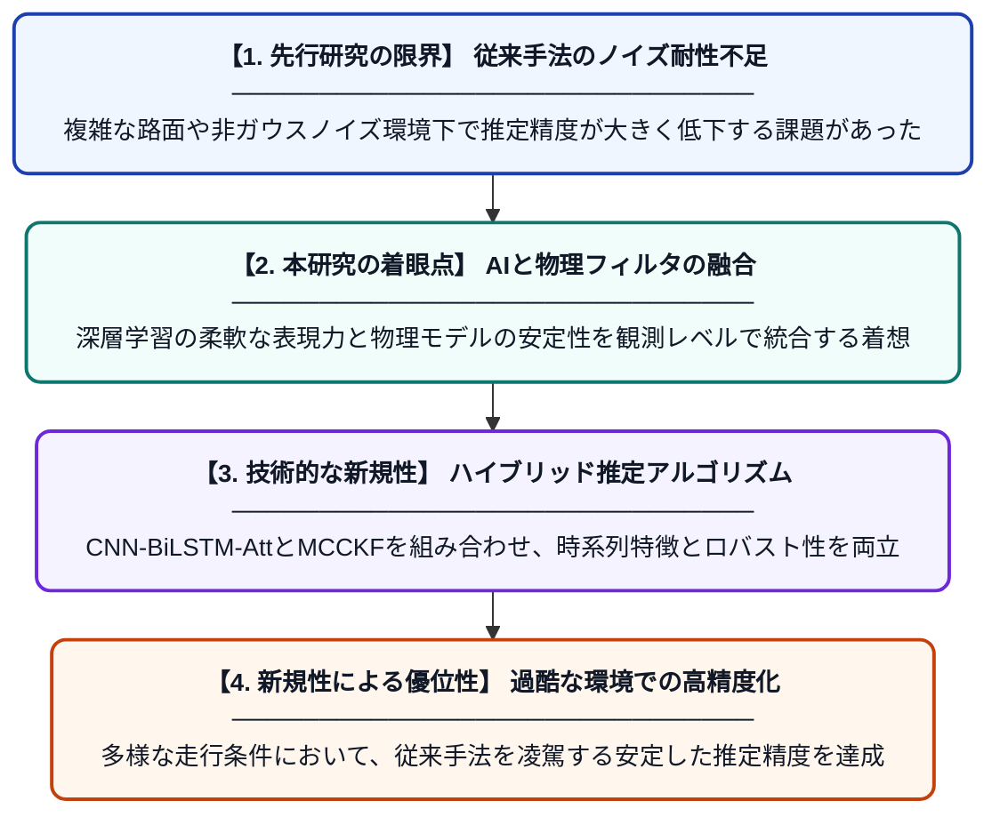

# CNN-BiLSTM-Attentionと最大コーレントロピー・キュバチュア・カルマンフィルタの観測レベル融合による車両横滑り角推定

**Original Title**: *Vehicle sideslip angle estimation via measurement-level information fusion of CNN-BiLSTM-attention and maximum correntropy cubature Kalman filtering*

> **💡 一言要約**: AIと高度なフィルタの融合で車両の横滑りを精密に推定

| 項目 | 内容 |
|---|---|
| **著者** | Q Zhang, H Wang, Y Cai, X Sun, L Chen |
| **掲載誌** | Applied Soft Computing 2026 |
| **アラートキーワード** | kalman filter |
| **原文リンク** | [https://www.sciencedirect.com/science/article/pii/S1568494626023112](https://www.sciencedirect.com/science/article/pii/S1568494626023112) |
| **PDF版要約** | [README.pdf](./README.pdf) |

---

## 📊 新規性の図解（先行研究との違いと本研究のブレークスルー）

## 📝 要約

車両の横滑り角を精密に推定するため、深層学習モデル（CNN-BiLSTM-Attention）とロバストなフィルタリング技術（MCCKF）を観測レベルで融合させた新しいフレームワークを提案しています。非線形な車両運動や複雑なノイズ環境下においても、従来の手法を上回る推定精度と安定性を実現しています。

## ❓ どんな問題に取り組んだか

自動運転や車両制御において重要な「横滑り角」は直接測定が難しく、高価なセンサーが必要です。従来の拡張カルマンフィルタ（EKF）や無香料カルマンフィルタ（UKF）を用いた推定手法では、複雑な路面状況や突発的なノイズ（非ガウスノイズ）が発生する環境で精度が著しく低下するという課題がありました。

## ✨ 何が新しい？何がすごい？（新規性）

時系列データから特徴を抽出するCNN-BiLSTMにアテンション機構を加え、さらに非ガウスノイズに強い最大コーレントロピー基準を用いたキュバチュア・カルマンフィルタ（MCCKF）を統合した点が最大の特徴です。物理モデルに基づくフィルタリングとデータ駆動型の深層学習を「観測レベル」で融合させることで、モデルの不確かさを補完しています。これにより、先行研究では困難だった動的な環境変化に対する高い堅牢性と推定精度を両立させました。

## 🎓 大学1年生向けの解説

車がカーブを曲がる際、タイヤが外側に滑る「横滑り角」という値を正しく知ることは、事故を防ぐために非常に重要です。しかし、この値は専用のセンサーが高すぎるため、車にある他のセンサーの値から計算して予測する必要があります。この論文では、AI（深層学習）に車の動きのパターンを学ばせ、さらに「計算のズレを修正する高度な数学的フィルタ」を組み合わせることで、雨の日やデコボコ道でも正確に横滑りを予測できる仕組みを開発しました。
