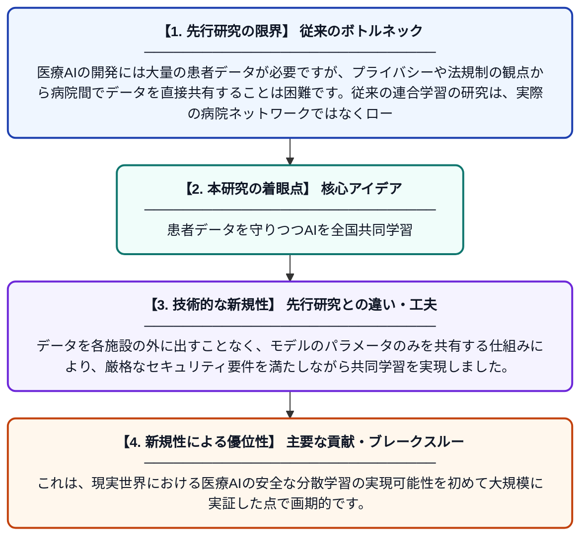

# 病理組織学のための全国規模の連合学習：ファイアウォールの背後でドイツ全土に安全に展開する

**Original Title**: *Nationwide federated learning for histopathology: secure deployment across Germany behind firewalls*

> **💡 一言要約**: 患者データを守りつつAIを全国共同学習

| 項目 | 内容 |
|---|---|
| **著者** | N Babendererde, N Lemke, J Stieber, M Fuchs, Z Weng |
| **掲載誌** | npj Digital Medicine 2026 |
| **アラートキーワード** | Federated Learning |
| **原文リンク** | [https://www.nature.com/articles/s41746-026-02958-y](https://www.nature.com/articles/s41746-026-02958-y) |
| **PDF版要約** | [README.pdf](./README.pdf) |

---

## 📊 新規性の図解（先行研究との違いと本研究のブレークスルー）

## 📝 要約

本論文は、ドイツ国内の複数の医療機関がファイアウォールを越えてデータを共有せずにAIモデルを共同学習する「連合学習（Federated Learning）」を、病理組織画像の解析に実際に展開した研究です。従来の研究がローカル環境でのシミュレーションにとどまっていたのに対し、本研究は実際のネットワーク環境での全国規模の安全な運用を実証しました。これにより、患者データのプライバシーを守りながら高精度な病理診断AIの開発が可能であることが示されました。

## ❓ どんな問題に取り組んだか

医療AIの開発には大量の患者データが必要ですが、プライバシーや法規制の観点から病院間でデータを直接共有することは困難です。従来の連合学習の研究は、実際の病院ネットワークではなくローカル環境でのシミュレーションにとどまっており、現実の運用における課題（ファイアウォール、セキュリティポリシーなど）が検証されていませんでした。

## ✨ 何が新しい？何がすごい？（新規性）

本研究の最大の新規性は、これまでシミュレーションにとどまっていた病理組織学向け連合学習を、ドイツ全国の実際の医療機関ネットワーク上でファイアウォールを越えて実運用したことです。データを各施設の外に出すことなく、モデルのパラメータのみを共有する仕組みにより、厳格なセキュリティ要件を満たしながら共同学習を実現しました。これは、現実世界における医療AIの安全な分散学習の実現可能性を初めて大規模に実証した点で画期的です。

## 🎓 大学1年生向けの解説

病気の診断に使うAIを作るには、たくさんの患者さんの画像データが必要です。でも、病院のデータは個人情報なので他の病院に送ることができません。そこで「連合学習」という技術を使います。これは、各病院でAIを学習させて、データそのものではなく「学習結果（モデルの設定値）」だけを共有してまとめるという方法です。この研究では、その仕組みをドイツ全国の本物の病院ネットワークで実際に動かすことに成功し、安全にAIを育てられることを証明しました。
