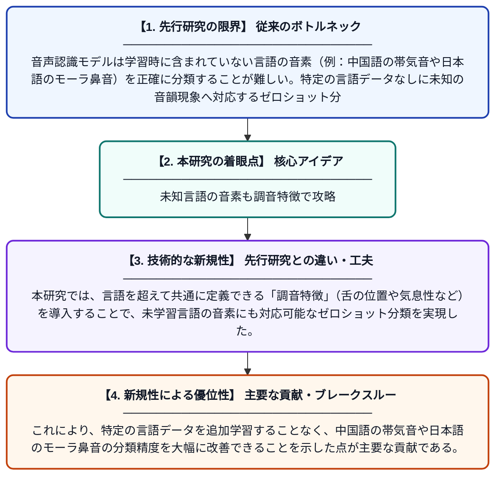

# 言語に依存しない調音特徴によるゼロショット音声分類の改善

**Original Title**: *Improving Zero-Shot Phonetic Classification through Language-Agnostic Articulatory Features*

> **💡 一言要約**: 未知言語の音素も調音特徴で攻略

| 項目 | 内容 |
|---|---|
| **著者** | R Magoshi, J Lee, S Sakai, T Kawahara |
| **掲載誌** | arXiv preprint arXiv:2607.23606 2026 |
| **アラートキーワード** | zero shot |
| **PDF** | [https://arxiv.org/pdf/2607.23606](https://arxiv.org/pdf/2607.23606) |
| **原文リンク** | [https://arxiv.org/pdf/2607.23606](https://arxiv.org/pdf/2607.23606) |
| **PDF版要約** | [README.pdf](./README.pdf) |

---

## 📊 新規性の図解（先行研究との違いと本研究のブレークスルー）

## 📝 要約

本研究では、中国語の帯気音と日本語のモーラ鼻音を対象に、ゼロショット音素分類の性能を評価した。これらの言語を除いたデータで学習した音素基盤モデル（PFM）は両タスクで精度が低いことが示されたが、言語に依存しない調音特徴を導入することでこの問題を解決しようとしている。調音特徴を活用することで、未学習言語の音素でも高精度な分類を実現できることを示した。

## ❓ どんな問題に取り組んだか

音声認識モデルは学習時に含まれていない言語の音素（例：中国語の帯気音や日本語のモーラ鼻音）を正確に分類することが難しい。特定の言語データなしに未知の音韻現象へ対応するゼロショット分類は、従来の音素ラベルベースの学習では限界があった。

## ✨ 何が新しい？何がすごい？（新規性）

従来の音素基盤モデル（PFM）はG2P（テキスト→音素変換）ラベルを用いて学習するため、学習対象外の言語固有の音韻特徴に対して脆弱であった。本研究では、言語を超えて共通に定義できる「調音特徴」（舌の位置や気息性など）を導入することで、未学習言語の音素にも対応可能なゼロショット分類を実現した。これにより、特定の言語データを追加学習することなく、中国語の帯気音や日本語のモーラ鼻音の分類精度を大幅に改善できることを示した点が主要な貢献である。

## 🎓 大学1年生向けの解説

コンピュータが音声を認識するとき、学習したことがない言語の音をうまく聞き取れないことがあります。例えば、日本語や中国語を学習データに含めないで訓練したAIは、日本語特有の「ん」の音や中国語の「息を強く吐く音」を正確に識別できません。この研究では、人間が発音するときの「舌の位置」や「息の出し方」といった体の動き（調音特徴）に着目し、これを手がかりにすることで言語が違っても音を正しく分類できるようにしました。まるで「発音の仕方」という共通ルールを使って、知らない言語の音も理解できるようにするアイデアです。
