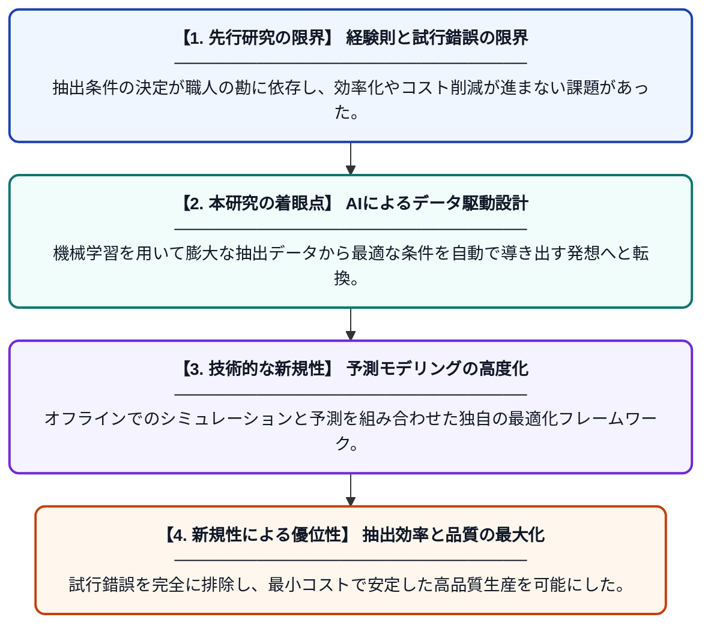

# 試行錯誤からデータ駆動型のプロセス最適化へ：植物精油抽出における人工知能の活用

**Original Title**: *From Trial-and-Error to Data-Driven Process Optimization: Artificial Intelligence in Plant Essential Oil Extraction*

> **💡 一言要約**: AIで精油抽出を効率化し、試行錯誤の時代を終わらせる

| 項目 | 内容 |
|---|---|
| **著者** | Z Jiang, H Zhao, J Ju |
| **掲載誌** | Trends in Food Science & Technology 2026 |
| **アラートキーワード** | optimization |
| **原文リンク** | [https://www.sciencedirect.com/science/article/pii/S0924224426007132](https://www.sciencedirect.com/science/article/pii/S0924224426007132) |
| **PDF版要約** | [README.pdf](./README.pdf) |

---

## 📊 新規性の図解（先行研究との違いと本研究のブレークスルー）

## 📝 要約

植物精油の抽出プロセスにおいて、従来の経験則に基づいた手法から、機械学習（ML）を用いた高度な予測と最適化への転換を論じた論文です。AI技術による大規模な予測モデリングやオフラインでのプロセス最適化が、抽出効率の向上や品質の安定化にどのように寄与するかを体系的に解説しています。

## ❓ どんな問題に取り組んだか

植物精油の抽出は、原料の個体差や複雑な環境要因に左右されるため、これまでは熟練者の経験や膨大な回数の実験（試行錯誤）に頼らざるを得ませんでした。このため、最適な抽出条件を特定するまでに多大な時間とコストがかかることが大きな課題となっていました。

## ✨ 何が新しい？何がすごい？（新規性）

本論文は、最新のAI・機械学習技術を精油抽出に統合し、大規模なデータに基づいた予測とプロセス最適化の枠組みを提示した点に新規性があります。従来の断片的な研究とは異なり、オフラインでのシミュレーションから実生産への適用までを包括的に議論しています。これにより、実験回数を最小限に抑えつつ、最高精度の抽出条件を導き出すための具体的な指針を確立しました。

## 🎓 大学1年生向けの解説

アロマオイルなどの植物精油を作るには、温度や時間をどう設定するかが重要ですが、これまでは何度も実験して「ちょうど良い条件」を探すしかありませんでした。この論文は、その大変な作業をAI（人工知能）に肩代わりさせる方法を紹介しています。AIが過去のデータを学習して「この温度ならこれだけ取れる」と予測してくれるので、無駄な実験をせずに、最高品質のオイルを賢く作れるようになります。
