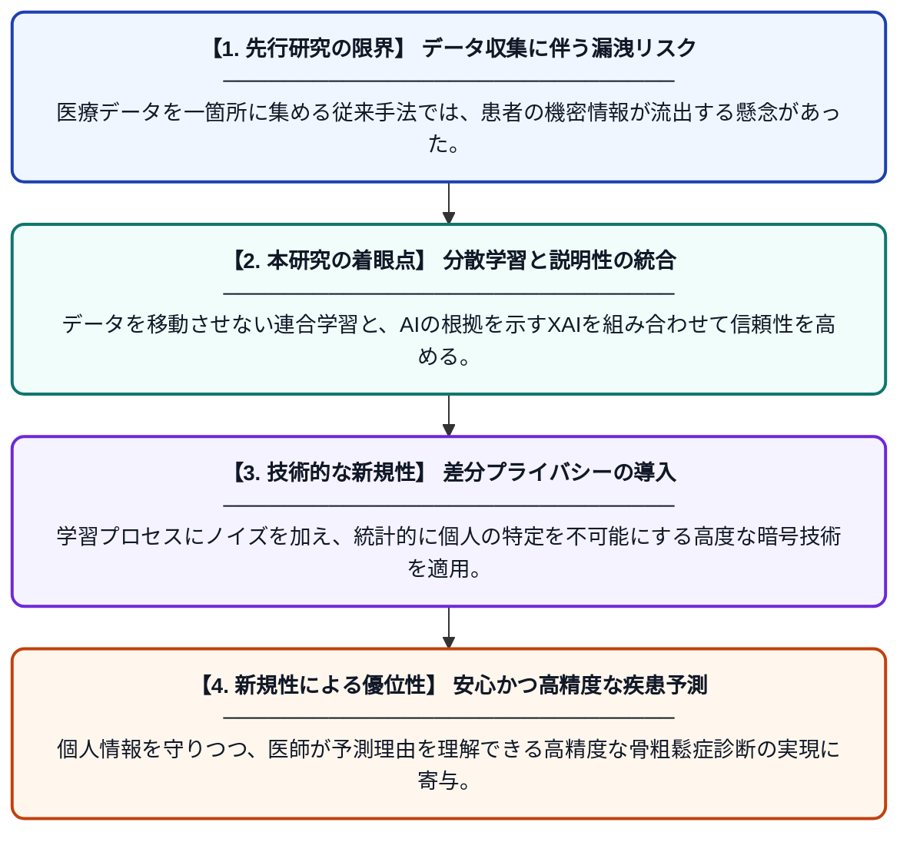

# 連合学習と説明可能なAIを用いたプライバシー保護型骨粗鬆症予測：サーベイ

**Original Title**: *Privacy-Preserving Osteoporosis Prediction using Federated Learning and Explainable AI: A Survey*

> **💡 一言要約**: プライバシーと信頼を両立する骨粗鬆症予測の羅針盤

| 項目 | 内容 |
|---|---|
| **著者** | S Ramesh, K Saruladha |
| **掲載誌** | 5th International Conference on Innovative … 2026 |
| **アラートキーワード** | differential privacy |
| **原文リンク** | [https://ieeexplore.ieee.org/abstract/document/11744774/](https://ieeexplore.ieee.org/abstract/document/11744774/) |
| **PDF版要約** | [README.pdf](./README.pdf) |

---

## 📊 新規性の図解（先行研究との違いと本研究のブレークスルー）

## 📝 要約

骨粗鬆症の早期予測において、患者の機密データを保護しつつ高精度なモデルを構築するための「連合学習」と、予測の根拠を明示する「説明可能なAI（XAI）」を統合した手法に関する包括的な調査論文です。差分プライバシーや秘密計算などの技術がどのようにデータの安全性を確保し、信頼性の高い医療診断を実現するかを整理しています。

## ❓ どんな問題に取り組んだか

医療データの活用には厳格なプライバシー保護が求められますが、従来の集中型学習ではデータ漏洩のリスクが高く、病院間のデータ共有が困難でした。また、AIの予測プロセスが「ブラックボックス」であるため、臨床現場で医師が診断の根拠を理解し、信頼することが難しいという課題がありました。

## ✨ 何が新しい？何がすごい？（新規性）

本論文は、データを一箇所に集めずに学習する「連合学習」に、数学的な匿名化を行う「差分プライバシー」と、予測理由を可視化する「説明可能なAI（XAI）」を組み合わせた最新動向を網羅的に調査しています。単なる精度向上だけでなく、医師が納得できる説明性と、患者が安心できる秘匿性を同時に確保する技術的枠組みを体系化した点が大きな貢献です。特に骨粗鬆症という疾患に特化し、安全な医療データ連携の具体的な実装ロードマップを示しています。

## 🎓 大学1年生向けの解説

病院にある患者さんのデータを外に持ち出すのは、個人情報の漏洩が心配で難しいことです。そこで、データは病院に置いたまま、AIの学習結果だけを共有する「連合学習」という仕組みが注目されています。この論文は、さらにその学習結果から個人を特定できないようにノイズを加える技術や、AIがなぜ「骨粗鬆症のリスクがある」と判断したのかを人間にわかるように説明する技術についてまとめたものです。これにより、プライバシーを守りながらも賢く、信頼できる医療AIを作ることができます。
