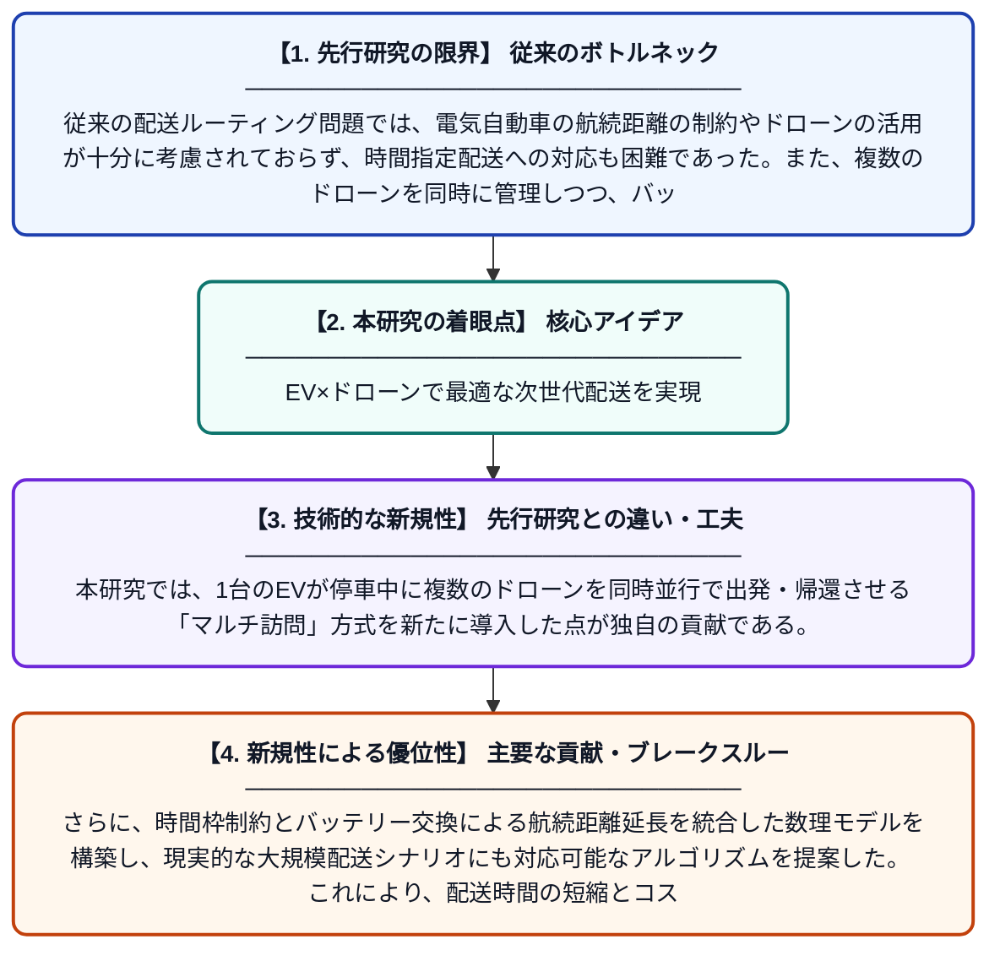

# 時間枠とバッテリー交換ステーションを考慮したマルチ訪問ドローンを搭載した電気自動車ルーティング問題

**Original Title**: *Electric vehicle routing problem with multi-visit drones considering time windows and battery swapping stations*

> **💡 一言要約**: EV×ドローンで最適な次世代配送を実現

| 項目 | 内容 |
|---|---|
| **著者** | S Meng, H Ma |
| **掲載誌** | Transportation Research Part E: Logistics and Transportation Review 2026 |
| **アラートキーワード** | VRP |
| **原文リンク** | [https://www.sciencedirect.com/science/article/pii/S136655452600445X](https://www.sciencedirect.com/science/article/pii/S136655452600445X) |
| **PDF版要約** | [README.pdf](./README.pdf) |

---

## 📊 新規性の図解（先行研究との違いと本研究のブレークスルー）

## 📝 要約

本研究では、電気自動車（EV）と複数ドローンを組み合わせた統合配送システムを対象とした車両ルーティング問題を提案している。EVが顧客拠点に停車している間に複数のドローンを同時に展開し、時間制約のある配送を行うとともに、バッテリー交換ステーションの活用も考慮している。この複雑な最適化問題に対して、効率的な解法アルゴリズムを開発し、システム全体の配送効率向上を実証した。

## ❓ どんな問題に取り組んだか

従来の配送ルーティング問題では、電気自動車の航続距離の制約やドローンの活用が十分に考慮されておらず、時間指定配送への対応も困難であった。また、複数のドローンを同時に管理しつつ、バッテリー交換ステーションの利用も組み込んだ統合的な最適化モデルは存在しなかった。これらの現実的な制約を同時に扱う問題の定式化と効率的な解法の開発が課題となっていた。

## ✨ 何が新しい？何がすごい？（新規性）

先行研究ではEVとドローンの連携を扱う場合でも、ドローンの同時複数展開やバッテリー交換ステーションを同時に考慮したモデルは存在しなかった。本研究では、1台のEVが停車中に複数のドローンを同時並行で出発・帰還させる「マルチ訪問」方式を新たに導入した点が独自の貢献である。さらに、時間枠制約とバッテリー交換による航続距離延長を統合した数理モデルを構築し、現実的な大規模配送シナリオにも対応可能なアルゴリズムを提案した。これにより、配送時間の短縮とコスト削減の両立を定量的に示した点が高く評価される。

## 🎓 大学1年生向けの解説

宅配便を届けるとき、トラックが1件ずつ家を回ると時間がかかりますよね。この研究では、電気自動車（トラック）が一か所に止まっている間に、複数のドローンを同時に飛ばして近くの家々に荷物を届けるシステムを考えました。さらに、ドローンのバッテリーが切れそうになったら途中の交換ステーションで取り替えられるようにしています。「何時までに届けてほしい」という時間の希望にも応えながら、どのルートで動けば一番効率が良いかをコンピューターで計算する方法を開発しました。この仕組みにより、配送をより速く・安く・環境にやさしく行えることを示しています。
