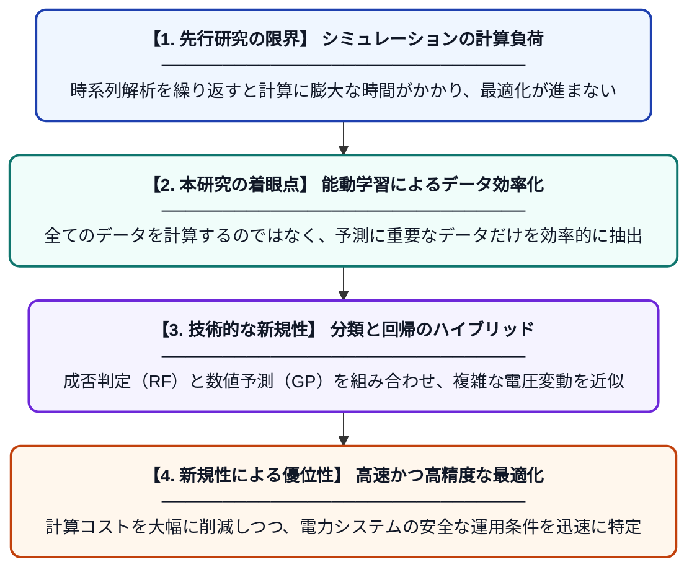

# 能動学習支援ハイブリッドサロゲートモデルに基づく複数モータの始動間隔の最適化

**Original Title**: *Starting Interval Optimization of Multiple Motors Based on an Active Learning-Assisted Hybrid Surrogate Model*

> **💡 一言要約**: AIで複数モータの最適な始動タイミングを高速特定

| 項目 | 内容 |
|---|---|
| **著者** | W Han, Q Yu, D Ren, X Song |
| **掲載誌** | 6th International Conference on Energy, Power … 2026 |
| **アラートキーワード** | gaussian process |
| **原文リンク** | [https://ieeexplore.ieee.org/abstract/document/11754798/](https://ieeexplore.ieee.org/abstract/document/11754798/) |
| **PDF版要約** | [README.pdf](./README.pdf) |

---

## 📊 新規性の図解（先行研究との違いと本研究のブレークスルー）

## 📝 要約

複数のモータを順次始動させる際の電圧低下を抑制し、最適な始動間隔を効率的に算出する手法を提案しています。計算負荷の高い時系列シミュレーションの代わりに、ランダムフォレストとガウス過程回帰を組み合わせたAIモデル（サロゲートモデル）を用いることで、高速かつ高精度な最適化を実現しました。

## ❓ どんな問題に取り組んだか

大型モータを複数始動する際、大きな始動電流による電圧低下（電圧サグ）がシステムの安定性を脅かすため、適切な始動間隔の設定が不可欠です。しかし、従来のMATLAB/Simulinkを用いた時系列シミュレーションは計算コストが極めて高く、最適解を見つけるために膨大な時間を要するという課題がありました。

## ✨ 何が新しい？何がすごい？（新規性）

本研究の新規性は、能動学習を取り入れた「ハイブリッドサロゲートモデル」を構築した点にあります。具体的には、ランダムフォレストで始動の成否や電圧安全性を分類し、切断ガウス過程回帰で具体的な電圧挙動を予測する二段構えの構成を採用しました。これにより、少ないサンプル数で複雑な電力システムの挙動を模倣でき、従来のシミュレーションに依存する手法よりも劇的に計算時間を短縮しながら、高い予測精度を維持することに成功しました。

## 🎓 大学1年生向けの解説

工場などで大きなモーターをいくつも動かす時、一斉にスイッチを入れると一気に電気が使われてしまい、電圧が下がって機械が止まったり故障したりする原因になります。そのため、モーターを回すタイミングを少しずつずらす必要がありますが、その「ちょうど良い秒数」を計算するのは、これまではスーパーコンピュータのような計算が必要なほど大変でした。この研究では、AIに「どんな時に失敗しやすいか」を賢く学習させることで、計算の手間を大幅に減らし、安全で最適なスイッチを入れるタイミングを素早く見つける方法を開発しました。
