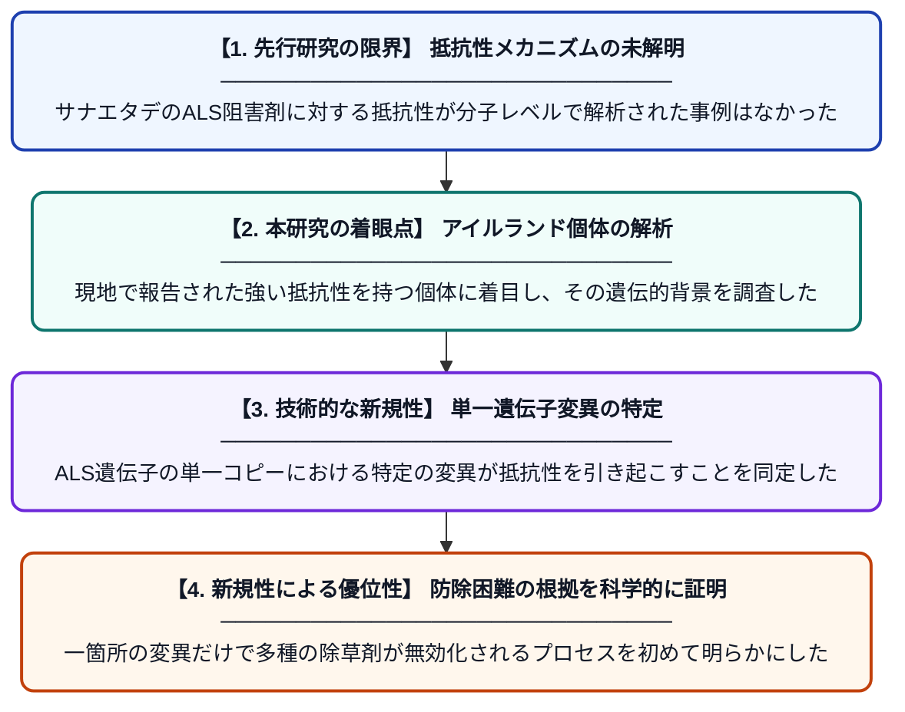

# アイルランドにおけるALS阻害剤抵抗性サナエタデの特性評価

**Original Title**: *Characterisation of ALS inhibitor resistant Persicaria lapathifolia from Ireland*

> **💡 一言要約**: 雑草サナエタデの除草剤抵抗性を分子レベルで初解明

| 項目 | 内容 |
|---|---|
| **著者** | I Vijayakumar, GG Crisan, F Runge, J Carroll… |
| **アラートキーワード** | ALS |
| **PDF** | [https://www.researchgate.net/profile/Vijaya-Bhaskar-Av/publication/418161808_Characterisation_of_ALS_inhibitor_resistant_Persicaria_lapathifolia_from_Ireland/links/6b014f0648544d044010afd4/Characterisation-of-ALS-inhibitor-resistant-Persicaria-lapathifolia-from-Ireland.pdf](https://www.researchgate.net/profile/Vijaya-Bhaskar-Av/publication/418161808_Characterisation_of_ALS_inhibitor_resistant_Persicaria_lapathifolia_from_Ireland/links/6b014f0648544d044010afd4/Characterisation-of-ALS-inhibitor-resistant-Persicaria-lapathifolia-from-Ireland.pdf) |
| **原文リンク** | [https://www.researchgate.net/profile/Vijaya-Bhaskar-Av/publication/418161808_Characterisation_of_ALS_inhibitor_resistant_Persicaria_lapathifolia_from_Ireland/links/6b014f0648544d044010afd4/Characterisation-of-ALS-inhibitor-resistant-Persicaria-lapathifolia-from-Ireland.pdf](https://www.researchgate.net/profile/Vijaya-Bhaskar-Av/publication/418161808_Characterisation_of_ALS_inhibitor_resistant_Persicaria_lapathifolia_from_Ireland/links/6b014f0648544d044010afd4/Characterisation-of-ALS-inhibitor-resistant-Persicaria-lapathifolia-from-Ireland.pdf) |
| **PDF版要約** | [README.pdf](./README.pdf) |

---

## 📊 新規性の図解（先行研究との違いと本研究のブレークスルー）

## 📝 要約

アイルランドで採取されたサナエタデ（Persicaria lapathifolia）が、広範囲のALS阻害型除草剤に対して強い抵抗性を持っていることを明らかにしました。分子レベルの解析により、ALS遺伝子内の特定の標的部位変異（TSR）がこの抵抗性の原因であることを世界で初めて特定しました。

## ❓ どんな問題に取り組んだか

農業において深刻な雑草であるサナエタデが、主要な除草剤であるALS阻害剤に対して効きにくくなっている現象がアイルランドで報告されていました。しかし、その抵抗性がどのような遺伝的メカニズムによって引き起こされているのか、その具体的な原因はこれまで不明でした。

## ✨ 何が新しい？何がすごい？（新規性）

本研究は、サナエタデにおけるALS抵抗性の分子的な特性を世界で初めて明らかにしました。特に、ALS遺伝子の複数のコピーのうち、わずか1つのコピーに特定の変異が生じるだけで、広範な除草剤に対する高い抵抗性が付与されることを実証した点が極めて重要です。これにより、単一の遺伝子変異が雑草の防除をいかに困難にするかを科学的に裏付けました。

## 🎓 大学1年生向けの解説

農家が雑草を枯らすために使う「除草剤」が効かない、進化を遂げた雑草がアイルランドで見つかりました。この研究では、その雑草の遺伝子を詳しく調べることで、薬が効かなくなった原因（遺伝子の変化）を突き止めました。人間で例えると、特定の鍵穴の形が変わってしまったために、除草剤という「鍵」が刺さらなくなった状態です。この仕組みを理解することは、将来新しい除草剤を開発したり、効率的な農業を守るために欠かせないステップです。
