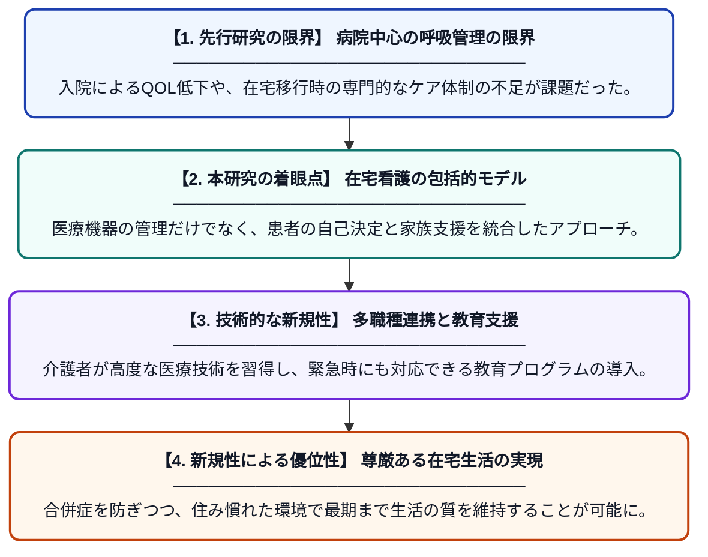

# 進行期筋萎縮性側索硬化症（ALS）における在宅人工呼吸管理

**Original Title**: *Home ventilation in advanced amyotrophic lateral sclerosis*

> **💡 一言要約**: ALS患者の呼吸と生活を支える在宅ケアの最前線

| 項目 | 内容 |
|---|---|
| **著者** | G Martins, LSAD Silva |
| **掲載誌** | Nursing (Ed. bras., Impr.) 2026 |
| **アラートキーワード** | ALS |
| **原文リンク** | [https://pesquisa.bvsalud.org/portal/resource/pt/biblio-1714983](https://pesquisa.bvsalud.org/portal/resource/pt/biblio-1714983) |
| **PDF版要約** | [README.pdf](./README.pdf) |

---

## 📊 新規性の図解（先行研究との違いと本研究のブレークスルー）

## 📝 要約

筋萎縮性側索硬化症（ALS）の進行に伴い不可避となる呼吸筋不全に対し、在宅での人工呼吸器管理の重要性と看護ケアの在り方を論じています。患者の生活の質（QOL）向上と生存期間の延長を目指し、多職種連携による包括的な支援体制を提示しています。

## ❓ どんな問題に取り組んだか

ALS進行期の呼吸不全は最大の死因ですが、住み慣れた自宅で人工呼吸器を使いながら生活を継続するためのケア体制が十分に確立されていませんでした。患者と家族にかかる身体的・精神的な負担を軽減し、安全に管理を継続することが急務となっています。

## ✨ 何が新しい？何がすごい？（新規性）

本研究は、高度な医療機器を自宅で運用する際の看護介入に焦点を当て、臨床現場と家庭を繋ぐ具体的なプロトコルを提案しています。単なる延命処置ではなく、患者の意思決定と家族のケア能力向上を組み合わせた多角的な支援モデルを構築した点が画期的です。最新の看護実践に基づき、在宅環境特有のリスク管理と心理的サポートを体系化しました。

## 🎓 大学1年生向けの解説

ALSという病気は、次第に筋肉が動かなくなり、最後には自分で息をすることが難しくなります。この論文は、病院ではなく自分の家で人工呼吸器を使って生活するための方法を解説したものです。機械の使い方だけでなく、患者さんや家族が安心して暮らすための心のケアや、看護師さんの役割について詳しく書かれています。これを知ることで、重い病気があっても自分らしく生きるための助け合いの形がわかります。
