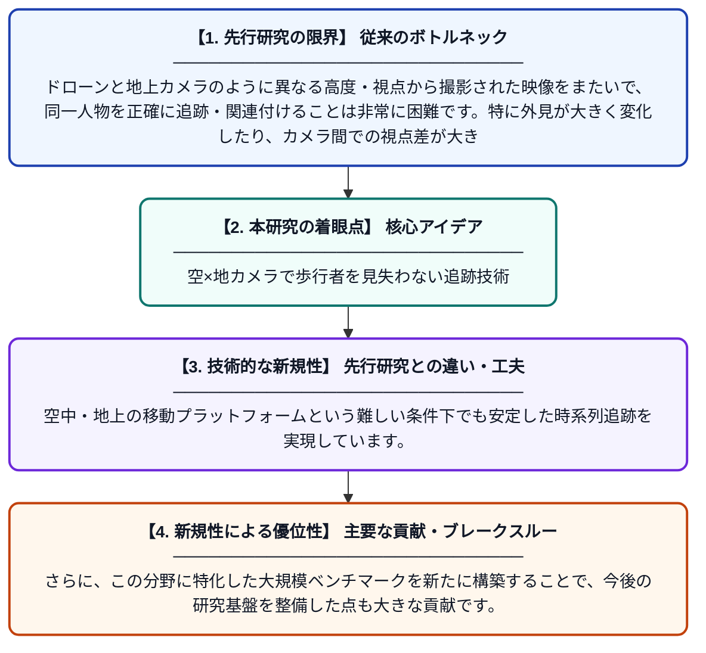

# 外見を超えて：モバイル空中・地上プラットフォームにおける歩行者関連付けと追跡のためのマルチキューフレームワークと大規模ベンチマーク

**Original Title**: *Beyond Appearance: A Multi-cue Framework and Large-scale Benchmark for Pedestrian Association and Tracking on Mobile Aerial-Ground Platforms*

> **💡 一言要約**: 空×地カメラで歩行者を見失わない追跡技術

| 項目 | 内容 |
|---|---|
| **著者** | R Wu, B Jiao, R Han, H Yu, X Jiang, S Wang, Y Hu |
| **掲載誌** | arXiv preprint arXiv:2607.23803 2026 |
| **アラートキーワード** | Multi Camera Tracking |
| **PDF** | [https://arxiv.org/pdf/2607.23803](https://arxiv.org/pdf/2607.23803) |
| **Git リポジトリ** | [https://github.com/ultralytics/ultralytics](https://github.com/ultralytics/ultralytics) |
| **原文リンク** | [https://arxiv.org/pdf/2607.23803](https://arxiv.org/pdf/2607.23803) |
| **PDF版要約** | [README.pdf](./README.pdf) |

---

## 📊 新規性の図解（先行研究との違いと本研究のブレークスルー）

## 📝 要約

本論文では、空中（ドローン等）と地上カメラを組み合わせたマルチビュー・マルチオブジェクト追跡のためのFUSIONフレームワークを提案しています。外見情報だけでなく複数の手がかり（マルチキュー）を適応的に統合することで、異なる視点からの歩行者を安定して追跡・関連付けることを実現しています。さらに、この研究を支える大規模ベンチマークデータセットも構築・公開しています。

## ❓ どんな問題に取り組んだか

ドローンと地上カメラのように異なる高度・視点から撮影された映像をまたいで、同一人物を正確に追跡・関連付けることは非常に困難です。特に外見が大きく変化したり、カメラ間での視点差が大きい場合、見た目だけの特徴量では対応関係の推定が破綻しやすいという課題がありました。また、この問題を評価するための大規模かつ現実的なベンチマークも不足していました。

## ✨ 何が新しい？何がすごい？（新規性）

従来手法が主に外見（見た目）特徴に依存していたのに対し、本研究はマルチキュー適応型アーキテクチャ（Multi-cue Adaptive）を導入し、外見以外の複数の補助的手がかりを柔軟に組み合わせる点が革新的です。空中・地上の移動プラットフォームという難しい条件下でも安定した時系列追跡を実現しています。さらに、この分野に特化した大規模ベンチマークを新たに構築することで、今後の研究基盤を整備した点も大きな貢献です。

## 🎓 大学1年生向けの解説

ドローンと地上のカメラを同時に使って、たくさんの人を追いかける技術の研究です。普通のカメラ追跡は「見た目」だけで人を識別しますが、角度や距離が違うと同じ人でも全然違って見えてしまいます。この研究では「見た目」以外にも複数の情報を組み合わせることで、より正確に人を追跡できるようにしました。また、この技術を正しく評価するための大きなデータセット（テスト素材集）も作りました。将来的には、防災・警備・自動運転など多くの場面で役立てられることが期待されます。
