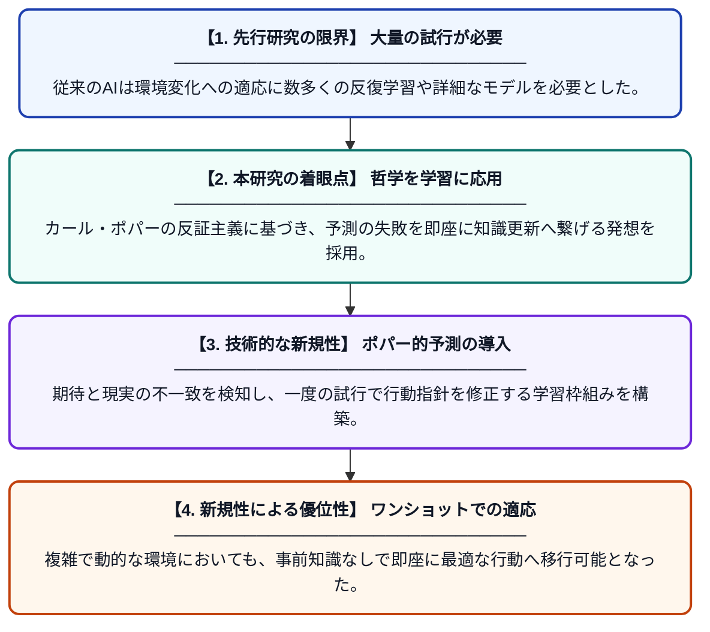

# 動的な環境におけるワンショット適応のためのポパー的予測

**Original Title**: *Popperian Expectations for One-Shot Adaptation in Dynamic Environments*

> **💡 一言要約**: 失敗から即座に学ぶ「ポパー的予測」で高速適応！

| 項目 | 内容 |
|---|---|
| **著者** | JRE Mills, PR Lewis |
| **掲載誌** | IEEE International Conference on Autonomic … 2026 |
| **アラートキーワード** | one shot |
| **原文リンク** | [https://ieeexplore.ieee.org/abstract/document/11767909/](https://ieeexplore.ieee.org/abstract/document/11767909/) |
| **PDF版要約** | [README.pdf](./README.pdf) |

---

## 📊 新規性の図解（先行研究との違いと本研究のブレークスルー）

## 📝 要約

複雑で変化の激しい環境において、AIエージェントが一度の試行で適応する「ワンショット適応」を実現する手法を提案しています。哲学者カール・ポパーの反証主義に基づき、予測が外れた瞬間に知識を修正する「ポパー的予測」を導入し、その有効性を検証しています。

## ❓ どんな問題に取り組んだか

従来の学習手法は、環境に適応するために大量のデータや繰り返しの試行錯誤、あるいは詳細な環境モデルを必要とします。しかし、一度の機会で未知の変化に対応しなければならない「ワンショット適応」が求められる複雑な動的環境では、これまでの手法は非効率で対応が困難でした。

## ✨ 何が新しい？何がすごい？（新規性）

科学哲学者カール・ポパーの「反証可能性」の概念をエージェントの予測モデルに応用し、期待と現実の乖離をトリガーに知識を更新する枠組みを提案した点が独創的です。単なる統計的な学習ではなく、仮説の棄却と更新という科学的なプロセスを組み込むことで、複雑なタスクにおける適応速度を飛躍的に向上させました。複数の学習パラダイムとの比較を通じて、未知の環境変化に対する堅牢性と即時性を実証しています。

## 🎓 大学1年生向けの解説

AIが新しい環境に放り出されたとき、普通は何度も失敗して学習しますが、この研究では「一度の失敗」で即座に適応することを目指しています。科学者が実験をして「予想が外れたから今の理論は間違いだ」と判断して新しい理論を作るのと同じ仕組みをAIに持たせました。これを「ポパー的予測」と呼び、予想外のことが起きた瞬間に頭の中の地図を書き換えます。この方法により、目まぐるしく変わる世界でもAIが立ち止まらずに賢く動けるようになります。
