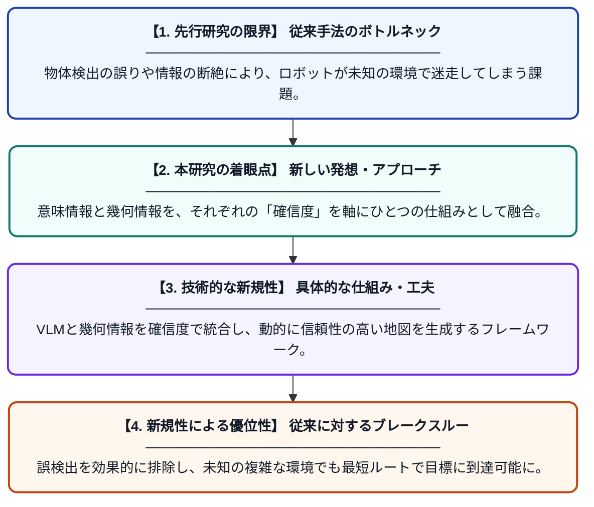

# CSG-Nav：ロバストな探索と高精度なゼロショット物体目標ナビゲーションのための確信度を考慮した意味・幾何融合

**Original Title**: *CSG-Nav: Confidence-Aware Semantic-Geometric Fusion for Robust Exploration and Accurate Zero-Shot Object-Goal Navigation*

> **💡 一言要約**: 確信度ベースの融合で未知の場所でも迷わず目標に到達

| 項目 | 内容 |
|---|---|
| **著者** | S Chen, R Xu, Z Wu, K Zhang, T Huang, Z Liu, Q Li |
| **掲載誌** | Information Fusion 2026 |
| **アラートキーワード** | Open-Vocabulary Object ... |
| **原文リンク** | [https://www.sciencedirect.com/science/article/pii/S1566253526008134](https://www.sciencedirect.com/science/article/pii/S1566253526008134) |
| **PDF版要約** | [README.pdf](./README.pdf) |

---

## 📊 新規性の図解（先行研究との違いと本研究のブレークスルー）

## 📝 要約

未知の環境で特定の物体を探すゼロショット物体目標ナビゲーションにおいて、意味情報と幾何情報を確信度に基づいて統合する手法「CSG-Nav」を提案しました。物体検出、情景理解、構造化言語などの多様な情報を統合することで、効率的な探索と高精度な目標到達を実現しています。

## ❓ どんな問題に取り組んだか

従来のゼロショットナビゲーションでは、物体検出の誤りや環境理解の不完全さにより、ロボットが効率的に探索できなかったり目標を見落としたりする課題がありました。また、意味的なヒントと物理的な地図情報を最適に組み合わせる標準的な枠組みが不足していました。

## ✨ 何が新しい？何がすごい？（新規性）

本研究は、認識、マッピング、計画、検証を独立した段階として扱うのではなく、確信度に基づいた異種情報の統合フレームワークを構築しました。オープン語彙の物体検出や視覚言語モデル（VLM）からの証拠を幾何学的な地図情報と密に連携させることで、ノイズに強く論理的な探索を可能にしています。これにより、先行研究と比較して探索の効率性と物体特定後の検証精度が大幅に向上しました。

## 🎓 大学1年生向けの解説

ロボットに「冷蔵庫を探して」と頼むとき、ロボットは初めての家でも効率よく動く必要があります。この研究では、カメラで見えたものの「確からしさ」を計算し、部屋の形と「キッチンにありそう」という知識を賢く組み合わせる技術を開発しました。これにより、ロボットが間違った情報を信じて迷うのを防ぎ、より確実に目的の場所へたどり着けるようになります。最新のAIを使って、人間のように柔軟に考えて動くロボットの実現を目指しています。
