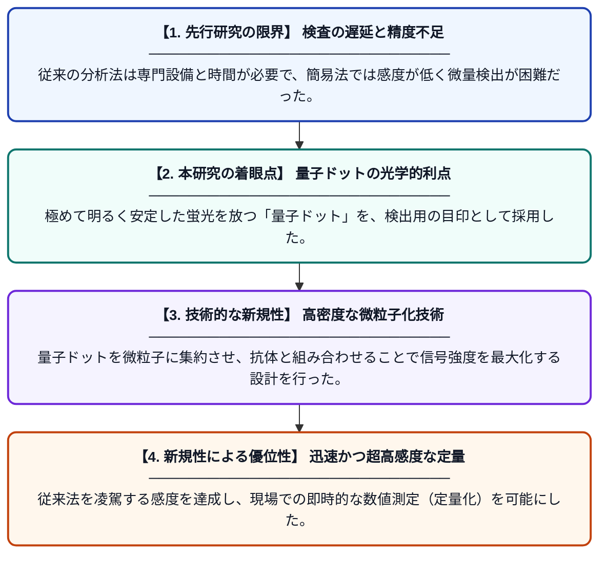

# 量子ドット微粒子を用いた免疫クロマトグラフィー法による動物組織中のアジスロマイシンの迅速・定量的な検出

**Original Title**: *Rapid quantitative detection of azithromycin in animal tissues by quantum-dot microsphere-based immunochromatographic assay.*

> **💡 一言要約**: 量子ドットで食肉の残留抗菌薬を素早く正確に検知

| 項目 | 内容 |
|---|---|
| **著者** | Z Huang, K Luo, Q Mi, H He, L Jin, S Gao, X Yu |
| **掲載誌** | 2026 |
| **アラートキーワード** | ICA |
| **原文リンク** | [https://www.cabidigitallibrary.org/doi/full/10.5555/20260540983](https://www.cabidigitallibrary.org/doi/full/10.5555/20260540983) |
| **PDF版要約** | [README.pdf](./README.pdf) |

---

## 📊 新規性の図解（先行研究との違いと本研究のブレークスルー）

## 📝 要約

動物組織に含まれる抗生物質「アジスロマイシン」を迅速かつ高精度に測定するため、量子ドット微粒子を利用した新しい検査法（QMs-ICA）を確立しました。この手法は高い感度と特異性を備えており、食の安全を守るための現場での薬物残留検査に大きく貢献します。

## ❓ どんな問題に取り組んだか

食肉などの動物組織に残るアジスロマイシンは、耐性菌の発生や健康被害のリスクがあるため厳格な管理が必要です。しかし、従来の検査法は分析に時間がかかるか、精度が不十分であるという課題があり、現場で手軽かつ正確に測定できる技術が求められていました。

## ✨ 何が新しい？何がすごい？（新規性）

本研究の最大の特徴は、非常に強力な発光特性を持つ量子ドット微粒子を免疫クロマトグラフィー（迅速検査キットの原理）に統合した点にあります。従来の金コロイド法に比べて検出感度が劇的に向上しており、複雑な前処理を最小限に抑えつつ極微量の薬物を定量化することに成功しました。これにより、専門設備がない環境でも迅速性と高精度を両立したモニタリングが可能です。

## 🎓 大学1年生向けの解説

私たちが食べるお肉に薬（抗生物質）が残っていないか調べることは、健康を守るためにとても重要です。この研究では、キラキラと光る「量子ドット」という非常に小さな粒を使い、お肉の中の薬をわずかな量でも見つけ出せる新しい検査チップを作りました。これを使えば、難しい機械を使わなくても、新型コロナの検査キットのように数分で、正確に薬の量を測ることができます。
