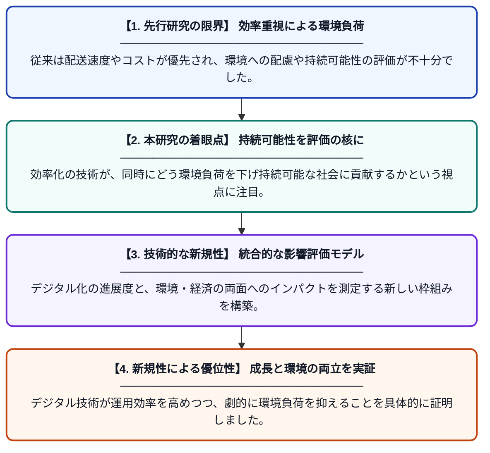

# デジタル技術が物流システムの持続可能な発展と効率性に与える影響の評価

**Original Title**: *Assessing the Impact of Digital Technologies on the Sustainable Development and Efficiency of Logistics Systems*

> **💡 一言要約**: デジタル化が物流の効率と環境性能を劇的に向上

| 項目 | 内容 |
|---|---|
| **著者** | M Taghizadeh |
| **掲載誌** | … Business Growth and Development (SBGD) … 2026 |
| **アラートキーワード** | logistics |
| **原文リンク** | [https://www.econstor.eu/handle/10419/344641](https://www.econstor.eu/handle/10419/344641) |
| **PDF版要約** | [README.pdf](./README.pdf) |

---

## 📊 新規性の図解（先行研究との違いと本研究のブレークスルー）

## 📝 要約

本研究は、デジタル技術の導入が物流システムの運用効率と持続可能な発展にどのような変革をもたらすかを包括的に分析しています。最新のサプライチェーン管理におけるテクノロジーの効果を検証し、環境負荷の低減と経済的利益を両立させる可能性を明らかにしました。

## ❓ どんな問題に取り組んだか

従来の物流システムは効率性の追求が優先され、環境負荷の低減や長期的な持続可能性との両立が大きな課題となっていました。また、デジタル技術が具体的にどの程度の規模で持続可能な発展に寄与しているかを定量的かつ包括的に評価する手法が不足していました。

## ✨ 何が新しい？何がすごい？（新規性）

本研究は、単なるコスト削減や速度向上といった指標を超え、「持続可能性」をデジタル技術評価の主軸に据えた点が非常に先進的です。物流の全プロセスにおけるデータの透明化が、CO2排出削減や資源最適化に直結することを具体的に示しています。先行研究が個別技術の導入効果に留まる中、システム全体としての長期的な発展性を評価した点が大きな貢献です。

## 🎓 大学1年生向けの解説

私たちがネットで買い物をしたときに荷物が届く仕組み（物流）を、最新のIT技術を使ってどう進化させるかを調べた研究です。例えばAIやロボットを使うと、荷物が早く届くだけでなく、トラックの無駄な走行が減り、地球に優しいクリーンな物流が実現できます。この論文は、デジタル技術が未来の物流を「便利」と「エコ」の両面でどう支えていくかをわかりやすく解説しています。
