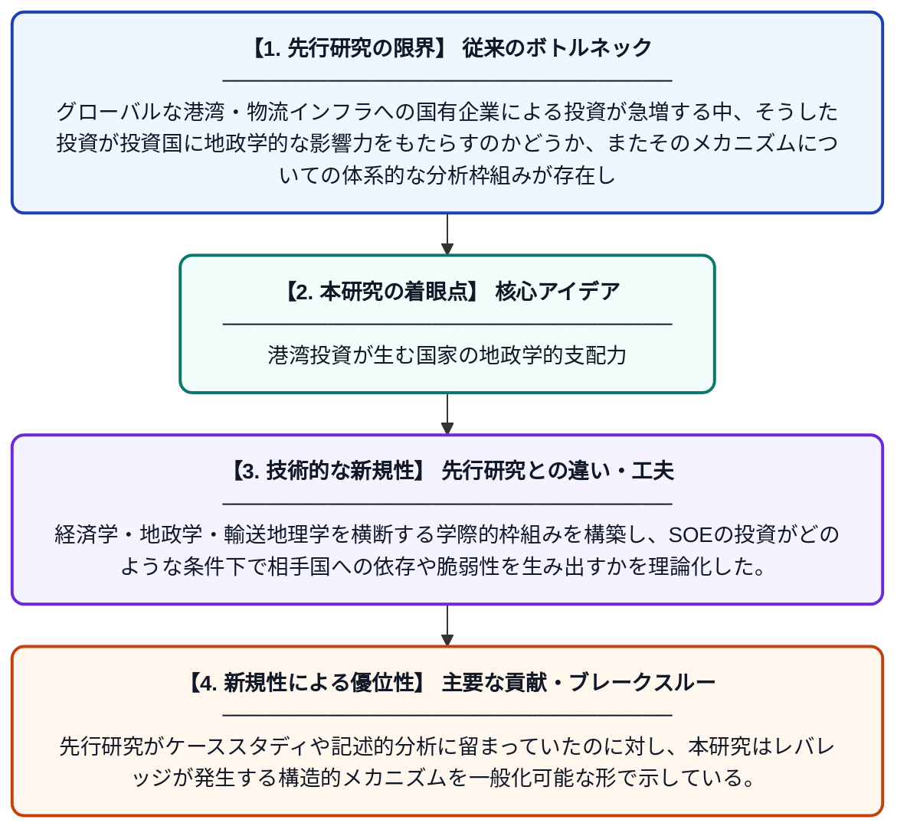

# 国有企業の港湾・海運物流への国際投資を通じて国家は地政学的レバレッジを獲得するか？

**Original Title**: *Do States develop geopolitical leverage through the international activities of State-Owned Enterprises (SOEs) in ports and maritime logistics?*

> **💡 一言要約**: 港湾投資が生む国家の地政学的支配力

| 項目 | 内容 |
|---|---|
| **著者** | PW de Langen, AA Pallis |
| **掲載誌** | Journal of Transport Geography 2026 |
| **アラートキーワード** | logistics |
| **原文リンク** | [https://www.sciencedirect.com/science/article/pii/S0966692326002371](https://www.sciencedirect.com/science/article/pii/S0966692326002371) |
| **PDF版要約** | [README.pdf](./README.pdf) |

---

## 📊 新規性の図解（先行研究との違いと本研究のブレークスルー）

## 📝 要約

本研究は、国有企業（SOE）が港湾・海運物流分野に行う国際投資を通じて、投資国が他国に対してどのような「影響力（レバレッジ）」を持つかを分析する概念的枠組みを構築した。海上拠点は戦略的インフラであるため、SOEによる投資は単なる経済活動にとどまらず、地政学的な力の行使手段となり得ることを示している。この枠組みは、中国などの国家主導型投資が国際港湾市場でどのように機能するかを理解するための理論的基盤を提供する。

## ❓ どんな問題に取り組んだか

グローバルな港湾・物流インフラへの国有企業による投資が急増する中、そうした投資が投資国に地政学的な影響力をもたらすのかどうか、またそのメカニズムについての体系的な分析枠組みが存在しなかった。特に中国系SOEによる港湾への大規模投資は国際社会で懸念を呼んでいるが、「影響力」がいつ・どのように生じるのかを論理的に整理した研究は乏しかった。

## ✨ 何が新しい？何がすごい？（新規性）

本研究は「レバレッジ（影響力を及ぼす能力）」という概念を港湾・海運物流の国際投資分析に初めて体系的に適用した点が新しい。経済学・地政学・輸送地理学を横断する学際的枠組みを構築し、SOEの投資がどのような条件下で相手国への依存や脆弱性を生み出すかを理論化した。先行研究がケーススタディや記述的分析に留まっていたのに対し、本研究はレバレッジが発生する構造的メカニズムを一般化可能な形で示している。

## 🎓 大学1年生向けの解説

国が持つ企業（国有企業）が外国の港や海の運送会社に投資すると、その国は相手国に対して「影響力」を持てるかもしれません。たとえば、ある国の重要な港を別の国の国有企業が運営していると、貿易や物流を人質にした交渉ができてしまう可能性があります。この論文は「どういう条件のときに、そんな影響力が生まれるのか」を整理するための考え方の틀（フレームワーク）を作りました。中国が世界中の港に投資していることが話題になっていますが、その背景にある地政学的な問題を分析するのに役立つ研究です。
