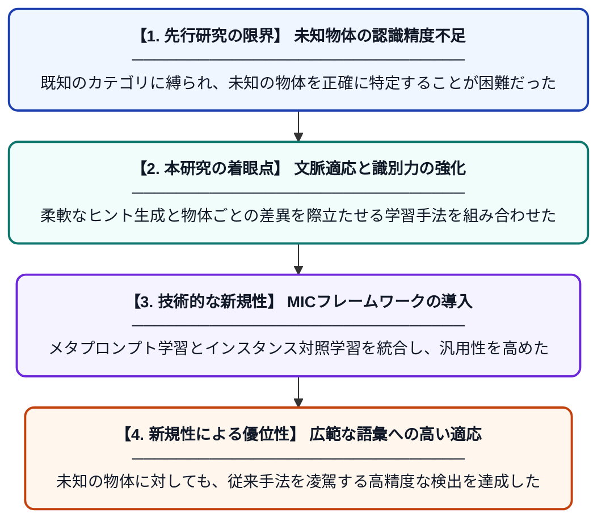

# 未知の物体を認識・生成する大規模深層モデルの構築に向けて

**Original Title**: *Towards Large-Scale Deep Models for Out-of-distribution Visual Perception and Generation*

> **💡 一言要約**: 未知の物体も正確に捉える新世代AI「MIC」

| 項目 | 内容 |
|---|---|
| **著者** | Z Wang |
| **掲載誌** | 2026 |
| **アラートキーワード** | Open-Vocabulary Object ... |
| **原文リンク** | [https://search.proquest.com/openview/0897d0b6dacb1dcaa6a9fe9d16c044e1/1?pq-origsite=gscholar&cbl=2026366&diss=y](https://search.proquest.com/openview/0897d0b6dacb1dcaa6a9fe9d16c044e1/1?pq-origsite=gscholar&cbl=2026366&diss=y) |
| **PDF版要約** | [README.pdf](./README.pdf) |

---

## 📊 新規性の図解（先行研究との違いと本研究のブレークスルー）

## 📝 要約

本論文は、学習データに含まれない未知の物体を検出するオープン語彙物体検出（Open-vocabulary object detection）のための新フレームワーク「MIC」を提案しています。メタプロンプト学習とインスタンス対照学習という2つの主要な手法を導入することで、未知のカテゴリに対する認識精度を大幅に向上させています。

## ❓ どんな問題に取り組んだか

従来の物体検出モデルは、学習時に与えられた特定のカテゴリしか認識できず、未知の物体に遭遇した際に精度が著しく低下するという課題がありました。大規模モデルを活用しても、新しい物体の特徴を既存の知識とうまく結びつけて識別する適応能力が不足していました。

## ✨ 何が新しい？何がすごい？（新規性）

本研究の最大の新規性は、メタプロンプト学習とインスタンス対照学習を統合した「MIC」フレームワークを開発した点です。メタプロンプトは文脈に応じて柔軟に特徴を抽出する役割を担い、インスタンス対照学習は個別の物体間の差異をより詳細に学習することを可能にします。これにより、先行研究よりも広範な語彙に対して高い汎用性と識別能力を実現しました。

## 🎓 大学1年生向けの解説

これまでのAIは、あらかじめ教えられた特定のモノ（犬や猫など）しか見つけることができませんでした。この研究では、教わっていない新しい種類の物体が出てきても、それを賢く推測して見つけ出す「MIC」という新しい仕組みを作りました。これは「賢いヒント（プロンプト）」をAIに与えつつ、物体の細かい違いを比べる練習をさせる手法です。このおかげで、AIは初めて見るものでも人間に近い感覚で認識できるようになります。
