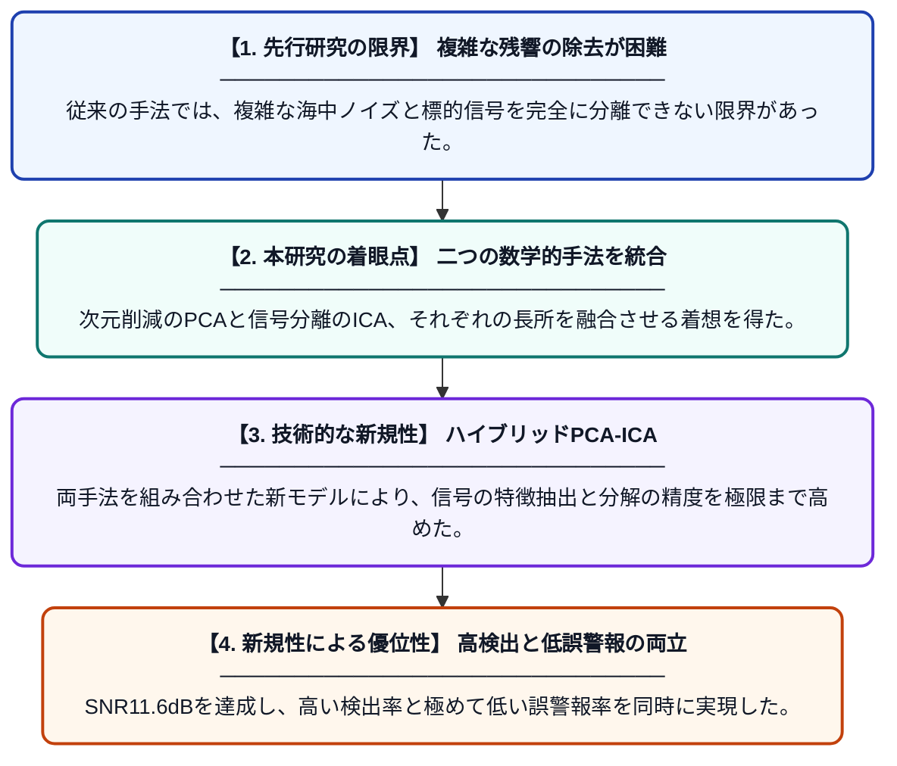

# アクティブソナーの残響抑制のための新しいハイブリッドPCA-ICAモデルを用いた信号分解技術の比較分析

**Original Title**: *A Comparative Analysis of Signal Decomposition Techniques with a Novel Hybrid PCA-ICA Model for Active SONAR Reverberation Suppression*

> **💡 一言要約**: PCAとICAの融合でソナーのノイズを劇的に除去！

| 項目 | 内容 |
|---|---|
| **著者** | JJ Jijesh |
| **掲載誌** | 11th International Conference on Communication … 2026 |
| **アラートキーワード** | ICA |
| **原文リンク** | [https://ieeexplore.ieee.org/abstract/document/11762398/](https://ieeexplore.ieee.org/abstract/document/11762398/) |
| **PDF版要約** | [README.pdf](./README.pdf) |

---

## 📊 新規性の図解（先行研究との違いと本研究のブレークスルー）

## 📝 要約

アクティブソナーにおいて探知の障害となる海中残響を除去するため、主成分分析（PCA）と独立成分分析（ICA）を組み合わせた新しいハイブリッドモデルを提案しました。この手法は信号の分解精度を大幅に向上させ、高い検出確率と極めて低い誤警報率を両立することに成功しています。

## ❓ どんな問題に取り組んだか

海中で音波を発信するアクティブソナーでは、海底や海面からの反射による「残響」がターゲット信号と混ざり、探知精度を低下させます。従来の単一の信号分解手法では、複雑な環境ノイズから微弱な標的信号を正確に切り出すことが困難であるという課題がありました。

## ✨ 何が新しい？何がすごい？（新規性）

本研究は、データの主要な特徴を抽出するPCAと、統計的な独立性を利用して信号を分離するICAを組み合わせた点が革新的です。個々の手法の弱点を補い合うハイブリッド構成により、SNR 11.6 dBという優れたノイズ抑制性能を達成しました。先行研究と比較して、0.96という高い検出率（Pd）を維持しながら、誤警報率（FAR）を0.041まで低減させた点が主要な貢献です。

## 🎓 大学1年生向けの解説

海の中で潜水艦や魚を探すソナーは、音の跳ね返りを利用しますが、海の中は余計な反射音（ノイズ）でいっぱいです。この研究では、たくさんの音の中から「必要な音」と「不要な音」を分けるために、2つの高度な数学的テクニックを組み合わせて「最強のフィルター」を作りました。これを使うと、雑音だらけの海でも、隠れた目標物をはっきりと見つけ出せるようになります。難しい計算を組み合わせることで、見間違いを最小限に抑えつつ正確に探知できるようになりました。
