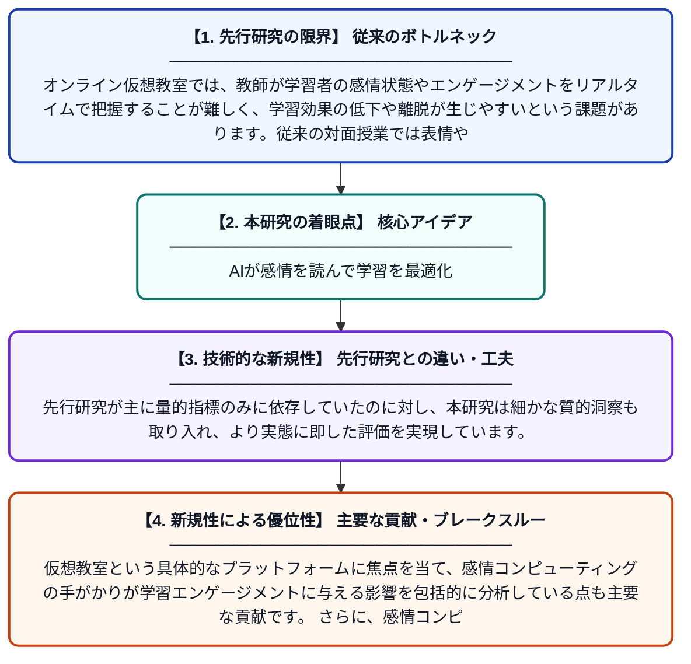

# バーチャル教室プラットフォームにおける感情コンピューティングの手がかりと学習者エンゲージメント：混合評価研究

**Original Title**: *Affective Computing Cues and Learner Engagement in Virtual Classroom Platforms: A Mixed Evaluation*

> **💡 一言要約**: AIが感情を読んで学習を最適化

| 項目 | 内容 |
|---|---|
| **著者** | Q Song, A Shah, H Luo |
| **掲載誌** | Artificial Intelligence and Intelligent Systems Research 2026 |
| **アラートキーワード** | affective computing |
| **原文リンク** | [https://intellisci.org/article/view/aiisr-v1-i3-a011](https://intellisci.org/article/view/aiisr-v1-i3-a011) |
| **PDF版要約** | [README.pdf](./README.pdf) |

---

## 📊 新規性の図解（先行研究との違いと本研究のブレークスルー）

## 📝 要約

本論文は、オンライン仮想教室における学習者の感情状態を自動的に認識・解釈する感情コンピューティング技術に関する包括的な混合評価を行っています。量的データと質的データを組み合わせた分析により、感情コンピューティングの手がかりが学習者のエンゲージメントに与える影響を多角的に検討しています。研究の結果、感情コンピューティングは一定の有効性を示す一方で、その効果には複雑な側面も存在することが明らかになりました。

## ❓ どんな問題に取り組んだか

オンライン仮想教室では、教師が学習者の感情状態やエンゲージメントをリアルタイムで把握することが難しく、学習効果の低下や離脱が生じやすいという課題があります。従来の対面授業では表情や身振りから自然に感情を読み取れましたが、オンライン環境ではそのような情報が失われがちです。この問題を解決するために、AIを活用した感情の自動認識・解釈技術の実用的な評価が求められていました。

## ✨ 何が新しい？何がすごい？（新規性）

本研究は量的評価と質的評価を組み合わせた混合評価手法を採用することで、感情コンピューティングの効果を多面的に検証している点が新しいです。先行研究が主に量的指標のみに依存していたのに対し、本研究は細かな質的洞察も取り入れ、より実態に即した評価を実現しています。仮想教室という具体的なプラットフォームに焦点を当て、感情コンピューティングの手がかりが学習エンゲージメントに与える影響を包括的に分析している点も主要な貢献です。さらに、感情コンピューティングの有用性だけでなく、その限界や複雑な側面も明らかにし、実用上の課題を提示しています。

## 🎓 大学1年生向けの解説

オンライン授業では、先生が生徒の「やる気」や「困り具合」をリアルタイムで把握するのが難しいという問題があります。この研究では、AIカメラやセンサーを使って生徒の表情・声・行動から感情を自動的に読み取る『感情コンピューティング』という技術をオンライン教室に導入し、その効果を調べました。数字で測るデータだけでなく、学習者へのインタビューなどの質的な方法も組み合わせて評価しているのが特徴です。結果として、この技術は学習への関与度を高める可能性を示しましたが、完璧ではなく改善すべき点もあることがわかりました。つまり、AIが感情を読み取って学習をサポートする未来の教室の可能性と課題を明らかにした研究です。
