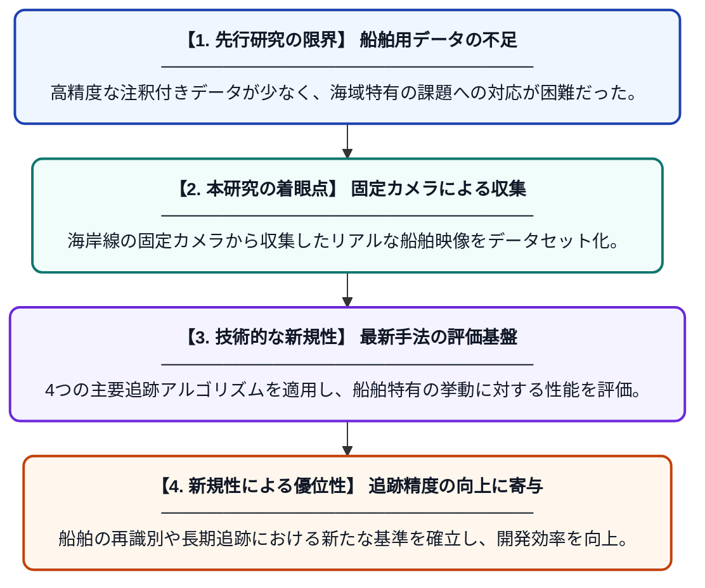

# 船舶追跡のためのデータセットとベンチマーク：海域MOTおよびReIDにおける最新動向の概説

**Original Title**: *A Dataset and Benchmark for Maritime Vessel Tracking with an Overview of Recent Advances in Maritime MOT and ReID*

> **💡 一言要約**: 船舶追跡を革新する新データセットと評価基盤

| 項目 | 内容 |
|---|---|
| **著者** | M Fabijanić, F Ferreira |
| **掲載誌** | 2026 |
| **アラートキーワード** | Multi Camera Tracking |
| **PDF** | [https://skoge.folk.ntnu.no/prost/proceedings/ifac2026_IFACWC26_preprints/files/2021.pdf](https://skoge.folk.ntnu.no/prost/proceedings/ifac2026_IFACWC26_preprints/files/2021.pdf) |
| **Git リポジトリ** | [https://github.com/mf1999/MOT-Sibenik-Dataset](https://github.com/mf1999/MOT-Sibenik-Dataset) |
| **原文リンク** | [https://skoge.folk.ntnu.no/prost/proceedings/ifac2026_IFACWC26_preprints/files/2021.pdf](https://skoge.folk.ntnu.no/prost/proceedings/ifac2026_IFACWC26_preprints/files/2021.pdf) |
| **PDF版要約** | [README.pdf](./README.pdf) |

---

## 📊 新規性の図解（先行研究との違いと本研究のブレークスルー）

## 📝 要約

海岸線に設置された固定カメラを用いて収集された、新しい船舶用マルチオブジェクト追跡（MOT）データセットを提案し、船舶追跡のロバスト性を向上させるための基盤を提供しています。主要な4つの追跡アルゴリズムをこのデータセットでベンチマーク評価し、海域におけるMOTおよび再識別（ReID）技術の最新の進歩を包括的にまとめています。

## ❓ どんな問題に取り組んだか

海域での船舶追跡は、波の反射や気象条件、船舶同士の重なりといった特有の困難がありますが、研究に活用できる注釈付きの高品質なデータセットが不足していました。また、既存の汎用的な追跡アルゴリズムが、こうした海域特有の課題に対してどの程度の性能を発揮できるかという標準的な評価も不十分でした。

## ✨ 何が新しい？何がすごい？（新規性）

海岸に固定されたカメラから撮影された独自の高品質な注釈付きデータセットを新たに構築し、公開した点が最大の貢献です。さらに、最新のマルチオブジェクト追跡（MOT）と再識別（ReID）の技術動向を海域監視の視点で体系化し、4つの代表的なアルゴリズムを船舶追跡の文脈で比較評価しました。これにより、船舶の動特性に特化したアルゴリズム開発のための明確な指標を確立しました。

## 🎓 大学1年生向けの解説

海の上を走る船をカメラでずっと追い続けるのは、波のしぶきで見えにくくなったり、船同士が重なったりするため、実はとても難しい技術です。この研究では、AIが船の動きを正しく学習できるように、たくさんの船の映像に正解ラベルを付けた「お手本データ」を新しく作りました。そして、既存の有名なAIたちにそのデータを使わせてみて、どれくらい正確に船を追いかけられるかをテストしました。これによって、将来の自動運転船や海の安全を守るシステムの開発がよりスムーズに進むようになります。
