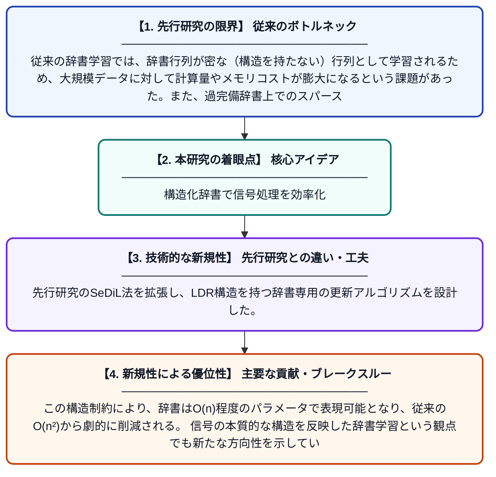

# 低変位ランク構造を用いた辞書学習

**Original Title**: *Low Displacement Rank Dictionary Learning*

> **💡 一言要約**: 構造化辞書で信号処理を効率化

| 項目 | 内容 |
|---|---|
| **著者** | CF Dantas, VC Lima, RR Lopes |
| **掲載誌** | IEEE Transactions on Signal Processing 2026 |
| **アラートキーワード** | sparse coding |
| **PDF** | [https://ieeexplore.ieee.org/iel8/78/4359509/11621975.pdf](https://ieeexplore.ieee.org/iel8/78/4359509/11621975.pdf) |
| **原文リンク** | [https://ieeexplore.ieee.org/iel8/78/4359509/11621975.pdf](https://ieeexplore.ieee.org/iel8/78/4359509/11621975.pdf) |
| **PDF版要約** | [README.pdf](./README.pdf) |

---

## 📊 新規性の図解（先行研究との違いと本研究のブレークスルー）

## 📝 要約

本論文は、信号処理における辞書学習問題に対して、低変位ランク（Low Displacement Rank; LDR）構造を持つ辞書行列を学習する新しい手法を提案する。スパースコーディングのステップにはOMP（直交マッチング追跡）アルゴリズムを用い、辞書更新にはSeDiLをベースとした手法を採用することで、構造化された辞書の効率的な学習を実現する。これにより、計算コストの削減と表現能力の維持を両立させることが目指されている。

## ❓ どんな問題に取り組んだか

従来の辞書学習では、辞書行列が密な（構造を持たない）行列として学習されるため、大規模データに対して計算量やメモリコストが膨大になるという課題があった。また、過完備辞書上でのスパース表現を求める問題はNP困難であり、現実的な計算コストで高品質な辞書を得ることが難しい。

## ✨ 何が新しい？何がすごい？（新規性）

本研究は、変位ランクが低い構造化行列クラス（Toeplitz行列やCirulant行列などを含む一般的なクラス）に辞書を制限することで、パラメータ数と計算量を大幅に削減する点が新しい。先行研究のSeDiL法を拡張し、LDR構造を持つ辞書専用の更新アルゴリズムを設計した。この構造制約により、辞書はO(n)程度のパラメータで表現可能となり、従来のO(n²)から劇的に削減される。信号の本質的な構造を反映した辞書学習という観点でも新たな方向性を示している。

## 🎓 大学1年生向けの解説

データを少ない要素の組み合わせで表す「辞書学習」という技術があります。例えば、画像を少数の「パーツ」の足し合わせで表現するイメージです。でも普通の辞書学習は計算量がとても多く、大きなデータには使いにくいという問題があります。この研究では、辞書に「低変位ランク」という特別な数学的構造を持たせることで、必要なパラメータ数を大幅に減らし、より速く効率的に学習できるようにしました。スマートな制約を加えることで、品質を保ちながら計算を軽くする、というアイデアです。
