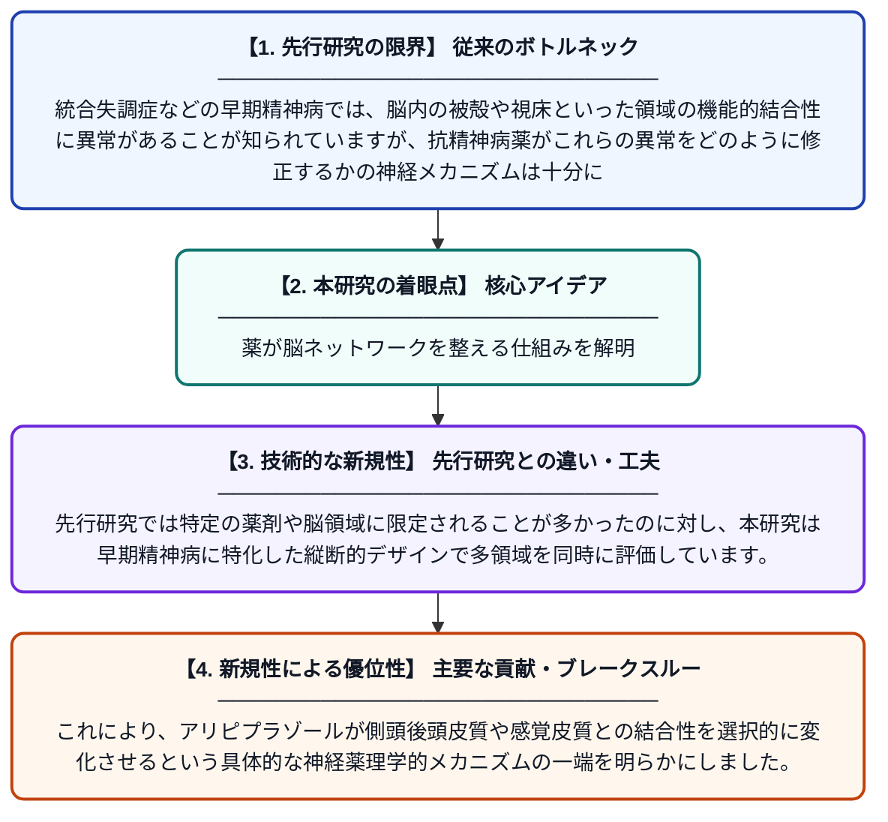

# 早期精神病患者における被殻と視床の機能的結合性に対するアリピプラゾールの調節的役割

**Original Title**: *The role of aripiprazole in modulating putamen and thalamus functional connectivity in early psychosis patients*

> **💡 一言要約**: 薬が脳ネットワークを整える仕組みを解明

| 項目 | 内容 |
|---|---|
| **著者** | C Chen, IF Chen, WC Chang, CC Liu, MH Hsieh |
| **掲載誌** | Journal of Psychopharmacology 2026 |
| **アラートキーワード** | VRP |
| **原文リンク** | [https://journals.sagepub.com/doi/abs/10.1177/02698811261464518](https://journals.sagepub.com/doi/abs/10.1177/02698811261464518) |
| **PDF版要約** | [README.pdf](./README.pdf) |

---

## 📊 新規性の図解（先行研究との違いと本研究のブレークスルー）

## 📝 要約

本研究は、早期精神病患者を対象に、非定型抗精神病薬アリピプラゾールが脳内の被殻および視床の機能的結合性にどのような影響を与えるかを検討したものです。シード基盤の結合性解析（SBC）を用いて、治療前後における脳領域間のネットワーク変化を詳細に解析しました。その結果、側頭後頭皮質や後中心回など複数の脳領域との機能的結合性がアリピプラゾール投与によって変化することが示されました。

## ❓ どんな問題に取り組んだか

統合失調症などの早期精神病では、脳内の被殻や視床といった領域の機能的結合性に異常があることが知られていますが、抗精神病薬がこれらの異常をどのように修正するかの神経メカニズムは十分に解明されていませんでした。特に、治療初期段階での脳ネットワーク変化の把握は、より効果的な治療戦略の構築に不可欠です。

## ✨ 何が新しい？何がすごい？（新規性）

本研究は、アリピプラゾール単剤での治療前後における被殻の複数サブ領域（背側認知部、背側感覚運動部、腹側運動部）および視床を包括的にシードとして用いた機能的結合性解析を行った点が新しいです。先行研究では特定の薬剤や脳領域に限定されることが多かったのに対し、本研究は早期精神病に特化した縦断的デザインで多領域を同時に評価しています。これにより、アリピプラゾールが側頭後頭皮質や感覚皮質との結合性を選択的に変化させるという具体的な神経薬理学的メカニズムの一端を明らかにしました。

## 🎓 大学1年生向けの解説

精神病（こころの病気の一種）の患者さんでは、脳の中の特定の部分がうまく連携できていないことがあります。この研究では、「アリピプラゾール」という薬を飲むと、脳のどの部分のつながりが変わるかを調べました。MRIという機械で脳の活動を撮影し、薬を飲む前と後を比べることで、薬が脳のネットワークを整える様子を可視化しました。この研究のおかげで、薬がどのように脳に作用して症状を改善するのかを科学的に理解する手がかりが得られます。
