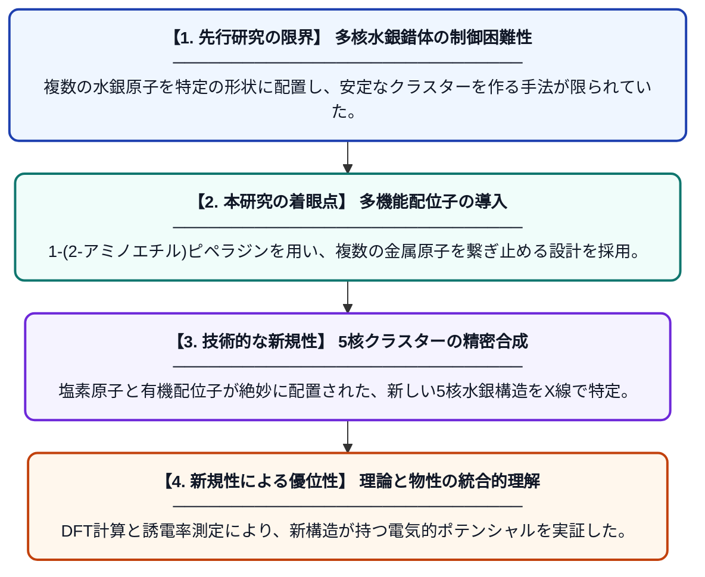

# 1-(2-アミノエチル)ピペラジンを基盤とした5核水銀(II)クラスターの合成、結晶構造、ヒルシュフェルト表面解析、DFT計算および誘電特性の解明

**Original Title**: *Synthesis, crystal structure, hirshfeld surface analysis, DFT investigation and dielectric properties of a pentanuclear mercury (II) cluster based on 1-(2-Aminoethyl) …*

> **💡 一言要約**: 複雑な5核水銀クラスターの構造と誘電特性を理論と実験で解明

| 項目 | 内容 |
|---|---|
| **著者** | W Nbili, S Hermi, F Lefebvre, U Böhme, VN Hegde… |
| **掲載誌** | Inorganica Chimica Acta 2026 |
| **アラートキーワード** | ICA |
| **原文リンク** | [https://www.sciencedirect.com/science/article/pii/S0020169326004470](https://www.sciencedirect.com/science/article/pii/S0020169326004470) |
| **PDF版要約** | [README.pdf](./README.pdf) |

---

## 📊 新規性の図解（先行研究との違いと本研究のブレークスルー）

## 📝 要約

1-(2-アミノエチル)ピペラジンを配位子として用い、これまでにない複雑な構造を持つ5核水銀(II)クラスターの合成に成功しました。X線結晶構造解析やDFT計算、誘電特性評価を組み合わせることで、この物質の微視的な結合状態からマクロな電気的性質までを包括的に明らかにしています。

## ❓ どんな問題に取り組んだか

多核金属クラスターは特異な触媒能や光学的・電気的性質を持つため注目されていますが、特に水銀を用いた多核錯体において、その構造を精密に制御し、かつ詳細な物性（誘電特性など）と理論的背景を一致させることは困難な課題でした。本研究は、特定の有機配位子を用いてこの構造的複雑さを制御し、物性を解明することを目指しました。

## ✨ 何が新しい？何がすごい？（新規性）

本研究の新規性は、1-(2-アミノエチル)ピペラジンという多点配位可能な分子を利用し、5つの水銀原子が塩素橋架け構造を介して結合した特異な「5核クラスター構造」を初めて実現した点にあります。ヒルシュフェルト表面解析により、分子間の微細な相互作用を結晶構造全体で視覚化・定量化した点は、従来の構造解析を一歩進めた成果です。さらに、DFT計算による電子状態の予測と実験的な誘電特性測定を高い精度でリンクさせており、新材料としての機能的価値を実証しました。

## 🎓 大学1年生向けの解説

水銀という金属原子が5つ集まって、1つの巨大な「分子の塊（クラスター）」を作る新しい化学物質を合成しました。この塊を作るために、特定の有機分子を「接着剤」や「枠組み」として使い、パズルのように精密な形に組み上げています。この研究では、その物質がどれくらい電気を蓄える力（誘電性）があるかを測定したり、コンピュータを使って分子の動きをシミュレーションしたりしました。実験と理論の両方から、この新しい物質の「正体」を徹底的に調べ上げた研究です。
