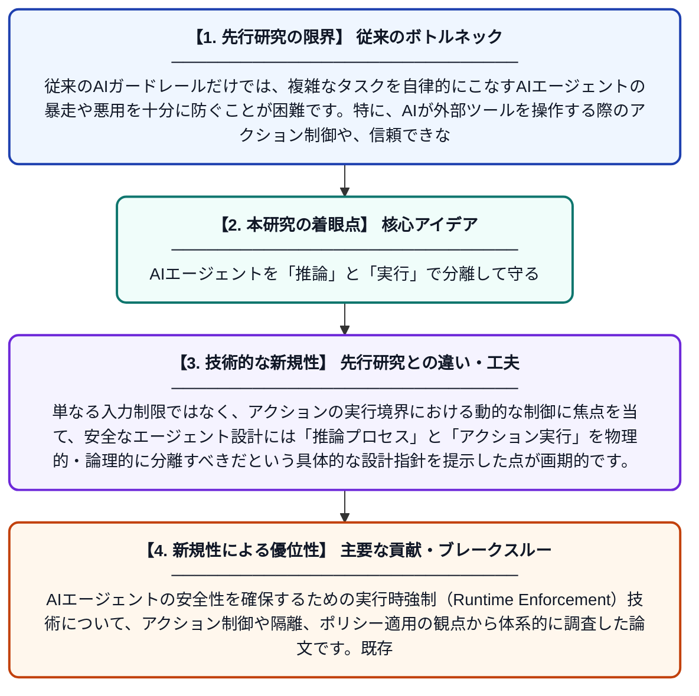

# ガードレールを超えて：セキュアなAIエージェントのための実行時強制 — アクション制御、隔離、およびポリシー適用の系統的レビュー

**Original Title**: *Beyond Guardrails: Runtime Enforcement for Secure AI Agents-A Systematic Review of Action Control, Isolation, and Policy Enforcement*

> **💡 一言要約**: AIエージェントを「推論」と「実行」で分離して守る

| 項目 | 内容 |
|---|---|
| **著者** | JMT Wu, L Kong, M Pirouz, ME Wu |
| **掲載誌** | Journal of Reliable and Secure Computing 2026 |
| **アラートキーワード** | Secure Computing |
| **原文リンク** | [https://www.icck.org/article/abs/jrsc.2026.526903](https://www.icck.org/article/abs/jrsc.2026.526903) |
| **PDF版要約** | [README.pdf](./README.pdf) |

---

## 📊 新規性の図解（先行研究との違いと本研究のブレークスルー）

## 📝 要約

AIエージェントの安全性を確保するための実行時強制（Runtime Enforcement）技術について、アクション制御や隔離、ポリシー適用の観点から体系的に調査した論文です。既存研究を分類した結果、多くのセキュリティ対策がツールやアクションの境界で実施されていることが明らかになり、推論と実行を分離するアーキテクチャの重要性が示唆されています。

## ❓ どんな問題に取り組んだか

従来のAIガードレールだけでは、複雑なタスクを自律的にこなすAIエージェントの暴走や悪用を十分に防ぐことが困難です。特に、AIが外部ツールを操作する際のアクション制御や、信頼できないコードを実行する際の安全な隔離といった「実行時のセキュリティ制御」が体系化されていませんでした。

## ✨ 何が新しい？何がすごい？（新規性）

AIエージェントのセキュリティを「適用場所」「セキュリティ機構」「保証タイプ」の3つの軸で初めて体系的に分類し、最新の研究動向を網羅しました。単なる入力制限ではなく、アクションの実行境界における動的な制御に焦点を当て、安全なエージェント設計には「推論プロセス」と「アクション実行」を物理的・論理的に分離すべきだという具体的な設計指針を提示した点が画期的です。

## 🎓 大学1年生向けの解説

AIエージェントは、人間のように自分で考えてパソコンを操作したり命令を実行したりできますが、間違った指示を出して大事なデータを消してしまうなどの危険があります。この論文は、AIが「何かをしようとした瞬間」にそれをチェックして止める方法について、世界中の研究をまとめて分析しました。一番大事な結論は、AIの「考える場所」と「実際に動く場所」を分けて作ることです。そうすれば、もしAIが変なことを考えても、実行する前に安全にブロックできるようになります。
