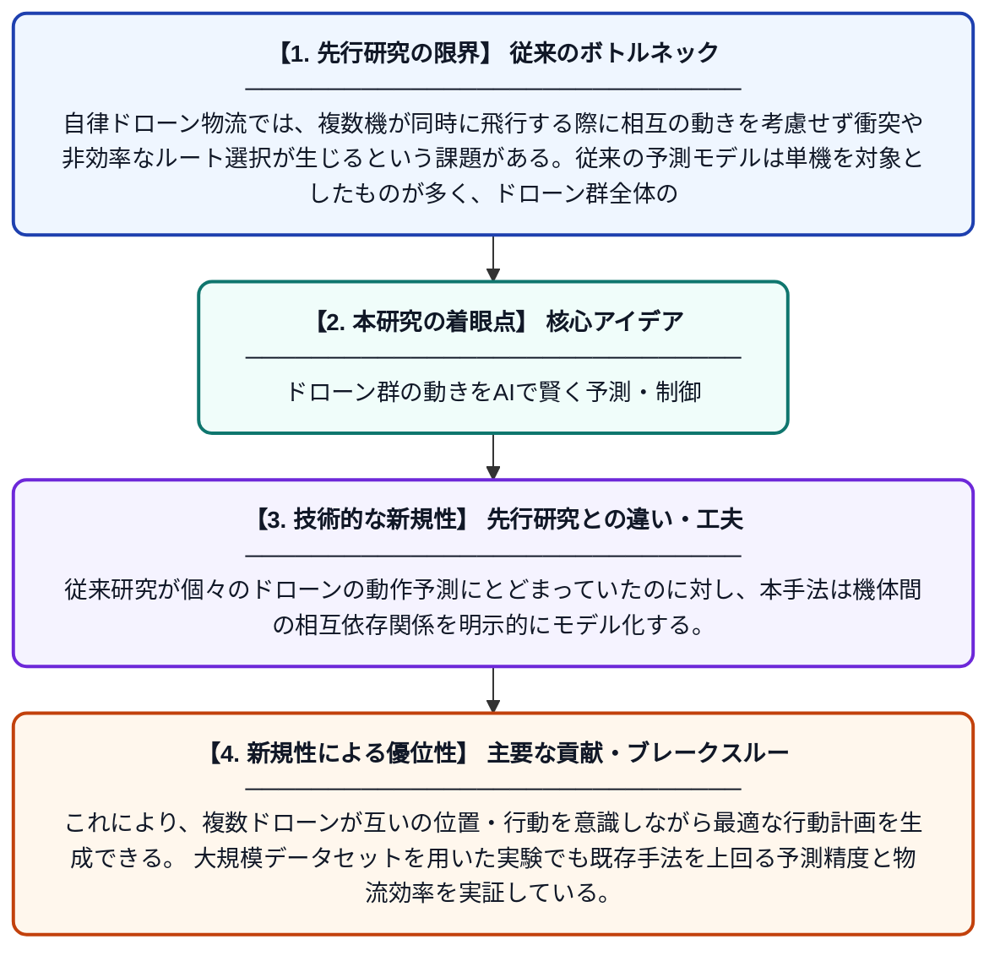

# 産業用IoT環境における自律ドローン物流のための協調認識型時系列学習

**Original Title**: *Coordination-Aware Temporal Learning for Autonomous Drone Logistics in Industrial IoT Environments*

> **💡 一言要約**: ドローン群の動きをAIで賢く予測・制御

| 項目 | 内容 |
|---|---|
| **著者** | MH Alkinani, AA Almazroi, N Ayub, NF Janbi |
| **掲載誌** | IEEE Transactions on Industrial Informatics 2026 |
| **アラートキーワード** | logistics |
| **原文リンク** | [https://ieeexplore.ieee.org/abstract/document/11623276/](https://ieeexplore.ieee.org/abstract/document/11623276/) |
| **PDF版要約** | [README.pdf](./README.pdf) |

---

## 📊 新規性の図解（先行研究との違いと本研究のブレークスルー）

## 📝 要約

本論文は、産業用IoT環境において複数の自律ドローンが協調して物流を行うシステムを対象に、フリートレベル（群全体）の行動予測を行う新しい時系列学習手法を提案している。ドローン群が互いの動きを考慮しながら効率的に配送を行うための協調認識機構を組み込んだモデルを構築し、大規模な実験によりその有効性を検証した。

## ❓ どんな問題に取り組んだか

自律ドローン物流では、複数機が同時に飛行する際に相互の動きを考慮せず衝突や非効率なルート選択が生じるという課題がある。従来の予測モデルは単機を対象としたものが多く、ドローン群全体の協調行動を時系列的に正確に予測することが困難であった。特に産業用IoT環境のようなダイナミックで複雑な空間では、この問題が顕著となる。

## ✨ 何が新しい？何がすごい？（新規性）

本研究は、ドローン群全体（フリートレベル）の協調行動を同時に考慮できる「協調認識型時系列学習」フレームワークを新たに提案した点が独自である。従来研究が個々のドローンの動作予測にとどまっていたのに対し、本手法は機体間の相互依存関係を明示的にモデル化する。これにより、複数ドローンが互いの位置・行動を意識しながら最適な行動計画を生成できる。大規模データセットを用いた実験でも既存手法を上回る予測精度と物流効率を実証している。

## 🎓 大学1年生向けの解説

ドローンを使って荷物を自動で届けるサービスを想像してください。1機だけなら簡単ですが、たくさんのドローンが同時に飛ぶと、ぶつかったり遠回りしたりする問題が起きます。この論文では、ドローンたちがお互いの動きを気にしながら次の行動を予測できるAIの仕組みを作りました。人間でいえば、チームのメンバーが互いの動きを見ながら協力してプレーするスポーツのようなイメージです。このAIを使うことで、ドローン群がより安全かつ効率よく荷物を届けられるようになります。
