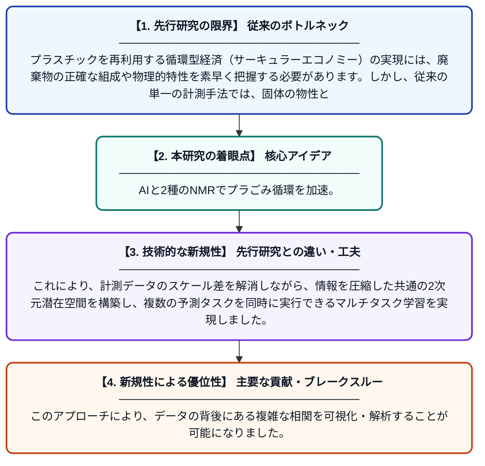

# ポリエチレン循環型経済のための時間領域・溶液状態マルチモーダルNMRとマルチタスク深層学習

**Original Title**: *Time-Domain and Solution-State Multimodal NMR and Multitask Deep Learning for the Polyethylene Circular Economy*

> **💡 一言要約**: AIと2種のNMRでプラごみ循環を加速。

| 項目 | 内容 |
|---|---|
| **著者** | W Zhu, S Miyagi, J Kikuchi |
| **掲載誌** | Journal of Magnetic Resonance Open 2026 |
| **アラートキーワード** | manifold learning |
| **原文リンク** | [https://www.sciencedirect.com/science/article/pii/S266644102600018X](https://www.sciencedirect.com/science/article/pii/S266644102600018X) |
| **PDF版要約** | [README.pdf](./README.pdf) |

---

## 📊 新規性の図解（先行研究との違いと本研究のブレークスルー）

## 📝 要約

ポリエチレンのリサイクルを推進するため、時間領域（TD）と溶液状態の2種類のNMR計測データをAIで統合解析する手法を開発しました。多様体学習と情報ボトルネック理論を用いることで、性質の異なる計測データを共通の2次元空間に統合し、プラスチックの分類や物性予測を同時に精度よく行うことに成功しています。

## ❓ どんな問題に取り組んだか

プラスチックを再利用する循環型経済（サーキュラーエコノミー）の実現には、廃棄物の正確な組成や物理的特性を素早く把握する必要があります。しかし、従来の単一の計測手法では、固体の物性と液体の化学構造の詳細を同時に捉えることが難しく、異なる種類のデータを統合して解析する効率的な手法も不足していました。

## ✨ 何が新しい？何がすごい？（新規性）

この研究の画期的な点は、物理的性質が全く異なるTD-NMRと溶液NMRのデータを直接連結するのではなく、バッチ正規化と情報ボトルネック理論を組み合わせた深層学習モデルで統合したことです。これにより、計測データのスケール差を解消しながら、情報を圧縮した共通の2次元潜在空間を構築し、複数の予測タスクを同時に実行できるマルチタスク学習を実現しました。このアプローチにより、データの背後にある複雑な相関を可視化・解析することが可能になりました。

## 🎓 大学1年生向けの解説

プラスチックを再利用するには、それが「どんな成分か」だけでなく「どんな硬さや混ざり具合か」を詳しく調べる必要があります。この研究では、磁石の力を使って物質を調べる「NMR」という装置の2つの異なる測り方と、最新のAIを組み合わせました。AIが2種類の複雑なデータを賢く整理して1つのマップにまとめることで、プラスチックの種類や性質をこれまで以上に正確に見抜けるようになります。ゴミを宝の山（資源）に変えるための、新しい「鑑定技術」のような研究です。
