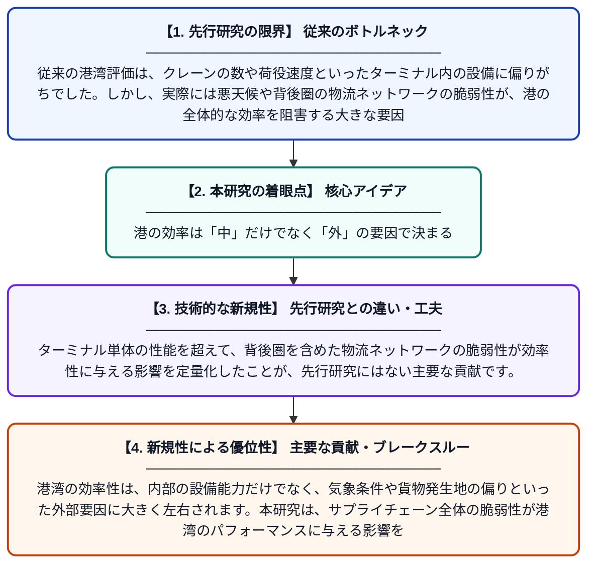

# ターミナルの枠を超えた港湾効率性：気象リスク、貨物発生地の集中、および物流の脆弱性

**Original Title**: *Port efficiency beyond the terminal: weather exposure, cargo-origin concentration and logistics vulnerability*

> **💡 一言要約**: 港の効率は「中」だけでなく「外」の要因で決まる

| 項目 | 内容 |
|---|---|
| **著者** | WB Miranda, TGZ Moura, L Garcia-Alonso… |
| **掲載誌** | Transport Policy 2026 |
| **アラートキーワード** | logistics |
| **原文リンク** | [https://www.sciencedirect.com/science/article/pii/S0967070X26005159](https://www.sciencedirect.com/science/article/pii/S0967070X26005159) |
| **PDF版要約** | [README.pdf](./README.pdf) |

---

## 📊 新規性の図解（先行研究との違いと本研究のブレークスルー）

## 📝 要約

港湾の効率性は、内部の設備能力だけでなく、気象条件や貨物発生地の偏りといった外部要因に大きく左右されます。本研究は、サプライチェーン全体の脆弱性が港湾のパフォーマンスに与える影響を多角的に分析しました。

## ❓ どんな問題に取り組んだか

従来の港湾評価は、クレーンの数や荷役速度といったターミナル内の設備に偏りがちでした。しかし、実際には悪天候や背後圏の物流ネットワークの脆弱性が、港の全体的な効率を阻害する大きな要因となっていることが課題でした。

## ✨ 何が新しい？何がすごい？（新規性）

この論文の新規性は、港湾効率の評価モデルに「気象への露出度」や「貨物発生地の集中度」といった外部的な地理的・構造的変数を組み込んだ点にあります。ターミナル単体の性能を超えて、背後圏を含めた物流ネットワークの脆弱性が効率性に与える影響を定量化したことが、先行研究にはない主要な貢献です。

## 🎓 大学1年生向けの解説

港の良し悪しを決めるとき、普通は「クレーンが何台あるか」といった中身に注目します。しかし、この研究では「嵐がよく来る場所か」や「荷物が特定の場所からしか届かないか」といった、港の外側の事情が実はとても重要だと指摘しています。つまり、港そのものが優秀でも、周りの環境や物流ルートが不安定だと、結果として効率が悪くなってしまうのです。
