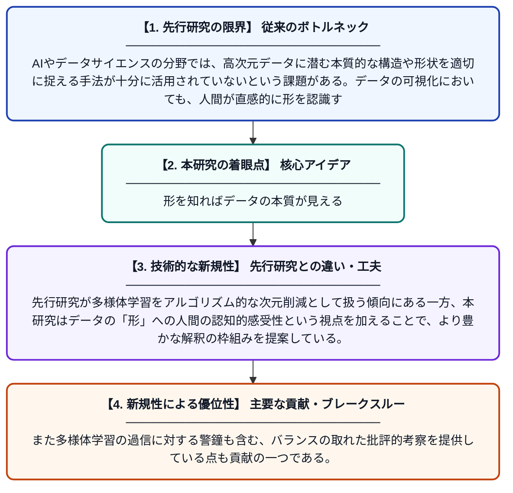

# 形と曲線について——AIはなぜチェルノフ顔をもっと活用すべきか、データサイエンスはなぜ多様体フィッティングをもっと重視すべきか

**Original Title**: *Of Shapes and Curves—Why AI Should Use More Chernoff Faces, and Data Science More Manifold Fitting*

> **💡 一言要約**: 形を知ればデータの本質が見える

| 項目 | 内容 |
|---|---|
| **著者** | XL Meng |
| **掲載誌** | Harvard Data Science Review 2026 |
| **アラートキーワード** | manifold learning |
| **PDF** | [https://assets.pubpub.org/c99608f92-d70f-46c1-a72c-df272215f13e/pa0170b2a-d45c-4f38-9eda-3ef82fc71806/exports/2ec77508d7cc1f9d.pdf](https://assets.pubpub.org/c99608f92-d70f-46c1-a72c-df272215f13e/pa0170b2a-d45c-4f38-9eda-3ef82fc71806/exports/2ec77508d7cc1f9d.pdf) |
| **原文リンク** | [https://assets.pubpub.org/c99608f92-d70f-46c1-a72c-df272215f13e/pa0170b2a-d45c-4f38-9eda-3ef82fc71806/exports/2ec77508d7cc1f9d.pdf](https://assets.pubpub.org/c99608f92-d70f-46c1-a72c-df272215f13e/pa0170b2a-d45c-4f38-9eda-3ef82fc71806/exports/2ec77508d7cc1f9d.pdf) |
| **PDF版要約** | [README.pdf](./README.pdf) |

---

## 📊 新規性の図解（先行研究との違いと本研究のブレークスルー）

## 📝 要約

本論文は、データの形状や構造を数学的に捉える「多様体」の概念をAIとデータサイエンスの文脈で論じた論考である。チェルノフ顔と呼ばれるデータ可視化手法と多様体フィッティングという統計的手法を結びつけ、両者がデータの本質的な構造を理解するうえでいかに重要かを主張する。さらに多様体学習の可能性と注意点についても議論を展開している。

## ❓ どんな問題に取り組んだか

AIやデータサイエンスの分野では、高次元データに潜む本質的な構造や形状を適切に捉える手法が十分に活用されていないという課題がある。データの可視化においても、人間が直感的に形を認識する能力を活かした手法が見過ごされてきた。

## ✨ 何が新しい？何がすごい？（新規性）

本論文は、人間の顔の形でデータを表現する「チェルノフ顔」という古典的な可視化手法と、高次元データの低次元構造を記述する「多様体フィッティング」という統計手法を横断的に論じた点が新しい。先行研究が多様体学習をアルゴリズム的な次元削減として扱う傾向にある一方、本研究はデータの「形」への人間の認知的感受性という視点を加えることで、より豊かな解釈の枠組みを提案している。また多様体学習の過信に対する警鐘も含む、バランスの取れた批評的考察を提供している点も貢献の一つである。

## 🎓 大学1年生向けの解説

私たちが扱うデータには、見えにくいけれども意味のある「形」や「構造」が隠れていることがあります。たとえば、たくさんの変数からなる複雑なデータも、実は2次元や3次元の曲面のような単純な構造をしている場合があります。この論文では、そうしたデータの形を数学的に表す「多様体」という考え方が重要だと主張しています。また、データを人の顔の形で表す「チェルノフ顔」という面白い可視化方法を使えば、人間の顔認識能力を活かしてデータの違いを直感的に理解できると提案しています。つまり、AIとデータサイエンスは「形」をもっとうまく使うべきだというメッセージの論文です。
