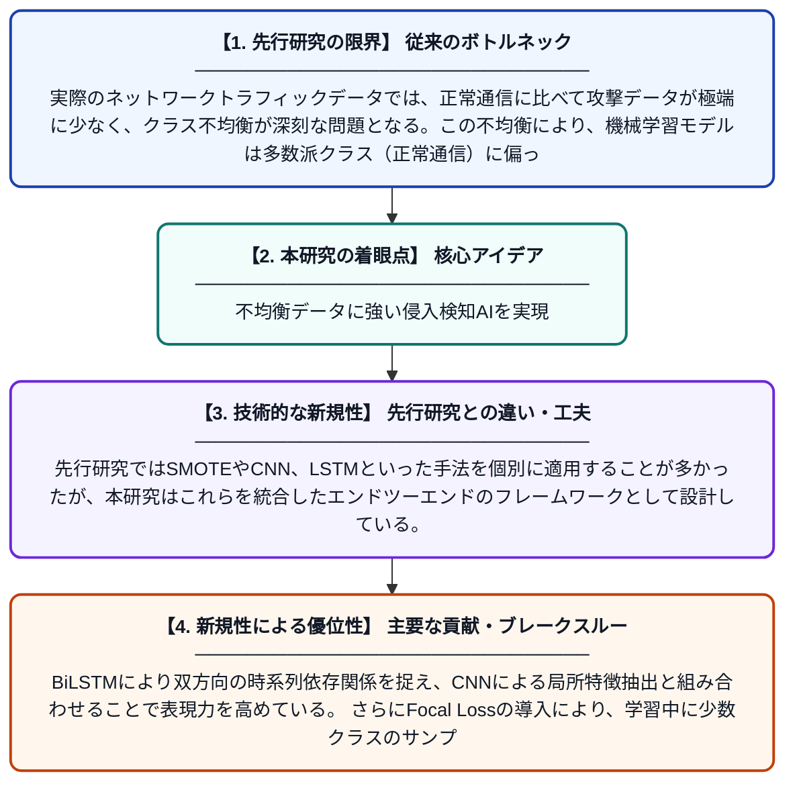

# NIDSにおける極端なクラス不均衡への対処：SMOTEとCNN-BiLSTMおよびFocal Lossを統合したハイブリッドアーキテクチャ

**Original Title**: *Tackling extreme class imbalance in NIDS: a hybrid architecture integrating SMOTE and CNN-BiLSTM with focal loss*

> **💡 一言要約**: 不均衡データに強い侵入検知AIを実現

| 項目 | 内容 |
|---|---|
| **著者** | Y Yang, D Xie |
| **掲載誌** | International Conference on Computer Vision, AI, and Robotics 2026 |
| **アラートキーワード** | SMOTE |
| **原文リンク** | [https://www.spiedigitallibrary.org/conference-proceedings-of-spie/14260/142600Q/Tackling-extreme-class-imbalance-in-NIDS--a-hybrid-architecture/10.1117/12.3117901.short](https://www.spiedigitallibrary.org/conference-proceedings-of-spie/14260/142600Q/Tackling-extreme-class-imbalance-in-NIDS--a-hybrid-architecture/10.1117/12.3117901.short) |
| **PDF版要約** | [README.pdf](./README.pdf) |

---

## 📊 新規性の図解（先行研究との違いと本研究のブレークスルー）

## 📝 要約

本論文は、ネットワーク侵入検知システム（NIDS）における極端なクラス不均衡問題を解決するため、SMOTE・CNN-BiLSTM・Focal Lossを組み合わせたハイブリッドフレームワークを提案する。データレベルではSMOTEによって少数クラス（攻撃データ）のサンプルを合成的に増加させ、モデルレベルではCNNとBiLSTMの組み合わせで空間的・時系列的特徴を同時に抽出する。さらにFocal Lossを損失関数に採用することで、学習時に誤分類されやすい少数クラスへの注目を強化している。

## ❓ どんな問題に取り組んだか

実際のネットワークトラフィックデータでは、正常通信に比べて攻撃データが極端に少なく、クラス不均衡が深刻な問題となる。この不均衡により、機械学習モデルは多数派クラス（正常通信）に偏った学習をしてしまい、少数派クラス（攻撃）を正確に検知できなくなる。従来のNIDSはこのクラス不均衡への対処が不十分であり、実運用での検知精度に課題があった。

## ✨ 何が新しい？何がすごい？（新規性）

本研究はデータ拡張・モデルアーキテクチャ・損失関数という三つの異なるレベルで同時に不均衡問題へ対処する点が新しい。先行研究ではSMOTEやCNN、LSTMといった手法を個別に適用することが多かったが、本研究はこれらを統合したエンドツーエンドのフレームワークとして設計している。BiLSTMにより双方向の時系列依存関係を捉え、CNNによる局所特徴抽出と組み合わせることで表現力を高めている。さらにFocal Lossの導入により、学習中に少数クラスのサンプルに動的に重みを与え、モデルの不均衡耐性をアルゴリズムレベルでも強化している。

## 🎓 大学1年生向けの解説

インターネットでは、ハッカーによる攻撃（不正アクセスなど）は全通信の中でごくわずかしかなく、AIにそれを見つけさせるのはとても難しい問題です。たとえば1万件の通信のうち攻撃が10件しかないと、AIは「全部正常」と答えるだけで99.9%正解できてしまい、攻撃を見逃してしまいます。この論文では、まず攻撃データを人工的に増やす技術（SMOTE）で学習データのバランスを整え、次にCNNとBiLSTMという二種類のAI構造を組み合わせてデータの特徴をしっかり学習させます。さらに「Focal Loss」という特別な評価方法を使って、少ない攻撃データを見逃さないようにAIを鍛えることで、高精度な不正侵入検知システムを実現しました。
